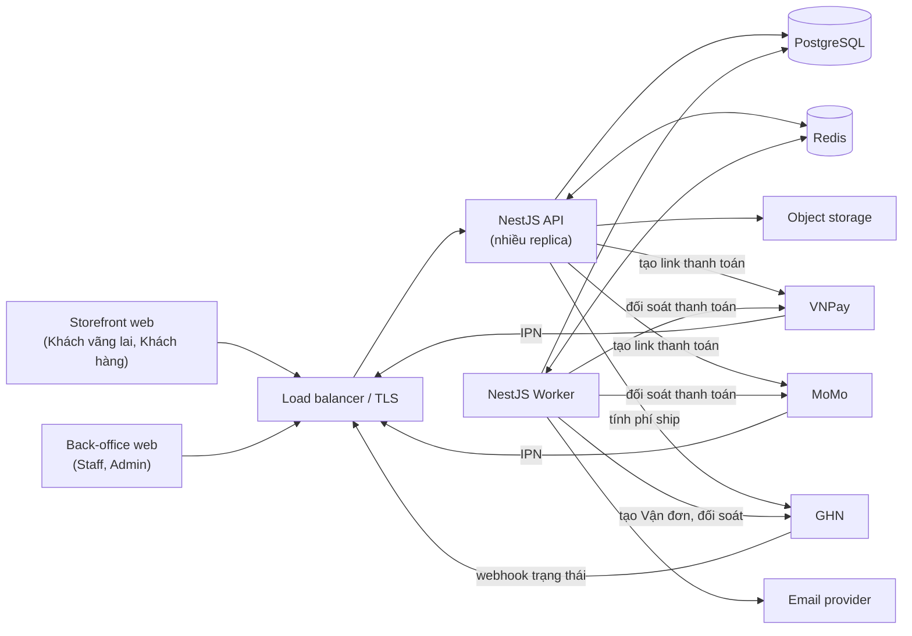

# 01. Tổng quan kiến trúc

> Trạng thái: **Bản nháp cho tái cấu trúc** ([quy ước](../README.md#trạng-thái-tài-liệu)). Phạm vi sản phẩm theo [01-vision-scope.md](../business/01-vision-scope.md).

## 1. Bối cảnh

Backend cho một cửa hàng thời trang bán lẻ trong nước: một người bán, chỉ VND, nội dung tiếng Việt, giao diện vi/en (`01-vision-scope` §5). Hai kênh dùng chung một backend:

- **Storefront** — Khách vãng lai và Khách hàng duyệt, mua, tra cứu đơn.
- **Back-office** — Staff và Admin xử lý đơn, tồn kho, sản phẩm, voucher, cấu hình.

Quy mô MVP giả định 500–5.000 đơn/ngày ([10-nfr.md](./10-nfr.md)).

## 2. Stack

| Thành phần | Lựa chọn | Vai trò |
|---|---|---|
| Ứng dụng | NestJS (TypeScript) | API và worker, cùng một codebase |
| Database | PostgreSQL + Prisma | Nguồn dữ liệu chính, mọi trạng thái thương mại |
| Cache / queue | Redis + BullMQ | Rate limit, cache, hàng đợi job; **không** là nguồn dữ liệu (ADR 0008) |
| Lưu file | Object storage (S3-compatible) | Ảnh Sản phẩm theo màu (BR-CAT-05) |
| Thanh toán | VNPay, MoMo, COD | ADR 0004 |
| Vận chuyển | GHN | Phí ship, Vận đơn, trạng thái giao |
| Email | Nhà cung cấp email giao dịch | Thông báo đơn (BR-NTF-*) |

## 3. Phong cách kiến trúc

**Modular monolith**: một deployable, chia module theo nghiệp vụ ([02-modules.md](./02-modules.md)), ranh giới rõ để có thể tách service sau nếu có bằng chứng cần. Cùng một image chạy ở hai vai trò:

- **API** — nhiều replica stateless sau load balancer.
- **Worker** — xử lý outbox, BullMQ, job định kỳ ([07-async-events-jobs.md](./07-async-events-jobs.md)).

## 4. Sơ đồ hệ thống

Chi tiết từng tích hợp: [06-integrations.md](./06-integrations.md).

## 5. Nguyên tắc kiến trúc

1. **PostgreSQL là nguồn sự thật.** Mọi thay đổi trạng thái đơn, tồn kho, thanh toán nằm trong transaction PostgreSQL; Redis mất không làm mất dữ liệu thương mại (ADR 0008).
2. **Không tin client.** Giá, tổng tiền, Voucher tính lại ở backend (BR-ORD-07, ADR 0013); trạng thái thanh toán chỉ từ IPN/Đối soát (BR-PAY-02).
3. **Side effect qua outbox.** Email, Vận đơn, thông báo được ghi outbox cùng transaction, worker xử lý at-least-once và idempotent (ADR 0003, ADR 0007).
4. **Idempotent ở mọi ranh giới.** Checkout, tạo thanh toán, IPN, webhook GHN, yêu cầu Hoàn tiền ([03-api.md](./03-api.md) §6, BR-PAY-03, BR-REF-06).
5. **State machine tường minh.** Mọi chuyển trạng thái Đơn không có trong bảng T1–T14 bị từ chối ([05-order-lifecycle.md](../business/05-order-lifecycle.md) §3).
6. **Bản chụp bất biến.** Đơn lưu bản chụp giá, địa chỉ, phần Voucher (ADR 0012).
7. **Ghi audit back-office.** Mọi thao tác ghi của Staff/Admin có ai, khi nào, trước/sau (`02-actors-permissions` §4).
8. **Tối giản trước, tối ưu khi đo được.** Cache, search engine, tách service chỉ thêm khi có số liệu ([10-nfr.md](./10-nfr.md)).
