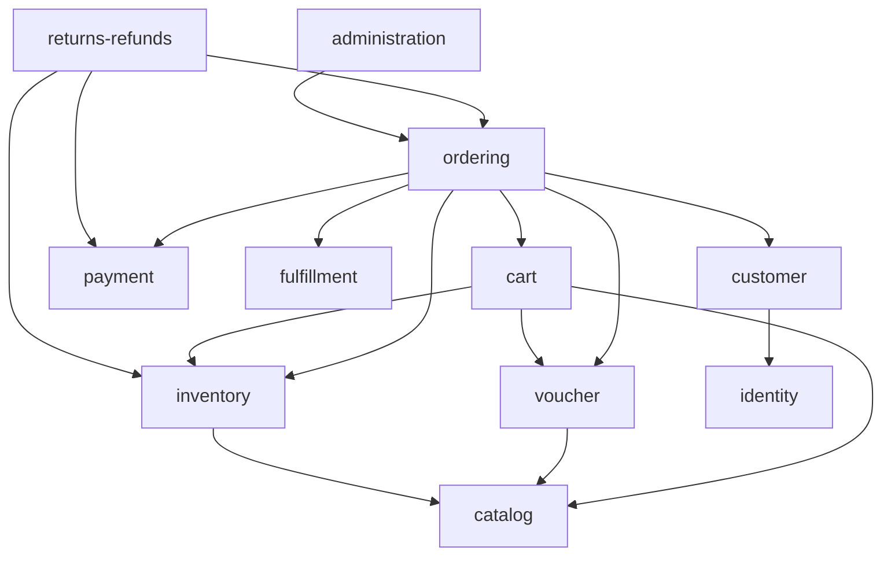

# 02. Module và ranh giới

> Trạng thái: **Đã chốt cho tái cấu trúc (2026-11-13)** ([quy ước](../README.md#trạng-thái-tài-liệu)). Cây thư mục đích đầy đủ, ký hiệu K/M/N/D và thứ tự chuyển: [`TARGET-REPOSITORY-TREE.md`](../../../TARGET-REPOSITORY-TREE.md). Quy ước đặt tên và cấu trúc file: [`../convention/`](../convention/).

## 1. Danh sách module

Module phẳng, mỗi module một seam nghiệp vụ, tên theo [GLOSSARY](../../GLOSSARY.md). Nhóm **Catalog / Operations / Administration** chỉ là nhóm logic (tên nhóm trong `Permission` enum, tag Swagger, menu CMS), không phải thư mục.

| Nhóm           | Module            | Trách nhiệm                                                                                                                                                          | Nghiệp vụ                                                                                                                                                                             |
| -------------- | ----------------- | -------------------------------------------------------------------------------------------------------------------------------------------------------------------- | ------------------------------------------------------------------------------------------------------------------------------------------------------------------------------------- |
| Administration | `identity`        | Tài khoản đăng nhập mọi loại: đăng ký, đăng nhập, xác thực email, quên mật khẩu, phiên; Tài khoản nội bộ (Staff qua API, Admin qua CLI); Role, Permission, gán role  | E5, US-1001, ADR 0005 — [modules/identity.md](./modules/identity.md)                                                                                                                  |
| Operations     | `customer`        | Dữ liệu Người mua: sổ địa chỉ, danh sách khách và lịch sử đơn cho CMS                                                                                                | E5                                                                                                                                                                                    |
| Catalog        | `catalog`         | Danh mục nhiều cấp, Sản phẩm, Biến thể size×màu, Size, Màu, ảnh theo màu, tìm kiếm/lọc, Giá khuyến mãi (`pricing/`)                                                  | BR-CAT-_, BR-PRC-_, E1, E8, ADR 0001 — [modules/catalog.md](./modules/catalog.md), [modules/pricing.md](./modules/pricing.md)                                                         |
| Catalog        | `voucher`         | Voucher, điều kiện áp dụng, Lượt dùng Voucher                                                                                                                        | BR-VCH-*, E9 — [modules/pricing.md](./modules/pricing.md)                                                                                                                             |
| Catalog        | `media`           | Upload/xoá ảnh qua `infrastructure/storage`                                                                                                                          | BR-CAT-05                                                                                                                                                                             |
| Operations     | `cart`            | Giỏ Khách hàng và Khách vãng lai, gộp giỏ                                                                                                                            | BR-CRT-*, E2, ADR 0009 — [modules/cart.md](./modules/cart.md)                                                                                                                         |
| Operations     | `inventory`       | Tồn kho theo Biến thể × Kho, Giữ hàng, Hàng chờ xuất, nhập/điều chỉnh, Kiểm kê, sổ biến động                                                                         | BR-INV-*, E7, ADR 0003, ADR 0010 — [modules/inventory.md](./modules/inventory.md)                                                                                                     |
| Operations     | `ordering`        | Tính thử, checkout, phân bổ Voucher vào dòng đơn, Đơn hàng, state machine, huỷ, Cờ cần xử lý, tra cứu đơn Khách vãng lai                                             | BR-ORD-*, E3, E4, E6, ADR 0011–0013 — [modules/ordering.md](./modules/ordering.md)                                                                                                    |
| Operations     | `payment`         | Thanh toán COD/online, IPN inbox, Đối soát; adapter VNPay/MoMo ở `infrastructure/payment`                                                                            | BR-PAY-*, ADR 0004 — [modules/payments.md](./modules/payments.md)                                                                                                                     |
| Operations     | `fulfillment`     | Phí ship, Vận đơn GHN, webhook và đối soát trạng thái giao, ánh xạ địa chỉ                                                                                           | BR-SHP-*, US-1004 — [modules/fulfillment.md](./modules/fulfillment.md)                                                                                                                |
| Operations     | `returns-refunds` | Đổi trả, Yêu cầu Hoàn tiền, ghi nhận Hoàn tiền thủ công                                                                                                              | BR-REF-_, BR-RET-_, ADR 0006 — [modules/refunds-returns.md](./modules/refunds-returns.md)                                                                                             |
| Operations     | `notification`    | Email giao dịch theo ngôn ngữ người nhận, EmailLog; consumer của outbox; transport ở `infrastructure/mail`                                                           | BR-NTF-* — [modules/notifications.md](./modules/notifications.md)                                                                                                                     |
| Administration | `administration`  | `settings/` cấu hình vận hành; `audit/` đọc audit log; `compliance/` đồng ý xử lý dữ liệu, yêu cầu xoá, lịch sử truy cập; `reporting/` doanh thu, bán chạy, xuất đơn | US-1002, US-1003, BR-REV-*, [06-compliance.md](../business/06-compliance.md) — [modules/admin-config.md](./modules/admin-config.md), [modules/compliance.md](./modules/compliance.md) |

Hạ tầng dùng chung (không phải module nghiệp vụ): `config`, `common` (filter, guard, decorator, pagination, swagger, `permission.enum`), `infrastructure/` (`database`, `audit` ghi log, `mail` transport, `observability`, `storage` Cloudinary, `payment` adapter, `shipping` GHN, `outbox`, `queue` BullMQ/Redis).

## 2. Quyền sở hữu dữ liệu

Chỉ module sở hữu được **ghi** vào bảng của nó; module khác gọi service public của module đó. Đọc chéo cho mục đích hiển thị được phép qua service, không truy vấn thẳng bảng của module khác. Mỗi module sở hữu bảng có một file `prisma/schema/<module>.prisma`; enum nằm trong file của module sở hữu.

| Module / file `.prisma` | Sở hữu                                                                                                                                                  |
| ----------------------- | ------------------------------------------------------------------------------------------------------------------------------------------------------- |
| `identity`              | users, user_auth_providers, refresh_tokens, password_reset_tokens, email_verification_tokens, roles, role_permissions, user_roles, guest_order_sessions |
| `customer`              | customer_addresses                                                                                                                                      |
| `catalog`               | categories, products, sizes, colors, product_variants, product_images, product_sales_stats, sale_prices                                                 |
| `voucher`               | vouchers, voucher_usages                                                                                                                                |
| `cart`                  | carts, cart_items                                                                                                                                       |
| `inventory`             | warehouses, inventory_levels, inventory_reservations, awaiting_dispatch_items, inventory_movements, stock_counts                                        |
| `ordering`              | checkout_quotes, orders, order_lines, order_status_history, order_flags                                                                                 |
| `payment`               | payments, payment_notifications, cod_collections                                                                                                        |
| `fulfillment`           | provinces, wards, ghn_ward_mappings, shipments, shipment_events                                                                                         |
| `returns-refunds`       | refunds, returns, return_items                                                                                                                          |
| `notification`          | email_logs                                                                                                                                              |
| `administration`        | settings, audit_logs (ghi qua `infrastructure/audit`), consents, data_erasure_requests, data_access_logs                                                |
| `outbox` (hạ tầng)      | outbox_events, idempotency_keys                                                                                                                         |

Chi tiết bảng: [./11-database.md](./11-database.md).

Một use case cần ghi nhiều module (ví dụ checkout: `ordering` + `cart` + `inventory` + `voucher` + `payment`) chạy trong **một transaction** do module điều phối (`ordering`) mở; `Prisma.TransactionClient` được truyền vào service của module khác ([04-data-consistency.md](./04-data-consistency.md)).

## 3. Quy tắc phụ thuộc



- Phụ thuộc một chiều, không vòng. Khi module dưới cần báo ngược lên (ví dụ `payment` báo thanh toán thành công cho `ordering`, `fulfillment` báo đã giao), dùng **domain event** qua outbox — không import ngược ([07-async-events-jobs.md](./07-async-events-jobs.md)).
- `notification`, `administration` chỉ được gọi tới hoặc lắng nghe event; không module nghiệp vụ nào phụ thuộc vào chúng để hoàn thành transaction.
- **Cửa ngõ module là `exports` trong `<module>.module.ts`.** Mỗi module export đúng một service public (`InventoryService`, `CartService`, `VoucherService`, `PaymentService`, `FulfillmentService`, `OrderingService`, `CatalogService`, `CustomerService`; `identity` export `InternalAccountService` và `AccessService`). Service ruột không export. Module khác `imports: [XModule]` và inject service đó, không import file ruột theo đường dẫn. Không có file facade riêng.
- Interface + token DI chỉ khi có ≥ 2 implementation thật (`PaymentGateway`: VNPay, MoMo). Một adapter (Cloudinary, GHN, SMTP) inject class trực tiếp.
- `common/` không import `modules/`. `permission.enum.ts` là enum thuần nên ở `common/auth/`.
- Trong một module: Controller → Service → Prisma. Controller không truy cập DB; không thêm lớp repository mặc định ([../convention/](../convention/)).

## 4. Cấu trúc thư mục

Đây là nơi duy nhất mô tả cây `src/` của repo này; cây đầy đủ với ký hiệu K/M/N/D nằm ở [`TARGET-REPOSITORY-TREE.md`](../../../TARGET-REPOSITORY-TREE.md). Quy tắc đặt tên, thư mục con, barrel file và alias: [coding-style-conventions.md](../convention/coding-style-conventions.md).

```text
src/
├── main.ts                  # bootstrap API
├── cli.ts                   # bootstrap CLI (nest-commander): create-admin
├── worker.ts                # bootstrap Worker: outbox dispatcher + BullMQ consumer
├── app.module.ts
├── worker.module.ts
├── bootstrap/               # configure-app.ts, openapi.ts
├── cli/
├── config/                  # env.validation.ts
├── common/                  # auth/ (authorize, permissions.guard, permission.enum, ownership) filters/ middleware/ pagination/ swagger/ utils/ validation/
├── generated/               # Prisma Client (sinh tự động, không commit)
├── infrastructure/
│   ├── database/            # prisma.module, prisma.service, prisma-error.util
│   ├── audit/               # ghi audit log trong transaction nghiệp vụ
│   ├── mail/                # transport SMTP thuần
│   ├── observability/       # health/ metrics/ logging/
│   ├── storage/             # cloudinary.client
│   ├── payment/             # payment-gateway.interface, vnpay.adapter, momo.adapter
│   ├── shipping/            # ghn.client, ghn-webhook.verifier
│   ├── outbox/              # outbox.service (ghi), outbox-dispatcher (worker)
│   └── queue/               # BullMQ/Redis
└── modules/
    ├── identity/            # auth/ internal-account/ access/
    ├── customer/
    ├── catalog/             # product/ category/ product-option/ pricing/
    ├── voucher/
    ├── media/
    ├── cart/
    ├── inventory/
    ├── ordering/
    ├── payment/
    ├── fulfillment/
    ├── notification/
    ├── returns-refunds/
    └── administration/      # settings/ audit/ compliance/ reporting/
```

Trong một module, file xếp **theo thực thể** (sub-module), phẳng, chỉ `dto/` là thư mục con; storefront/back-office phân biệt bằng tiền tố `admin-` trong tên file:

```text
modules/catalog/
├── catalog.module.ts                      # gốc module chỉ có file này
├── product/
│   ├── product.controller.ts              # storefront /api/v1/products
│   ├── admin-product.controller.ts        # back-office /api/v1/admin/products
│   ├── product.service.ts
│   ├── admin-product.service.ts
│   ├── admin-product-image.service.ts
│   ├── variant-response.mapper.ts
│   ├── product.constants.ts
│   ├── *.spec.ts                          # cạnh file được test
│   └── dto/
├── category/
├── product-option/
└── pricing/
```

Module nhỏ (một thực thể, ≤ ~8 file) để file phẳng ngay dưới gốc module cạnh `<module>.module.ts` (ví dụ `cart/`, `voucher/`, `media/`).
