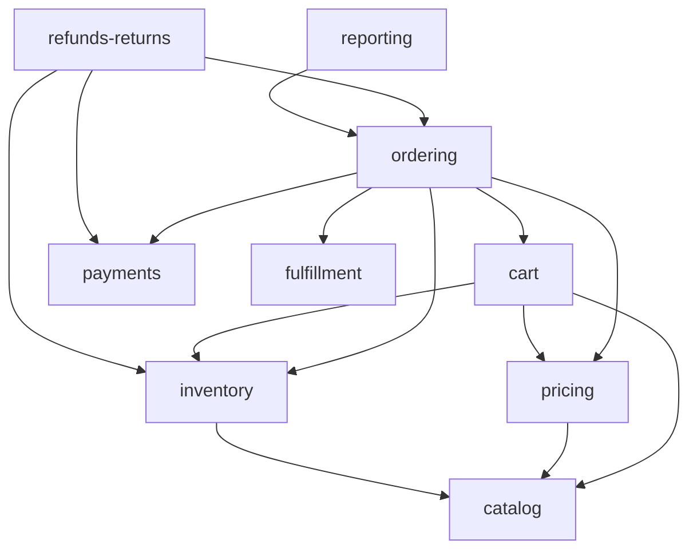

# 02. Module và ranh giới

> Trạng thái: **Bản nháp cho tái cấu trúc** ([quy ước](../README.md#trạng-thái-tài-liệu)). Quy ước đặt tên và cấu trúc file theo [`../convention/`](../convention/).

## 1. Danh sách module

| Module            | Trách nhiệm                                                                                                                                              | Nghiệp vụ                                                                          |
| ----------------- | -------------------------------------------------------------------------------------------------------------------------------------------------------- | ---------------------------------------------------------------------------------- |
| `identity`        | Đăng ký, đăng nhập email/Google, xác thực email, quên mật khẩu, phiên, Tài khoản Staff/Admin (Admin chỉ tạo bằng `npm run cli -- create-admin`), vai trò | E5, US-1001, ADR 0005 — [modules/identity.md](./modules/identity.md)               |
| `catalog`         | Danh mục nhiều cấp, Sản phẩm, Biến thể size×màu, danh sách size, bảng màu, ảnh theo màu, tìm kiếm/lọc                                                    | BR-CAT-*, E1, E8, ADR 0001 — [modules/catalog.md](./modules/catalog.md)            |
| `pricing`         | Giá khuyến mãi, Voucher, lượt dùng Voucher                                                                                                               | BR-PRC-_, BR-VCH-_, E9 — [modules/pricing.md](./modules/pricing.md)                |
| `cart`            | Giỏ Khách hàng và Khách vãng lai, gộp giỏ                                                                                                                | BR-CRT-*, E2, ADR 0009 — [modules/cart.md](./modules/cart.md)                      |
| `inventory`       | Tồn kho theo Biến thể × Kho, Giữ hàng, Hàng chờ xuất, nhập/điều chỉnh, Kiểm kê, sổ biến động                                                             | BR-INV-*, E7, ADR 0003, ADR 0010 — [modules/inventory.md](./modules/inventory.md)  |
| `ordering`        | Tính thử, checkout, phân bổ Voucher vào dòng đơn (ADR 0012), Đơn hàng, state machine, huỷ, tra cứu đơn Khách vãng lai                                    | BR-ORD-*, E3, E4, E6, ADR 0011–0013 — [modules/ordering.md](./modules/ordering.md) |
| `payments`        | Thanh toán COD/online, adapter VNPay/MoMo, IPN, Đối soát                                                                                                 | BR-PAY-*, ADR 0004                                                                 |
| `refunds-returns` | Yêu cầu Hoàn tiền, ghi nhận Hoàn tiền thủ công, Đổi trả                                                                                                  | BR-REF-_, BR-RET-_, ADR 0006                                                       |
| `fulfillment`     | Phí ship, Vận đơn GHN, webhook và đối soát trạng thái giao, ánh xạ địa chỉ                                                                               | BR-SHP-*, US-1004                                                                  |
| `notifications`   | Email theo ngôn ngữ người nhận, EmailLog                                                                                                                 | BR-NTF-*                                                                           |
| `reporting`       | Doanh thu, bán chạy, xuất đơn đã thu tiền                                                                                                                | BR-REV-*, BR-CAT-12, US-1003                                                       |
| `compliance`      | Đồng ý xử lý dữ liệu, yêu cầu xoá/ẩn danh, lịch sử truy cập dữ liệu, thời hạn lưu                                                                        | [06-compliance.md](../business/06-compliance.md), E11                              |
| `admin-config`    | Cấu hình vận hành (hạn mức COD, …), audit log back-office                                                                                                | US-1002, BR-PAY-06 — [modules/admin-config.md](./modules/admin-config.md)          |

Hạ tầng dùng chung (không phải module nghiệp vụ): `config`, `database` (Prisma), `outbox`, `queue`, `storage`, `logging`, `common` (filter, guard, pipe, decorator).

## 2. Quyền sở hữu dữ liệu

Chỉ module sở hữu được **ghi** vào bảng của nó; module khác gọi service public của module đó. Đọc chéo cho mục đích hiển thị được phép qua service, không truy vấn thẳng bảng của module khác.

| Module            | Sở hữu                                                                                                                                 |
| ----------------- | -------------------------------------------------------------------------------------------------------------------------------------- |
| `identity`        | users, user_auth_providers, customer_addresses, refresh_tokens, password_reset_tokens, email_verification_tokens, guest_order_sessions |
| `catalog`         | categories, products, sizes, colors, product_variants, product_images, product_sales_stats                                             |
| `pricing`         | sale_prices, vouchers, voucher_usages                                                                                                  |
| `cart`            | carts, cart_items                                                                                                                      |
| `inventory`       | warehouses, inventory_levels, inventory_reservations, awaiting_dispatch_items, inventory_movements, stock_counts                       |
| `ordering`        | checkout_quotes, orders, order_items, order_status_history, order_flags                                                                |
| `payments`        | payments, payment_notifications, cod_collections                                                                                       |
| `refunds-returns` | refunds, returns, return_items                                                                                                         |
| `fulfillment`     | provinces, wards, ghn_ward_mappings, shipments, shipment_events                                                                        |
| `notifications`   | email_logs                                                                                                                             |
| `compliance`      | consents, data_erasure_requests, data_access_logs                                                                                      |
| `admin-config`    | settings, audit_logs                                                                                                                   |
| hạ tầng `outbox`  | outbox_events, idempotency_keys                                                                                                        |

Chi tiết bảng: [./11-database.md](./11-database.md).

Một use case cần ghi nhiều module (ví dụ checkout: `ordering` + `inventory` + `pricing` + `payments`) chạy trong **một transaction** do module điều phối (`ordering`) mở; transaction client được truyền vào service của module khác ([04-data-consistency.md](./04-data-consistency.md)).

## 3. Quy tắc phụ thuộc



- Phụ thuộc một chiều, không vòng. Khi module dưới cần báo ngược lên (ví dụ `payments` báo thanh toán thành công cho `ordering`, `fulfillment` báo đã giao), dùng **domain event** qua outbox hoặc interface do module trên khai báo — không import ngược ([07-async-events-jobs.md](./07-async-events-jobs.md)).
- `notifications`, `compliance`, `admin-config` chỉ được gọi tới hoặc lắng nghe event; không module nghiệp vụ nào phụ thuộc vào chúng để hoàn thành transaction.
- Trong một module: Controller → Service → Prisma. Controller không truy cập DB; không thêm lớp repository mặc định (`../convention/`).

## 4. Cấu trúc thư mục

Đây là nơi duy nhất mô tả cây `src/`. README chỉ giữ cây cấp repo; quy tắc đặt tên, thư mục con, barrel file và alias nằm ở [coding-style-conventions.md](../convention/coding-style-conventions.md).

**Hiện tại** — module để phẳng dưới `src/`, chưa chuyển sang `modules/` + `infrastructure/`:

```text
src/
├── main.ts                  # bootstrap API
├── app.module.ts
├── bootstrap/               # cấu hình app dùng chung cho main và e2e
├── config/                  # validate env
├── common/                  # filter, logger, request context
├── generated/               # Prisma Client (sinh tự động, không commit)
├── prisma/                  # → infrastructure/database/
├── health/  metrics/        # chưa xếp chỗ trong cây mục tiêu
├── mail/                    # → modules/notifications/
├── auth/                    # → modules/identity/
└── categories/  products/   # → modules/catalog/
```

**Mục tiêu:**

```text
src/
├── main.ts                  # bootstrap API
├── cli.ts                   # bootstrap CLI (nest-commander): create-admin, …
├── worker.ts                # bootstrap Worker
├── app.module.ts
├── config/                  # env.validation.ts, config theo nhóm
├── common/                  # filters/, guards/, pipes/, decorators/, dto/
├── infrastructure/
│   ├── database/            # prisma.service.ts
│   ├── outbox/
│   ├── queue/
│   ├── storage/
│   └── logging/
└── modules/
    ├── identity/
    ├── catalog/
    ├── pricing/
    ├── cart/
    ├── inventory/
    ├── ordering/
    ├── payments/
    │   └── gateways/        # vnpay/, momo/ — adapter sau PaymentGateway (ADR 0004)
    ├── refunds-returns/
    ├── fulfillment/
    │   └── ghn/
    ├── notifications/
    ├── reporting/
    ├── compliance/
    └── admin-config/
```

Mỗi module:

```text
modules/<module>/
├── <module>.module.ts
├── storefront/              # controller cho /api/v1/... của Người mua
├── back-office/             # controller cho /api/v1/admin/...
├── <module>.service.ts      # có thể tách theo use case khi file lớn
├── dto/
├── events/                  # tên và payload event module phát ra
└── <module>.service.spec.ts
```
