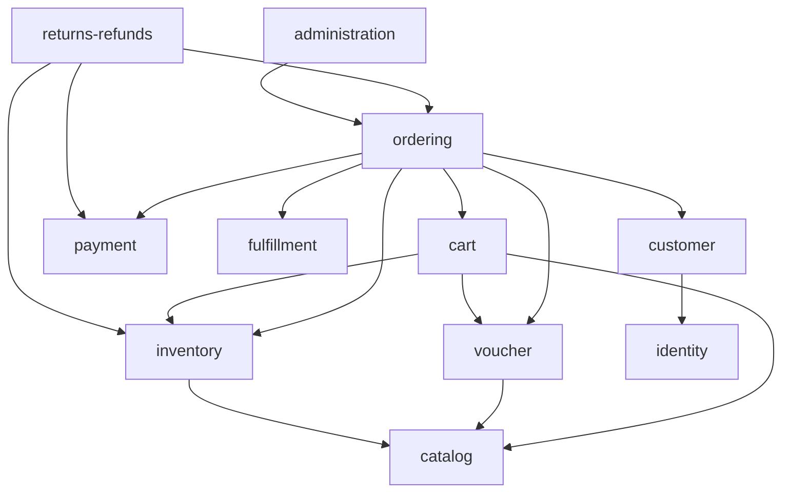

# 02. Module và ranh giới

> Trạng thái: **Đã chốt cho tái cấu trúc (2026-11-13)** ([quy ước](../README.md#trạng-thái-tài-liệu)). §4 phân biệt cây source đang triển khai với cây kiến trúc mục tiêu; không tạo thư mục placeholder cho phần chưa triển khai. Quy ước đặt tên và cấu trúc file: [`../convention/`](../conventions/).

## 1. Danh sách module mục tiêu

Module phẳng, mỗi module một seam nghiệp vụ, tên theo [GLOSSARY](../../GLOSSARY.md). Nhóm **Catalog / Operations / Administration** chỉ là nhóm logic (tên nhóm trong `Permission` enum, tag Swagger, menu CMS), không phải thư mục.

Danh sách dưới đây mô tả module nghiệp vụ của kiến trúc mục tiêu. Hiện source mới triển khai `identity`, `catalog` (gồm `category`, `product`, `product-option`, `pricing`) và `voucher`; các module còn lại là định hướng, chưa phải thư mục cần tạo. Cây thực tế và cây mục tiêu được tách riêng tại §4.

| Nhóm           | Module            | Trách nhiệm                                                                                                                                                          | Nghiệp vụ                                                                                                                                                                             |
| -------------- | ----------------- | -------------------------------------------------------------------------------------------------------------------------------------------------------------------- | ------------------------------------------------------------------------------------------------------------------------------------------------------------------------------------- |
| Administration | `identity`        | Tài khoản đăng nhập mọi loại: đăng ký, đăng nhập, xác thực email, quên mật khẩu, phiên; Tài khoản nội bộ (Staff qua API, Admin qua CLI); Role, Permission, gán role  | E5, US-1001, ADR 0005 — [modules/identity.md](./modules/identity.md)                                                                                                                  |
| Operations     | `customer`        | Dữ liệu Người mua: sổ địa chỉ, danh sách khách và lịch sử đơn cho CMS                                                                                                | E5                                                                                                                                                                                    |
| Catalog        | `catalog`         | Danh mục nhiều cấp, Sản phẩm, Biến thể size×màu, Size, Màu, ảnh theo màu, tìm kiếm/lọc, Giá khuyến mãi (`pricing/`)                                                  | BR-CAT-_, BR-PRC-_, E1, E8, ADR 0001 — [modules/catalog.md](./modules/catalog.md), [modules/pricing.md](./modules/pricing.md)                                                         |
| Catalog        | `voucher`         | Voucher, điều kiện áp dụng, Lượt dùng Voucher                                                                                                                        | BR-VCH-*, E9 — [modules/pricing.md](./modules/pricing.md)                                                                                                                             |
| Catalog        | `media`           | Upload/xoá ảnh qua `infrastructure/storage`                                                                                                                          | BR-CAT-05                                                                                                                                                                             |
| Operations     | `cart`            | Giỏ Khách hàng và Khách vãng lai, gộp giỏ                                                                                                                            | BR-CRT-*, E2, ADR 0009 — [modules/cart.md](./modules/cart.md)                                                                                                                         |
| Operations     | `inventory`       | Tồn kho theo Biến thể × Kho, Giữ hàng, Hàng chờ xuất, nhập/điều chỉnh, Kiểm kê, sổ biến động                                                                         | BR-INV-*, E7, ADR 0003, ADR 0010 — [modules/inventory.md](./modules/inventory.md)                                                                                                     |
| Operations     | `ordering`        | Tính thử, checkout, phân bổ Voucher vào dòng đơn, Đơn hàng, state machine, huỷ, Cờ cần xử lý, tra cứu đơn Khách vãng lai                                             | BR-ORD-*, E3, E4, E6, ADR 0011–0013 — [modules/ordering.md](./modules/ordering.md)                                                                                                    |
| Operations     | `payment`         | Thanh toán COD/online, IPN inbox, Đối soát; adapter VNPay/MoMo ở `infrastructure/payment`                                                                            | BR-PAY-*, ADR 0004 — [modules/payments.md](./modules/payments.md)                                                                                                                     |
| Operations     | `fulfillment`     | Phí ship, Vận đơn GHN, webhook và đối soát trạng thái giao, ánh xạ địa chỉ                                                                                           | BR-SHP-*, US-1004 — [modules/fulfillment.md](./modules/fulfillment.md)                                                                                                                |
| Operations     | `returns-refunds` | Đổi trả, Yêu cầu Hoàn tiền, ghi nhận Hoàn tiền thủ công                                                                                                              | BR-REF-_, BR-RET-_, ADR 0006 — [modules/refunds-returns.md](./modules/refunds-returns.md)                                                                                             |
| Operations     | `notification`    | Email giao dịch theo ngôn ngữ người nhận, EmailLog; consumer của outbox; transport ở `infrastructure/mail`                                                           | BR-NTF-* — [modules/notifications.md](./modules/notifications.md)                                                                                                                     |
| Administration | `administration`  | `settings/` cấu hình vận hành; `audit/` đọc audit log; `compliance/` đồng ý xử lý dữ liệu, yêu cầu xoá, lịch sử truy cập; `reporting/` doanh thu, bán chạy, xuất đơn | US-1002, US-1003, BR-REV-*, [06-compliance.md](../business/06-compliance.md) — [modules/admin-config.md](./modules/admin-config.md), [modules/compliance.md](./modules/compliance.md) |

Hạ tầng dùng chung (không phải module nghiệp vụ): `config`, `common` (pagination, Swagger, utils, validation), `http` (filter, middleware của HTTP pipeline), `security` (authentication, authorization), và `infrastructure/` (database, audit, mail, observability, storage cùng các adapter kỹ thuật khác).

## 2. Quyền sở hữu dữ liệu

Chỉ module sở hữu được **ghi** vào bảng của nó; module khác gọi service public của module đó. Đọc chéo cho mục đích hiển thị được phép qua service, không truy vấn thẳng bảng của module khác. Mỗi module sở hữu bảng có một file `prisma/schema/<module>.prisma`; enum nằm trong file của module sở hữu.

| Module / file `.prisma` | Sở hữu                                                                                                                                                  |
| ----------------------- | ------------------------------------------------------------------------------------------------------------------------------------------------------- |
| `identity`              | users, user_auth_providers, refresh_tokens, password_reset_tokens, email_verification_tokens, roles, role_permissions, user_roles, guest_order_sessions |
| `customer`              | customer_addresses (sổ địa chỉ thuộc module Khách hàng; module này là target-only)                                                                      |
| `catalog`               | categories, products, sizes, colors, product_variants, product_images, product_sales_stats, sale_prices                                                 |
| `voucher`               | vouchers, voucher_usages                                                                                                                                |
| `cart`                  | carts, cart_items                                                                                                                                       |
| `inventory`             | warehouses, inventory_levels, inventory_reservations, awaiting_dispatch_items, inventory_movements, stock_counts                                        |
| `ordering`              | checkout_quotes, orders, order_lines, order_status_history, order_flags                                                                                 |
| `payment`               | payments, payment_notifications, cod_collections                                                                                                        |
| `fulfillment`           | provinces, wards, ghn_ward_mappings, shipments, shipment_events                                                                                         |
| `returns-refunds`       | refunds, returns, return_items                                                                                                                          |
| `notification`          | email_logs                                                                                                                                              |
| `administration`        | settings, audit_logs (ghi qua `infrastructure/audit`), consents, data_erasure_requests, data_access_logs                                                |
| `outbox` (hạ tầng)      | outbox_events, idempotency_keys                                                                                                                         |

Chi tiết bảng: [./11-database.md](./11-database.md).

Một use case cần ghi nhiều module (ví dụ checkout: `ordering` + `cart` + `inventory` + `voucher` + `payment`) chạy trong **một transaction** do module điều phối (`ordering`) mở bằng `TransactionRunner.run()`; module điều phối gọi service công khai của từng module khác, các adapter tự nhập vào giao dịch đang mở nên không có `tx` nào đi qua service hay Port, và không module nào ghi bảng của module khác ([module-architecture-conventions.md §6](../conventions/module-architecture-conventions.md#6-transaction), [04-data-consistency.md](./04-data-consistency.md)).

## 3. Quy tắc phụ thuộc



- Phụ thuộc một chiều, không vòng. Khi module dưới cần báo ngược lên (ví dụ `payment` báo thanh toán thành công cho `ordering`, `fulfillment` báo đã giao), dùng **domain event** qua outbox — không import ngược ([07-async-events-jobs.md](./07-async-events-jobs.md)).
- `notification`, `administration` chỉ được gọi tới hoặc lắng nghe event; không module nghiệp vụ nào phụ thuộc vào chúng để hoàn thành transaction.
- **Cửa ngõ module là `exports` trong `<module>.module.ts`.** Mỗi module export đúng một service public (`InventoryService`, `CartService`, `VoucherService`, `PaymentService`, `FulfillmentService`, `OrderingService`, `CatalogService`, `CustomerService`; `identity` export `InternalAccountService` và `AccessService`). Service ruột không export. Module khác `imports: [XModule]` và inject service đó, không import file ruột theo đường dẫn. `CategoryModule` là feature module nội bộ của Catalog: `CatalogModule` import module này để sở hữu Category endpoints và composition, không export provider nghiệp vụ ra ngoài Catalog. Category dùng `CategoryCoreModule` cho persistence/Port binding và `AdminCategoryModule` / `StorefrontCategoryModule` cho controllers/providers; chỉ surface mới import Core trực tiếp. Không có file facade riêng.
- Mọi truy cập DB đi qua Persistence Port (`abstract class` làm token); I/O ngoài DB dùng port dùng chung (`src/infrastructure/**/*.port.ts`) hoặc port riêng của module. Thư viện thuần không I/O không cần port. Xem [module-architecture-conventions.md §4](../conventions/module-architecture-conventions.md#4-port-và-di).
- `common/` là tầng dùng chung ít phụ thuộc: không import `http/`, `security/`, `infrastructure/` hoặc `modules/`. `http/` và `security/` được phép dùng `common/` và adapter cần thiết từ `infrastructure/`, nhưng không import `modules/`. `infrastructure/` có thể dùng thành phần dùng chung từ `common/`, không import `modules/`. Hợp đồng `Permission` và `JwtPayload` dùng chung giữa authentication/authorization nằm ở `security/contracts/` để tránh phụ thuộc vòng giữa hai nhánh.
- Mọi module (kể cả các feature Catalog) theo một flow: Controller → Application → Port ← Infrastructure Adapter, wiring DI tại file module ([ADR 0015](../adr/0015-one-layered-architecture-for-every-module.md), [module-architecture-conventions.md](../conventions/module-architecture-conventions.md)). Module chưa chuyển đổi giữ cấu trúc hiện tại đến khi có task refactor riêng (mục _Migration status_ của [rule agent](../../.claude/rules/module-architecture.md)).

### 3.1 Composition root và Nest feature modules

`CatalogModule` vẫn là composition root bên ngoài cho Catalog và import `CategoryModule` (module duy nhất tách Core/Admin/Storefront Nest module); `IdentityModule` vẫn là composition root cho Identity; `VoucherModule` tiếp tục là module độc lập. Không tạo `product.module.ts` hoặc Nest feature module con khác chỉ để mỗi folder có một module file.

Chỉ xem xét tách Nest feature module khi có nhu cầu độc lập thực tế về ownership, lifecycle, kiểm thử hoặc export service. Trước khi tách, lập dependency graph giữa các feature, giữ hướng phụ thuộc một chiều, tránh vòng import và chỉ export API mà feature khác cần. Không dùng số file hay số dòng làm ngưỡng tự động.

## 4. Cấu trúc thư mục

Đây là nơi duy nhất mô tả cây `src/` của repo này. §4.1 ghi cây đang tồn tại trong source; §4.2 ghi cây mục tiêu, bao gồm cả phần chưa triển khai. Quy tắc đặt tên, thư mục con, barrel file và alias: [coding-style-conventions.md](../conventions/coding-style-conventions.md).

### 4.1 Cây source hiện đang triển khai

```text
src/
├── main.ts
├── cli.ts
├── app.module.ts
├── bootstrap/               # configure-app.ts, openapi.ts
├── cli/                     # CliModule, create-admin command, password prompt
├── config/                  # env.validation.ts
├── common/                  # pagination/, swagger/, utils/, validation/
├── http/                    # filters/, middleware/
├── security/                # contracts/, authentication/, authorization/
├── generated/               # generated Prisma Client; ignored by Git
├── infrastructure/
│   ├── audit/
│   ├── database/
│   ├── mail/
│   ├── observability/
│   │   ├── health/
│   │   ├── logging/
│   │   └── metrics/
│   └── storage/
└── modules/
    ├── catalog/             # CatalogModule import CategoryModule
    │   ├── category/
    │   ├── pricing/
    │   ├── product/
    │   └── product-option/
    ├── identity/
    │   ├── access/
    │   ├── auth/
    │   └── internal-account/
    ├── inventory/           # đã chuyển sang kiến trúc chung (task 41)
    │   ├── inventory.module.ts
    │   ├── domain/inventory.model.ts
    │   ├── application/     # admin-inventory.service.ts (không export), inventory.service.ts (public), ports/inventory.repository.ts
    │   ├── infrastructure/prisma-inventory.repository.ts
    │   └── admin/           # controllers/inventory.controller.ts, dto/inventory.dto.ts
    └── voucher/             # đã chuyển sang kiến trúc chung (task 42)
        ├── voucher.module.ts
        ├── domain/          # voucher.model.ts, voucher-status.ts, voucher-rules.ts
        ├── application/     # admin-voucher.service.ts (không export), voucher.service.ts (public), ports/voucher.repository.ts
        ├── infrastructure/  # prisma-voucher.repository.ts, voucher-status-where.ts
        └── admin/           # controllers/admin-voucher.controller.ts, dto/*.dto.ts
```

### 4.2 Cây kiến trúc mục tiêu

Cây sau bao gồm cả source hiện có và các nhánh dự kiến. Phần chưa triển khai chỉ là định hướng; **không tạo trước thư mục hoặc module rỗng**. Chỉ thêm nhánh khi bắt đầu có implementation thực tế.

```text
src/
├── main.ts
├── cli.ts
├── worker.ts                # planned: outbox dispatcher + BullMQ consumer
├── app.module.ts
├── worker.module.ts         # planned
├── bootstrap/               # configure-app.ts, openapi.ts
├── cli/                     # command-line application
├── config/                  # env.validation.ts
├── common/                  # pagination/ swagger/ utils/ validation/
├── http/                    # filters/ middleware/ cho HTTP pipeline
├── security/                # contracts/ authentication/ authorization/ dùng toàn app
├── generated/               # generated Prisma Client; ignored by Git
├── infrastructure/
│   ├── database/            # prisma.module, prisma.service, prisma-error.util
│   ├── audit/               # ghi audit log trong transaction nghiệp vụ
│   ├── mail/                # transport SMTP thuần
│   ├── observability/       # health/ metrics/ logging/
│   ├── storage/             # cloudinary.client
│   ├── payment/             # planned: VNPay/MoMo adapters
│   ├── shipping/            # planned: GHN adapters
│   ├── outbox/              # planned: outbox persistence and dispatcher
│   └── queue/               # planned: BullMQ/Redis
└── modules/
    ├── identity/            # auth/ internal-account/ access/
    ├── catalog/             # product/ category/ product-option/ pricing/
    ├── voucher/
    ├── customer/             # planned
    ├── media/                # planned
    ├── cart/                 # planned
    ├── inventory/            # đã triển khai: xem §4.1
    ├── ordering/             # planned
    ├── payment/              # planned
    ├── fulfillment/          # planned
    ├── notification/         # planned
    ├── returns-refunds/      # planned
    └── administration/       # planned: settings/ compliance/ reporting/
```

Chi tiết bên dưới mô tả cấu trúc các module đang triển khai và cần được giữ ổn định; chúng cũng là mẫu cho feature tương ứng trong cây mục tiêu.

Trong một module, giữ các thư mục theo **thực thể**; bên trong mỗi thực thể, file được nhóm theo **vai trò**. Chỉ tạo thư mục vai trò có file thực tế. Với audience, `admin/` và `storefront/` là nhánh thư mục chính; tiền tố `admin-` trong tên file được giữ làm tín hiệu bổ trợ để tìm file và bảo toàn tên class/`operationId`:

```text
modules/catalog/
├── catalog.module.ts                      # gốc composition cho product, product-option và pricing
├── product/
│   ├── controllers/
│   │   ├── storefront/
│   │   └── admin/
│   ├── services/
│   │   ├── storefront/
│   │   └── admin/
│   ├── mappers/shared/
│   ├── domain/                            # constants, query helpers
│   └── dto/
│       ├── storefront/
│       ├── admin/
│       └── shared/
├── category/                              # multi-layer example; own Nest composition root
│   ├── category.module.ts
│   ├── domain/
│   │   ├── models/
│   │   ├── tree/
│   │   ├── localization/
│   │   ├── image/
│   │   └── errors/
│   ├── application/
│   │   ├── ports/
│   │   └── services/
│   │       ├── admin/category|image|translation/
│   │       ├── shared/localization|translation/
│   │       └── storefront/category/
│   ├── controllers/{admin,storefront}/
│   ├── dto/{admin,shared,storefront}/
│   ├── presentation/mappers/shared/
│   ├── infrastructure/
│   │   ├── integrations/translation/
│   │   └── persistence/relational/{queries,adapters}/
│   └── testing/                           # shared test setup only
├── product-option/
│   ├── controllers/
│   │   ├── storefront/
│   │   └── admin/
│   ├── services/shared/
│   ├── decorators/
│   └── dto/
│       ├── admin/
│       └── shared/
├── pricing/
│   ├── controllers/admin/
│   ├── services/admin/
│   ├── domain/
│   └── dto/admin/
└── ...

modules/identity/
├── identity.module.ts
├── auth/
│   ├── controllers/storefront/
│   ├── services/
│   │   ├── storefront/
│   │   └── shared/
│   ├── guards/
│   ├── strategies/
│   ├── utils/
│   └── dto/storefront/
├── access/
│   ├── controllers/admin/
│   ├── services/admin/
│   └── dto/admin/
└── internal-account/
    ├── controllers/admin/
    ├── services/admin/
    └── dto/admin/

modules/voucher/          # đã chuyển đổi (task 42), xem §4.1
├── voucher.module.ts
├── domain/
├── application/          # + ports/
├── infrastructure/
└── admin/                # controllers/ + dto/
```

Trong module có API cho cả Storefront và Admin CMS, nhóm controller và DTO theo `storefront/` hoặc `admin/`; service/mapper riêng cho một phía cũng theo nhóm tương ứng. Logic hoặc DTO dùng chung nằm trong `shared/`; domain thuần nằm trong `domain/`. Chỉ tạo nhóm thực sự có file, không để thư mục rỗng. Swagger dùng tag riêng có tiền tố `Storefront —` hoặc `Admin CMS —`. Test `*.spec.ts` đặt cạnh file được test trong nhóm tương ứng.

Mọi module tuân thủ [module-architecture-conventions.md](../conventions/module-architecture-conventions.md) (bộ khung `domain/`, `application/`, `infrastructure/`, `presentation/`, `admin/`, `storefront/`); `category/` là ví dụ cấu trúc đầy đủ và được `CatalogModule` import qua `CategoryModule`. Các port outbound thuộc Application, adapter công nghệ thuộc Infrastructure. Tách file theo trách nhiệm: mục tiêu khoảng 150 dòng, giới hạn cứng 200 dòng mỗi file (miễn code sinh tự động và file test). Cây ở §4.1 là as-built nên có thể chưa theo bộ khung ở module chưa chuyển đổi; mỗi PR đổi cấu trúc phải cập nhật cây này trong cùng PR.

## 5. As-built inventory — shared/runtime

Inventory này ghi source đang có, không sửa nghĩa các cây mục tiêu ở §4.2. Phạm vi là file triển khai không sinh tự động dưới `src/` ngoài `src/modules/` và `src/generated/`, cùng các cấu hình/runtime liên quan. Chi tiết bảo mật nằm ở [05-auth-security.md §9](./05-auth-security.md#9-as-built-inventory--security); Prisma, migrations và kiểm thử DB nằm ở [11-database.md §7](./11-database.md#7-as-built-inventory--database). Thư mục `src/modules/` không được kiểm kê ở đây.

### 5.1 Composition root, HTTP và cấu hình dùng chung

| File                                           | Trách nhiệm, ký hiệu chính và phụ thuộc đáng kể                                                                                                                                                                                                            |
| ---------------------------------------------- | ---------------------------------------------------------------------------------------------------------------------------------------------------------------------------------------------------------------------------------------------------------- |
| `src/main.ts`                                  | HTTP entrypoint: tạo `AppModule`, gọi `configureApp`/`setupSwagger`, CORS theo `FRONTEND_URL`, shutdown hooks và listen theo `PORT`; phụ thuộc NestFactory, ConfigService và bootstrap helpers.                                                            |
| `src/app.module.ts`                            | Composition root: cấu hình `ConfigModule` với `validate`, default `ThrottlerModule` 20 request/phút, các module hiện có, global `ThrottlerGuard` và `AllExceptionsFilter`; cài `RequestIdMiddleware`. Redis-backed throttling không được cấu hình tại đây. |
| `src/bootstrap/configure-app.ts`               | `configureApp()` cài `AppLogger`, URI versioning mặc định `v1`, prefix `api`, global `ValidationPipe` (whitelist/forbid/transform) và `cookie-parser`; dùng trong entrypoint và e2e bootstrap.                                                             |
| `src/bootstrap/openapi.ts`                     | `SWAGGER_PATH`, `setupSwagger()`, `buildOpenApiDocument()`, `isSwaggerEnabled()` và `addTooManyRequestsResponse()`; dùng Nest Swagger, `API_TAGS`, `ErrorResponseDto`, `ConfigService`.                                                                    |
| `src/config/env.validation.ts`                 | `EnvironmentVariables`, `validate()` và phép biến đổi chuỗi rỗng/boolean; kiểm tra biến khởi động bằng class-transformer/class-validator và `IsStrongPassword`. `.env.example` đánh dấu rõ các biến `[PLANNED]` chưa được validator/runtime đọc.           |
| `src/http/middleware/request-id.middleware.ts` | `RequestIdMiddleware`: giữ `x-request-id` hợp lệ hoặc tạo UUID, set `X-Request-Id` và mở `RequestContext`; phụ thuộc Node crypto, Express và logging context.                                                                                              |
| `src/http/filters/all-exceptions.filter.ts`    | `AllExceptionsFilter`: chuẩn hoá lỗi HTTP/Prisma thành `{statusCode,message,requestId}`, chỉ log 5xx; ánh xạ các mã Prisma qua `getUniqueConstraintTarget()` và đọc request ID từ `RequestContext`.                                                        |

### 5.2 Common và hạ tầng

| File                                                                 | Trách nhiệm, ký hiệu chính và phụ thuộc đáng kể                                                                                                                                                   |
| -------------------------------------------------------------------- | ------------------------------------------------------------------------------------------------------------------------------------------------------------------------------------------------- |
| `src/common/pagination/pagination.dto.ts`                            | `PaginationDto`: parse/default page 1, limit 20, giới hạn tối đa 100; dùng class-validator/transformer/Swagger.                                                                                   |
| `src/common/pagination/pagination-meta.dto.ts`                       | `PaginationMetaDto`: response metadata gồm page, limit, total và tổng số trang; dùng Swagger.                                                                                                     |
| `src/common/pagination/paginate.ts`                                  | `Paginated<T>`, `NEWEST_FIRST`, `paginate()`: chạy find/count song song và tạo envelope phân trang; dùng Prisma-compatible delegates.                                                             |
| `src/common/swagger/api-error-responses.decorator.ts`                | `ApiErrorResponses()`: gắn các response lỗi chuẩn cho route; dùng Nest Swagger decorators.                                                                                                        |
| `src/common/swagger/api-tags.ts`                                     | `API_TAGS`: nguồn tag Swagger hiện có, gồm tag có tiền tố Storefront/Admin CMS.                                                                                                                   |
| `src/common/swagger/error-response.dto.ts`                           | `ErrorResponseDto`: schema lỗi HTTP được khai báo trong OpenAPI; tương ứng shape do exception filter trả về.                                                                                      |
| `src/common/utils/slug.util.ts`                                      | `toSlugOrThrow()` tạo slug tiếng Việt bằng `slugify`, từ chối tên không tạo được slug.                                                                                                            |
| `src/common/validation/is-strong-password.decorator.ts`              | `IsStrongPassword()` dùng MinLength/Matches từ class-validator; được dùng ở validation cấu hình và CLI.                                                                                           |
| `src/infrastructure/database/prisma.module.ts`                       | `PrismaModule` là global module và export `PrismaService`.                                                                                                                                        |
| `src/infrastructure/database/prisma.service.ts`                      | `PrismaService` khởi tạo Prisma Client bằng `PrismaPg`/`DATABASE_URL`, quản lý connect/disconnect theo Nest lifecycle; client generated được import từ `src/generated/`.                          |
| `src/infrastructure/database/prisma-error.util.ts`                   | `getUniqueConstraintTarget()`/`writeUnique()` đọc P2002 và dịch race unique thành HTTP 409 cho field được chỉ định.                                                                               |
| `src/infrastructure/audit/audit.module.ts`                           | `AuditModule` đăng ký và export `AuditLogService`.                                                                                                                                                |
| `src/infrastructure/audit/audit-log.service.ts`                      | `AuditLogService.record(tx, entry)` ghi `auditLog` bằng transaction client do caller quản lý và lấy request ID từ `RequestContext`.                                                               |
| `src/infrastructure/mail/mail.module.ts`                             | `MailModule` đăng ký và export `MailService`.                                                                                                                                                     |
| `src/infrastructure/mail/mail.service.ts`                            | `MailService` gửi email xác minh/đặt lại mật khẩu qua nodemailer khi có đủ `SMTP_*`; nếu thiếu cấu hình chỉ log thông báo dev.                                                                    |
| `src/infrastructure/storage/storage.module.ts`                       | `StorageModule` đăng ký và export `CloudinaryClient`.                                                                                                                                             |
| `src/infrastructure/storage/cloudinary.client.ts`                    | `CloudinaryClient` tạo signed upload, URL, lookup và destroy ảnh qua Cloudinary HTTP API; dùng `CLOUDINARY_*`, timeout 10 giây và báo 503 khi không khả dụng. S3 trong `.env.example` là planned. |
| `src/infrastructure/observability/health/health.module.ts`           | `HealthModule` đăng ký controller và Prisma health indicator.                                                                                                                                     |
| `src/infrastructure/observability/health/health.controller.ts`       | `HealthController` công khai `/health/live` và `/health/ready`.                                                                                                                                   |
| `src/infrastructure/observability/health/prisma-health.indicator.ts` | `PrismaHealthIndicator` kiểm tra readiness bằng `SELECT 1`; không kiểm Redis.                                                                                                                     |
| `src/infrastructure/observability/logging/request-context.ts`        | `RequestContext` dùng `AsyncLocalStorage` để giữ request ID qua async calls.                                                                                                                      |
| `src/infrastructure/observability/logging/app-logger.ts`             | `AppLogger` thêm request ID khi định dạng log Nest; không thực hiện lọc PII/IP-HMAC tập trung.                                                                                                    |
| `src/infrastructure/observability/metrics/metrics.module.ts`         | `MetricsModule` đăng ký service/interceptor và controller metrics.                                                                                                                                |
| `src/infrastructure/observability/metrics/metrics.controller.ts`     | Public scrape endpoint `/metrics`, không đưa vào Swagger hoặc URI versioning.                                                                                                                     |
| `src/infrastructure/observability/metrics/metrics.interceptor.ts`    | Ghi method/route/status/duration khi response kết thúc; dùng `MetricsService`.                                                                                                                    |
| `src/infrastructure/observability/metrics/metrics.service.ts`        | Sở hữu prom-client registry và metrics `http_requests_total`/`http_request_duration_seconds`.                                                                                                     |

Security contracts, decorators và guards được kiểm kê riêng tại [05-auth-security.md §9](./05-auth-security.md#9-as-built-inventory--security); `src/security/` không được lặp tại bảng shared/runtime này.

### 5.3 Test và repository entrypoints liên quan

- Unit specs cross-cutting ngoài domain modules:

  | File                                                                   | Phạm vi kiểm tra                                                                                                                               |
  | ---------------------------------------------------------------------- | ---------------------------------------------------------------------------------------------------------------------------------------------- |
  | `src/bootstrap/openapi.spec.ts`                                        | `addTooManyRequestsResponse()` giữ 429 tùy chỉnh và thêm response mặc định; `isSwaggerEnabled()` với giá trị rõ ràng, default theo môi trường. |
  | `src/cli/create-admin.command.spec.ts`                                 | Tạo tài khoản quản trị qua CLI, validate tham số và password confirmation, xử lý email trùng và lỗi tạo user.                                  |
  | `src/common/pagination/paginate.spec.ts`                               | Offset `skip/take`, envelope metadata và trang rỗng.                                                                                           |
  | `src/common/pagination/pagination.dto.spec.ts`                         | Default/coercion page-limit và giới hạn hợp lệ.                                                                                                |
  | `src/common/utils/slug.util.spec.ts`                                   | Slug tiếng Việt và trường hợp tên không sinh slug.                                                                                             |
  | `src/common/validation/is-strong-password.decorator.spec.ts`           | Chấp nhận mật khẩu đạt policy và từ chối thiếu từng nhóm ký tự bắt buộc.                                                                       |
  | `src/config/env.validation.spec.ts`                                    | Parse `SWAGGER_ENABLED` dạng chuỗi, xử lý unset và từ chối giá trị không hợp lệ.                                                               |
  | `src/infrastructure/observability/metrics/metrics.interceptor.spec.ts` | Gắn nhãn route khớp; fallback URL/status cho request không khớp route.                                                                         |

- Unit specs về security được liệt kê riêng tại [05-auth-security.md §9](./05-auth-security.md#9-as-built-inventory--security). E2E CLI tạo Admin được liệt kê ở identity inventory; unit spec của command nằm tại đây vì thuộc `src/cli/`.
- E2E system/shared cross-cutting:

  | File                                 | Phạm vi kiểm tra                                                           |
  | ------------------------------------ | -------------------------------------------------------------------------- |
  | `test/system/health.e2e-spec.ts`     | Liveness và readiness khi PostgreSQL up/down.                              |
  | `test/system/mail-smtp.e2e-spec.ts`  | Gửi email qua SMTP transport cấu hình cho test.                            |
  | `test/system/metrics.e2e-spec.ts`    | Prometheus endpoint và metric request/status cho response thành công, lỗi. |
  | `test/system/versioning.e2e-spec.ts` | API versioning: route auth dưới `/api/v1`, không phải path không version.  |

  Migration e2e được ghi ở [11-database.md §7.3](./11-database.md#73-runtime-db-wiring-seed-và-test). Các e2e catalog/identity-domain không lặp trong inventory cross-cutting này.

- `test/support/create-test-app.ts` dựng `AppModule` qua `configureApp`, thay throttler guard và Cloudinary bằng stub cho phần lớn e2e; các test rate limiting dùng guard thật.
- `test/support/create-test-user.ts` tạo User có email ngẫu nhiên và gán role hệ thống khi cần.
- `src/cli.ts` là CLI entrypoint, hiện chỉ hỗ trợ command `create-admin` và không mở HTTP server.
- `src/cli/cli.module.ts` tạo Nest application context và wiring cho command; phụ thuộc `IdentityModule`.
- `src/cli/create-admin.command.ts` kiểm tra input/mật khẩu rồi gọi `InternalAccountService` để tạo Admin.
- `src/cli/password-prompt.ts` đọc và xác nhận password không echo ra terminal bằng một readline instance.
- `package.json` khai báo dependencies và lệnh build, typecheck, lint, test, e2e, seed, OpenAPI/Postman.
- `tsconfig.json` bật strict + NodeNext và alias `#src/*`.
- `tsconfig.build.json` giới hạn build vào `src/`.
- `nest-cli.json` xác định `src` làm source root.
- `vitest.config.ts` cấu hình unit specs và alias `#src/*` về `src/`.
- `vitest.config.e2e.ts` lọc `*.e2e-spec.ts`.
- `oxlint.json` và `.prettierrc` lần lượt cấu hình lint và format.
- `Dockerfile` build multi-stage Node 24, generate Prisma Client và chạy `dist/main.js`.
- `docker-compose.yml` cung cấp PostgreSQL, Redis, Mailpit và API local.
- `docker-compose.override.yml` trong working tree là override cá nhân bị `.gitignore` loại trừ, không phải config chia sẻ.
- `scripts/write-openapi.ts` build/import app từ `dist/` để ghi spec OpenAPI ổn định; `scripts/sync-postman-collection.ts` đồng bộ spec đang chạy vào collection Postman; `scripts/token-usage.ts` là tiện ích phân loại usage từ transcript Claude Code, không tham gia runtime ứng dụng.
