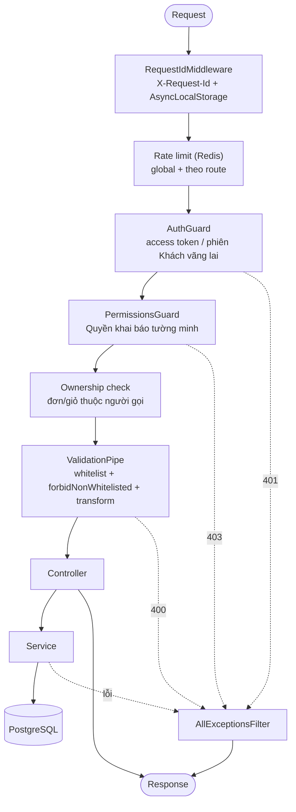

# 03. API

> Trạng thái: **Bản nháp cho tái cấu trúc** ([quy ước](../README.md#trạng-thái-tài-liệu)). Quy trình viết một API theo [`../convention/api-rules.md`](../convention/api-rules.md) (code mẫu CRUD: [`api-crud-walkthrough.md`](../convention/api-crud-walkthrough.md)).

## 1. Request pipeline



- Route public (duyệt Sản phẩm, Tính thử, IPN, webhook GHN) bỏ qua AuthGuard nhưng vẫn qua rate limit và validation. IPN/webhook xác thực bằng chữ ký riêng ([06-integrations.md](./06-integrations.md)).
- Chi tiết xác thực và phiên: [05-auth-security.md](./05-auth-security.md).

## 2. Versioning

Mọi route dưới `/api/v1`, Swagger ở `/docs` (ADR 0002).

## 3. Nhóm route

| Nhóm                 | Prefix              | Người gọi                                      | Ví dụ                                                                                                        |
| -------------------- | ------------------- | ---------------------------------------------- | ------------------------------------------------------------------------------------------------------------ |
| Storefront public    | `/api/v1/`          | Mọi người                                      | `GET /products`, `GET /categories`, `POST /checkout/quotes`                                                  |
| Storefront Người mua | `/api/v1/`          | `guest` (cookie/phiên tra cứu) hoặc `customer` | `/cart`, `POST /orders`, `POST /orders/{code}/payments`, `POST /orders/{code}/cancel`, `POST /order-lookups` |
| Tài khoản            | `/api/v1/me`        | `customer`                                     | hồ sơ, sổ địa chỉ, lịch sử đơn, ngôn ngữ                                                                     |
| Back-office          | `/api/v1/admin/`    | `staff`, `admin`                               | đơn, tồn kho, Kiểm kê, Sản phẩm, Voucher, Đổi trả, Hoàn tiền                                                 |
| Chỉ Admin            | `/api/v1/admin/`    | `admin`                                        | Tài khoản Staff, cấu hình, báo cáo                                                                           |
| Callback             | `/api/v1/webhooks/` | VNPay, MoMo, GHN                               | `/webhooks/vnpay`, `/webhooks/momo`, `/webhooks/ghn`                                                         |

Ma trận quyền đầy đủ: [02-actors-permissions.md](../business/02-actors-permissions.md) §3. Đơn được tham chiếu bằng Mã đơn (BR-ORD-03) ở storefront, không lộ `id` nội bộ.

## 4. Định dạng lỗi

Mọi lỗi đi qua một `AllExceptionsFilter` duy nhất (`../convention/error-logging-conventions.md`):

```json
{
  "statusCode": 409,
  "code": "QUOTE_CHANGED",
  "message": "Giá hoặc điều kiện bán đã thay đổi, vui lòng xác nhận lại",
  "details": { "changedLines": ["..."] },
  "requestId": "..."
}
```

- `code` là mã máy đọc được, ổn định, để frontend hiển thị theo ngôn ngữ (vi/en). Ví dụ: `OUT_OF_STOCK` (BR-INV-06, kèm Biến thể thiếu và số còn), `QUOTE_CHANGED`/`QUOTE_EXPIRED` (ADR 0013), `COD_LIMIT_EXCEEDED` (BR-PAY-06), `INVALID_TRANSITION` (state machine), `ORDER_NOT_FOUND` (cũng dùng khi tra cứu sai — US-401 AC2).
- Chỉ log lỗi 5xx; 4xx không log.

## 5. Phân trang, lọc, sắp xếp

- Danh sách storefront dùng `page` + `pageSize` (mặc định 20, tối đa 100); response có `items`, `page`, `pageSize`, `total`.
- Danh sách back-office lớn (đơn, biến động tồn kho, audit) dùng cursor (`cursor`, `limit`) theo `(created_at, id)` để ổn định khi có dữ liệu mới.
- Lọc và sắp xếp Sản phẩm theo US-102, BR-CAT-12, BR-CAT-13; tham số lọc dùng mã size và mã màu (BR-CAT-11).

## 6. Idempotency

| Thao tác               | Cơ chế                                                                                                                                                                   |
| ---------------------- | ------------------------------------------------------------------------------------------------------------------------------------------------------------------------ |
| Đặt đơn `POST /orders` | Header `Idempotency-Key` bắt buộc; lưu theo `scope + actor + key` cùng fingerprint payload và response. Gửi lại cùng key → trả kết quả cũ; cùng key khác payload → `409` |
| Tạo link thanh toán    | `Idempotency-Key` như trên; mã giao dịch gửi Cổng sinh một lần và dùng lại khi retry (ADR 0004)                                                                          |
| IPN VNPay/MoMo         | Khử trùng theo mã giao dịch Cổng (BR-PAY-03)                                                                                                                             |
| Webhook GHN            | Khử trùng theo mã Vận đơn + trạng thái + thời điểm ([07-async-events-jobs.md](./07-async-events-jobs.md) §1.3)                                                           |
| Yêu cầu Hoàn tiền      | Một yêu cầu mỗi thao tác nghiệp vụ mỗi Thanh toán (BR-REF-06)                                                                                                            |

Bản ghi idempotency đang `processing` quá ngưỡng thời gian thì retry phải đối soát với Cổng trước, không tạo lời gọi mới mù quáng.
