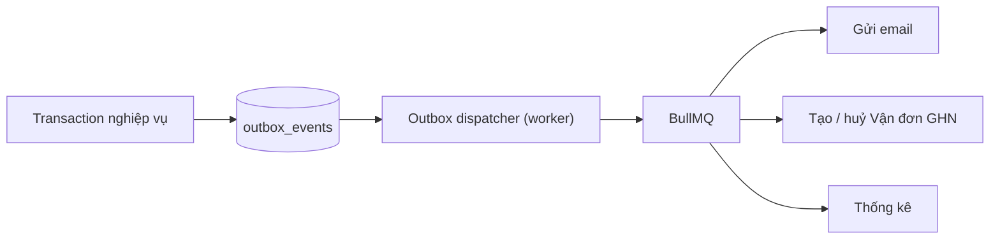

# 07. Sự kiện, xử lý bất đồng bộ và job định kỳ

> Trạng thái: **Đã chốt cho MVP**. Nguồn nghiệp vụ: [05-order-lifecycle.md](../business/05-order-lifecycle.md), [06-compliance.md](../business/06-compliance.md). Quyết định: [ADR 0003](../adr/0003-inventory-reservations-and-transactional-outbox.md), [ADR 0007](../adr/0007-outbox-done-means-downstream-ack.md), [ADR 0008](../adr/0008-redis-outage-degrades-not-unready.md).

Request của Người mua không chờ tác dụng phụ không thiết yếu (email, tạo Vận đơn, thống kê). Mọi việc đó đi qua outbox hoặc job, chạy trong **worker** tách khỏi API.

## 1. Thông báo từ bên ngoài (IPN, webhook GHN)

### 1.1. Nhận và lưu

1. Endpoint nhận thông báo xác thực chữ ký của Cổng thanh toán (VNPay/MoMo) hoặc GHN; sai chữ ký trả lỗi và không lưu.
2. Lưu thông báo thô vào bảng inbox — `payment_notifications` (UK `(gateway, dedup_key)`, `processed_at`) hoặc `shipment_events` (UK `(shipment_id, dedup_key)`, `applied_at`, `attempts`, `next_attempt_at`) — thông báo lặp chỉ được xử lý **một lần** (BR-PAY-03).
3. Trả `2xx` cho provider ngay sau khi lưu; xử lý nghiệp vụ chạy trong worker. Return URL của Người mua không bao giờ là nguồn xác nhận (BR-PAY-02).

### 1.2. Áp dụng vào Đơn hàng

Worker đối chiếu thông báo với trạng thái hiện tại của Đơn hàng và chỉ áp dụng chuyển trạng thái hợp lệ theo bảng T1–T14 ([05-order-lifecycle.md](../business/05-order-lifecycle.md) mục 3), trong một transaction có khoá dòng Đơn hàng. Các tình huống tiền về sai số tiền (BR-PAY-04) hoặc về cho đơn không còn chờ thanh toán (BR-PAY-05) xử lý theo [ADR 0006](../adr/0006-manual-refund-mvp-scope.md).

Job huỷ đơn hết hạn (mục 4) **tạm dừng** khi inbox thanh toán đang dồn ứ, để thu hẹp cửa sổ "tiền về nhưng đơn đã huỷ" (business/05 mục 4.1).

### 1.3. Thông báo tới không theo thứ tự

Hệ thống không dựa vào thứ tự tới (business/05 mục 4.2):

| Trường hợp | Xử lý |
|---|---|
| Trùng | Chặn ở UK `dedup_key` lúc lưu, không xử lý lại |
| Báo một bước đơn đã qua | Đặt `applied_at`/`processed_at`, không đổi gì |
| Tới sớm hơn bước trước nó (vd. GHN báo đã giao khi chưa ghi nhận Vận đơn tạo xong) | Giữ `applied_at` null, tăng `attempts`, đặt `next_attempt_at` theo backoff tăng dần (1, 2, 5, 10, 30 phút…) |
| Thử lại quá giới hạn (mặc định 10 lần / 24 giờ) mà vẫn chưa áp dụng được | Ngừng thử (`next_attempt_at` null, `applied_at` vẫn null), gửi cảnh báo cho đội kỹ thuật ([08-observability.md](./08-observability.md) mục 4) |
| Mâu thuẫn với trạng thái đơn (vd. báo đã giao khi đơn đã Hoàn hàng) | Đặt `applied_at`, không áp dụng, chỉ ghi log |

Job Đối soát (mục 4) là đường thứ hai: nếu thông báo bị mất hẳn, đối soát với API của provider vẫn đưa đơn về đúng trạng thái.

## 2. Transactional outbox và danh mục sự kiện

Transaction làm thay đổi trạng thái domain ghi luôn một dòng outbox (cùng commit). Dispatcher đọc outbox, đưa job vào BullMQ; consumer thực hiện tác dụng phụ.

**Quy tắc:**

- Giao **at-least-once**; mọi consumer idempotent với dedup key ổn định (`event_id` + loại tác dụng phụ).
- Một dòng chỉ **xong** khi downstream xác nhận thành công hoặc đã dùng hết retry và được escalate — không phải khi enqueue (ADR 0007). Trạng thái: `pending → enqueued → done | failed`. Quét đối chiếu định kỳ phát hiện dòng kẹt ở `enqueued` quá ngưỡng và enqueue lại.
- **Payload không chứa PII**: chỉ ID và mã (order_id, payment_id, mã đơn). Consumer đọc dữ liệu cần thiết từ DB lúc chạy.
- Dòng `done` được xoá sau **90 ngày** (business/06 mục 5).

**Danh mục sự kiện (MVP):**

| Sự kiện | Phát sinh khi | Consumer |
|---|---|---|
| `ordering.order-placed` | T2 (COD) | Email "Đặt đơn thành công" |
| `ordering.order-paid` | T3 | Email "Thanh toán thành công" |
| `ordering.order-cancelled` | T7, T9, T14 (không gồm T4/T5 — BR-NTF-01) | Email "Đơn đã huỷ"; huỷ Vận đơn nếu có |
| `ordering.order-expired` | T4 | Không gửi email; chỉ thống kê |
| `ordering.unexpected-payment-received` | Tiền về cho đơn không còn chờ thanh toán (BR-PAY-05) | Email báo tiền sẽ được hoàn; cảnh báo Staff |
| `payments.amount-mismatch` | BR-PAY-04 | Cảnh báo Staff (Cờ `amount_mismatch`) |
| `refunds.refund-requested` | Tạo yêu cầu Hoàn tiền | Cảnh báo Staff |
| `refunds.refund-recorded` | Staff ghi nhận Đã hoàn tiền | Email "Hoàn tiền được ghi nhận" |
| `fulfillment.handover-requested` | Staff bàn giao | Tạo Vận đơn GHN |
| `fulfillment.shipment-created` | T10 | Email "Đơn đang được giao" |
| `fulfillment.shipment-delivered` | T11 | Email "Đã giao" |
| `fulfillment.returned-to-sender` | T12 | Cảnh báo Staff chờ nhận hàng về Kho |
| `fulfillment.shipment-exception` | BR-SHP-08 | Cảnh báo Staff (`shipment_exception`) |
| `identity.email-verified` | Email Tài khoản được xác thực (kể cả qua Google) | `ordering` gắn đơn vãng lai cùng email (BR-ORD-08) |
| `compliance.erasure-step-requested` | Yêu cầu xoá dữ liệu được duyệt (US-1101) | Mỗi module xoá/ẩn danh phần dữ liệu của mình |
| `compliance.erasure-completed` | Mọi bước xoá đã xác nhận | Email xác nhận cho Người mua |
| `identity.email-verification-requested`, `identity.password-reset-requested` | Đăng ký, quên mật khẩu | Email tài khoản |

## 3. Thông báo cho Người mua (email)

### 3.1. Gửi email

- Chỉ các sự kiện ở BR-NTF-01 sinh email. Ngôn ngữ theo Khách hàng đã chọn, hoặc theo ngôn ngữ giao diện lúc đặt với Khách vãng lai; tên Sản phẩm luôn tiếng Việt (BR-NTF-02). Khách vãng lai không có email thì không gửi (BR-NTF-03).
- Provider email đứng sau interface `Mailer` ([06-integrations.md](./06-integrations.md)). Retry với backoff; lỗi vĩnh viễn (địa chỉ không hợp lệ) không retry.

### 3.2. Nhật ký email (`email_logs`)

Mỗi email có một bản ghi `email_logs`: `outbox_event_id`, `order_id`, `template`, `locale`, `recipient`, `amount`, `status` (`sent`, `failed`, `cancelled`), `attempts`, `last_error`, `sent_at`. Chống gửi trùng: BullMQ `jobId = event_id` + consumer kiểm tra đã có dòng `sent` cho `(outbox_event_id, template)` trước khi gửi (schema không đặt UK).

- `cancelled`: email không còn đúng lúc gửi (vd. đơn đã đổi trạng thái trước khi worker chạy).
- Sau **90 ngày** kể từ trạng thái cuối, job dọn dẹp **đặt `recipient`, `amount` = null**, giữ phần còn lại để thống kê (business/06 mục 5).

## 4. Job định kỳ

Job chạy bằng BullMQ repeatable job trong worker; mỗi lần chạy giữ một khoá để chỉ một instance chạy cùng lúc, và xử lý theo lô nhỏ, idempotent.

| Job | Tần suất | Nguồn |
|---|---|---|
| Huỷ đơn `PENDING_PAYMENT` quá 15 phút (T4), giải phóng Giữ hàng | Mỗi phút | BR-INV-05, T4 |
| Đối soát Thanh toán treo với VNPay / MoMo | Mỗi 5 phút | BR-PAY-02, T3 |
| Đối soát trạng thái Vận đơn với GHN | Mỗi 15 phút **[Giả định · kiểm chứng hạn mức API GHN]** | T11, T12 |
| Chuyển `DELIVERED` quá 7 ngày, không còn Đổi trả đang mở, sang `COMPLETED` | Mỗi giờ | T13, BR-REV-01 |
| Thử lại `shipment_events` chưa áp dụng (`next_attempt_at` tới hạn) | Mỗi phút | Mục 1.3 |
| Quét outbox kẹt `enqueued` | Mỗi 5 phút | ADR 0007 |
| Xoá Giỏ Khách vãng lai không hoạt động 30 ngày | Mỗi ngày | BR-CRT-02 |
| Xoá token hết hạn/đã dùng (refresh, reset, verify) và Tính thử hết hạn | Mỗi ngày | [11-database.md](./11-database.md) |
| Tính số liệu **bán chạy** 30 ngày | Mỗi đêm | BR-CAT-12 |
| Dọn outbox `done` > 90 ngày, ẩn PII `email_logs` > 90 ngày | Mỗi ngày | business/06 mục 5 |

## 5. Vai trò của Redis/BullMQ và khi Redis lỗi

PostgreSQL là nguồn dữ liệu duy nhất; Redis chỉ chứa hàng đợi, rate limit và cache. Khi Redis lỗi (ADR 0008):

- API vẫn `ready`; mọi thao tác ghi nghiệp vụ (đặt đơn, nhận IPN) vẫn chạy vì chỉ cần PostgreSQL. Dòng outbox tích lại ở `pending`, inbox ở `processed_at`/`applied_at` null.
- Route có rate limit fail closed với `503`; cache rơi về PostgreSQL.
- Job định kỳ ngừng; khi Redis trở lại, dispatcher và job tiếp tục từ dữ liệu trong PostgreSQL — không mất việc.
