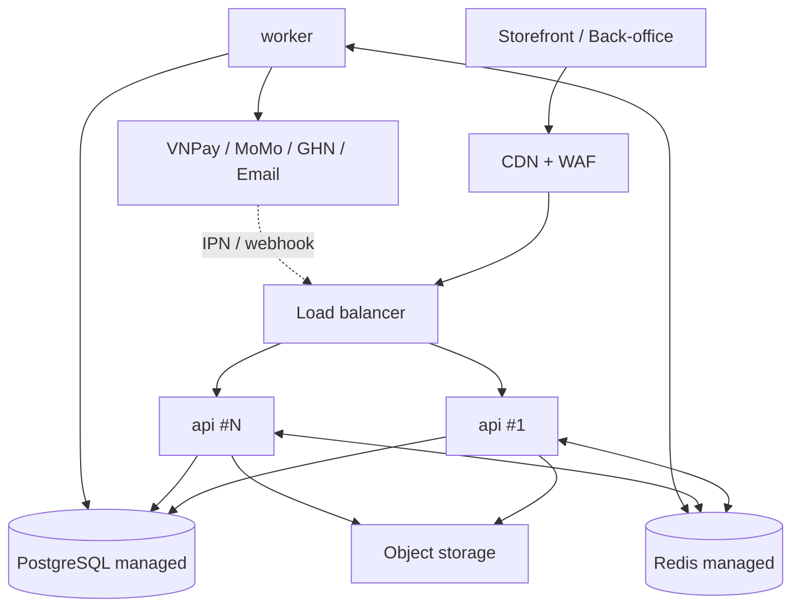

# 09. Triển khai (Deployment)

> Trạng thái: **Đã chốt cho MVP**. Ràng buộc: chạy local trước, AWS là môi trường mục tiêu sau ([01-vision-scope.md](../business/01-vision-scope.md) mục 6). Liên quan: [08-observability.md](./08-observability.md), [10-nfr.md](./10-nfr.md).

## 1. Thành phần chạy

Cùng một image NestJS, chạy hai vai trò:

- **api**: HTTP stateless, nhiều replica.
- **worker**: outbox dispatcher, consumer BullMQ, job định kỳ ([07](./07-async-events-jobs.md)). Scale riêng với API.

Phụ thuộc: PostgreSQL (nguồn dữ liệu duy nhất), Redis (queue, rate limit, cache), object storage tương thích S3 (ảnh Sản phẩm).

## 2. Môi trường phát triển (Docker Compose)

`docker-compose.yml` cho local và test tích hợp trong CI — không phải topology production:

| Service    | Vai trò                                               |
| ---------- | ----------------------------------------------------- |
| `api`      | NestJS chế độ watch                                   |
| `worker`   | Cùng code, chạy entrypoint worker                     |
| `postgres` | PostgreSQL (port có thể override qua biến môi trường) |
| `redis`    | Redis                                                 |
| `minio`    | Object storage tương thích S3                         |
| `mailpit`  | Bắt email gửi ra để xem local                         |

Cổng thanh toán và GHN dùng **sandbox** ở local/staging; test tự động dùng adapter giả lập theo hợp đồng ([06-integrations.md](./06-integrations.md)).

## 3. Môi trường

| Môi trường    | Mục đích                                                                | Dữ liệu                     | Tích hợp ngoài    |
| ------------- | ----------------------------------------------------------------------- | --------------------------- | ----------------- |
| `dev` (local) | Phát triển                                                              | Seed                        | Sandbox / giả lập |
| `staging`     | UAT, test tải k6 ([10](./10-nfr.md)), nghiệm thu sandbox VNPay/MoMo/GHN | Dữ liệu giả, không PII thật | Sandbox           |
| `production`  | Bán thật                                                                | Thật                        | Production        |

Cấu hình qua biến môi trường, kiểm tra fail-fast khi khởi động; secret lấy từ secret manager, không commit vào repo.

## 4. Topology production

- Ít nhất 2 replica API; replica không giữ state (phiên, giỏ đều ở DB/Redis).
- PostgreSQL managed có backup tự động và point-in-time recovery.
- Graceful shutdown: ngừng nhận request mới, hoàn tất request/job đang chạy, rồi thoát.

## 5. CI/CD

Mỗi Pull Request: lint, typecheck, unit test, e2e test với PostgreSQL + Redis thật (service container), `prisma migrate deploy` + seed trên DB rỗng. Merge vào `main`: build image một lần, deploy staging, chạy smoke test, promote cùng image lên production sau khi duyệt.

Migration chạy như **một job riêng trước khi** rollout replica mới, không chạy lúc khởi động app.

## 6. Thay đổi schema khi đang chạy nhiều replica

Dùng **expand → migrate → contract**:

1. Thêm schema tương thích ngược (cột nullable, bảng mới).
2. Deploy code đọc/ghi được cả hai dạng.
3. Backfill và kiểm tra.
4. Khi mọi replica đã ở bản mới, xoá dạng cũ ở một release sau.

Không đổi tên/xoá cột trong cùng release với code dùng tên mới.

## 7. Gate trước khi bật thanh toán thật

- Test tích hợp với PostgreSQL/Redis thật; test đồng thời cho bán vượt và đặt đơn trùng.
- Test hợp đồng với VNPay và MoMo; nghiệm thu sandbox các kịch bản IPN timeout, trùng, sai thứ tự, sai số tiền (BR-PAY-03, BR-PAY-04), tiền về cho đơn đã huỷ (BR-PAY-05).
- Replay outbox/worker, Giữ hàng hết hạn, rolling migration, graceful shutdown.
- Hợp đồng merchant và UAT của cả hai Cổng ([ADR 0004](../adr/0004-payment-gateways-vnpay-momo-cod.md)).

## 8. Điều kiện go-live

Ngoài các gate kỹ thuật ở mục 7, phải hoàn tất danh sách pháp lý ở [06-compliance.md](../business/06-compliance.md) mục 6 (dữ liệu cá nhân, hoá đơn điện tử, thông báo website, thời hạn lưu dữ liệu).
