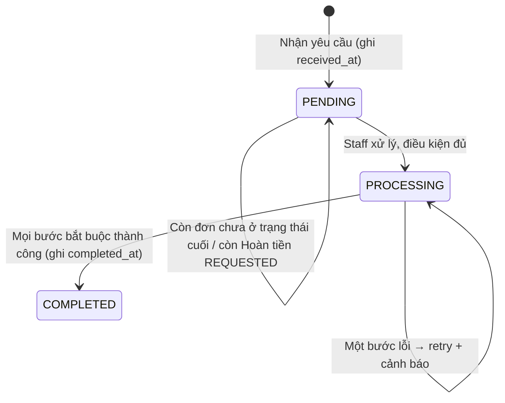

# Module `compliance`

> Trạng thái: **Đã chốt cho MVP**, trừ các mục **[Cần xác minh trước go-live]**. Nguồn nghiệp vụ: [`../../business/06-compliance.md`](../../business/06-compliance.md), US-1101, US-1102. Bảo mật: [`../05-auth-security.md`](../05-auth-security.md). Bảng: [`../11-database.md`](../11-database.md).

## 1. Trách nhiệm

- Lưu bằng chứng đồng ý xử lý dữ liệu và lựa chọn email marketing (CMP-01..03).
- Tiếp nhận và điều phối Yêu cầu xoá dữ liệu: kiểm tra điều kiện, gọi từng module ẩn danh phần dữ liệu của mình (CMP-05, CMP-06).
- Ghi lịch sử Staff xem dữ liệu cá nhân (CMP-07).
- Không tự sửa bảng của module khác: mỗi module sở hữu dữ liệu PII cung cấp hàm `anonymizeFor(subject)` idempotent ([`../02-modules.md`](../02-modules.md) §2).

## 2. Mô hình

Chi tiết cột, ràng buộc, enum: [`../11-database.md` §4.11](../11-database.md#411-compliance).

- `consents` — bằng chứng đồng ý, chỉ thêm
- `data_erasure_requests` — Yêu cầu xoá dữ liệu và tiến độ ẩn danh
- `data_access_logs` — nhật ký Staff xem dữ liệu cá nhân

## 3. Interface public

| Hàm | Gọi bởi | Ghi chú |
|---|---|---|
| `recordConsent(tx, subject, purpose, granted, policyVersion, channel)` | `identity` (đăng ký), `ordering` (checkout) | Checkbox không tick sẵn là trách nhiệm frontend; backend từ chối đăng ký/đặt đơn nếu thiếu đồng ý `DATA_PROCESSING` (CMP-01) |
| `logAccess(staff, action, subject)` | decorator/interceptor trên route back-office có PII | Ghi bất đồng bộ được nhưng không mất (qua outbox) |

## 4. API

| Method | Path | Actor | Ghi chú |
|---|---|---|---|
| `PATCH` | `/me/consents/marketing-email` | customer | Đổi lựa chọn marketing |
| `POST` | `/me/data-erasure-requests` | customer | US-1101 AC1 |
| `GET` | `/admin/data-erasure-requests` | staff | |
| `POST` | `/admin/data-erasure-requests` | staff | Tạo cho Khách vãng lai qua kênh hỗ trợ, kèm xác minh (US-1101 AC5) |
| `POST` | `/admin/data-erasure-requests/:id/process` | staff | Bắt đầu xử lý |
| `GET` | `/admin/data-access-logs?subjectId=` | admin | US-1102 |

## 5. Luồng xoá dữ liệu

1. Điều kiện: mọi đơn liên quan ở `COMPLETED`/`CANCELLED`/`RETURNED_TO_SENDER` và không còn Hoàn tiền `REQUESTED` (US-1101 AC4). Yêu cầu của Khách hàng chỉ áp cho đơn đã gắn Tài khoản (AC5).
2. Worker gọi lần lượt `anonymizeFor` của `identity` (tên, email, SĐT; Tài khoản không đăng nhập được nữa — AC3; thu hồi mọi phiên), `ordering` (thông tin liên hệ, địa chỉ, email nhận hoá đơn — **giữ** tên công ty, MST, địa chỉ công ty), `fulfillment` (địa chỉ trong `creation_input`), `payments`/`fulfillment` (`raw_payload` có PII), `notifications` (`email_logs.recipient`). Mỗi bước idempotent; tiến độ ghi vào `steps`.
3. Chỉ `COMPLETED` khi mọi bước thành công; bước lỗi giữ `PROCESSING` (CMP-05).

## 6. Sự kiện

Phát: `compliance.erasure-step-requested` (nội bộ, để worker chạy từng bước), `compliance.erasure-completed`. Lắng nghe: không.

## 7. Job

| Job | Tần suất |
|---|---|
| Thử lại bước ẩn danh lỗi; cảnh báo yêu cầu quá hạn xử lý | Mỗi giờ (thời hạn: **[Cần xác minh trước go-live]**, CMP-06) |

## 8. Bao phủ nghiệp vụ

CMP-01..07, US-1101, US-1102, business/06 §2, §5. CMP-08, CMP-09 là quy trình ngoài hệ thống. Hoá đơn (business/06 §3) thuộc `reporting`.

## 9. Câu hỏi mở

- Thời hạn xử lý yêu cầu xoá (CMP-06), thời hạn thông báo sự cố (CMP-09) — pháp chế chốt.
- Thời hạn lưu `raw_payload`, `creation_input`, địa chỉ trên Đơn hàng khi **không** có yêu cầu xoá (business/06 §5).
- `data_access_logs` có PII gián tiếp (subject_id) — thời hạn lưu của chính bảng này.
