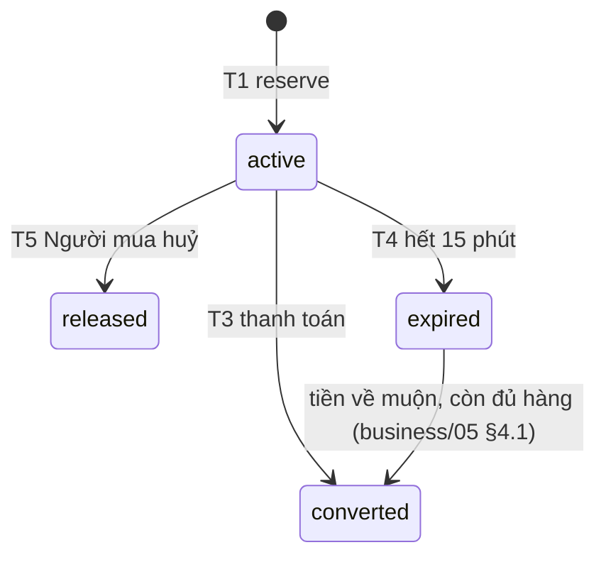

# Module `inventory`

> Trạng thái: **Bản nháp cho tái cấu trúc** ([quy ước](../../README.md#trạng-thái-tài-liệu)). Bảng: [`../11-database.md`](../11-database.md). Ranh giới: [`../02-modules.md`](../02-modules.md). Nguồn nghiệp vụ: [business/04](../../business/04-business-rules.md) §3 (BR-INV-*), [business/03](../../business/03-user-stories.md) E7. Nhất quán: [../04-data-consistency.md](../04-data-consistency.md).

## 1. Trách nhiệm

- Sở hữu: Tồn kho theo Biến thể × Kho, Giữ hàng, Hàng chờ xuất, sổ biến động, Kiểm kê.
- Công thức: Số lượng bán được = Tồn kho − tổng Giữ hàng còn hiệu lực, không âm (BR-INV-02); Hàng trên kệ = Tồn kho + Hàng chờ xuất ([ADR 0010](../../adr/0010-stock-decremented-at-order-awaiting-dispatch.md)).

## 2. Mô hình

Chi tiết cột, ràng buộc, enum: [`../11-database.md` §4.5](../11-database.md#45-inventory).

- `warehouses` — Kho (MVP một Kho)
- `inventory_levels` — Tồn kho và Giữ hàng theo Biến thể × Kho
- `inventory_reservations` — Giữ hàng 15 phút của đơn online
- `awaiting_dispatch_items` — Hàng chờ xuất theo đơn
- `inventory_movements` — sổ biến động tồn kho, chỉ thêm
- `stock_counts` — phiếu Kiểm kê

## 3. Interface cho module khác

Mọi hàm nhận `tx` của module gọi; khoá `inventory_levels` theo `variant_id` tăng dần.

| Hàm | Gọi ở |
|---|---|
| `getSellable(variantIds)` | `catalog`, `cart`, `ordering` (Tính thử) |
| `reserve(orderId, lines, tx)` | T1 (online) — thiếu → lỗi kèm số còn (BR-INV-06) |
| `decrementToAwaitingDispatch(orderId, lines, tx)` | T2 (COD, BR-INV-04) |
| `consumeReservation(orderId, tx)` | T3 — `on_hand -= q`, `reserved -= q`, tạo Hàng chờ xuất; Giữ hàng đã quá hạn thì giữ lại nếu còn đủ (business/05 §4.1) |
| `releaseReservation(orderId, tx)` | T4, T5 |
| `returnAwaitingDispatch(orderId, tx)` | T7, T9 (BR-INV-07) |
| `clearAwaitingDispatch(orderId, tx)` | T10 |
| `restockReturned(orderId | returnId, lines, tx)` | Staff xác nhận hàng về Kho (BR-INV-08): theo `orderId` (Hoàn hàng T12) → movement `return_to_sender`; theo `returnId` (Đổi trả, gọi khi Staff `decide`, không phải khi `receive`) → movement `return_restock` |

## 4. API

| Method | Path | Actor | Ghi chú |
|---|---|---|---|
| `GET` | `/admin/inventory` | staff | Theo Biến thể: Tồn kho, Giữ hàng, Hàng chờ xuất, Số lượng bán được; lọc dưới ngưỡng (mặc định 5) (US-702) |
| `POST` | `/admin/inventory/receipts` | staff | Nhập kho (US-701) |
| `POST` | `/admin/inventory/adjustments` | staff | Lý do bắt buộc; giảm ≤ Số lượng bán được (BR-INV-11) |
| `POST` | `/admin/inventory/stock-counts` (+ `/preview`) | staff | Kiểm kê (US-703) |
| `GET` | `/admin/inventory/:variantId/movements` | staff | Lịch sử |

## 5. Luồng

### 5.1. Kiểm kê (BR-INV-12)

Mỗi thay đổi Tồn kho ghi một dòng `inventory_movements` với `type` ∈ `receipt`/`adjustment`/`stock_count`/`sale`/`cancel_restock`/`return_restock`/`return_to_sender`.

Preview không khoá. Xác nhận: khoá dòng `inventory_levels` → chênh lệch = số đếm − (`on_hand` + Hàng chờ xuất của Biến thể) tính **lúc xác nhận** → nếu giảm vượt Số lượng bán được thì `422` kèm số tối đa → cập nhật `on_hand`, ghi `stock_counts` và movement `stock_count`.

## 6. Sự kiện

Không phát; mọi thay đổi được gọi đồng bộ trong transaction của module điều phối.

## 7. Job

Hết hạn Giữ hàng chạy trong job huỷ đơn của `ordering` ([ordering.md](./ordering.md) §8), không có job riêng.

## 8. Bao phủ

BR-INV-01–12; US-701–703; ADR 0003, ADR 0010.

## 9. Câu hỏi mở

- Danh sách lý do điều chỉnh cố định hay Staff nhập tự do? Business chỉ ví dụ (kiểm kê, hàng lỗi, hàng mẫu) — schema lưu `inventory_movements.reason` dạng text tự do; nếu cần danh sách cố định thì validate ở DTO.
