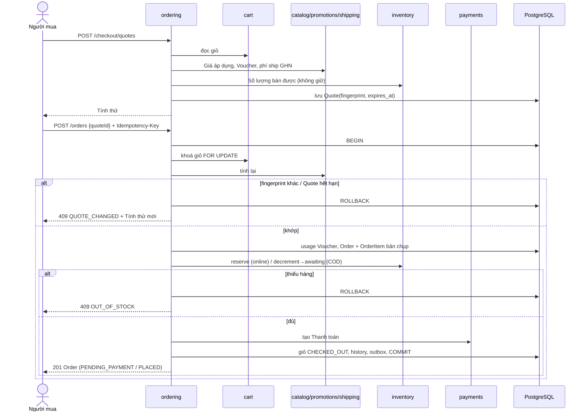

# Module `ordering`

> Trạng thái: **Đã chốt cho MVP**. Nguồn nghiệp vụ: [`../../business/05-order-lifecycle.md`](../../business/05-order-lifecycle.md), [`../../business/04-business-rules.md`](../../business/04-business-rules.md) §5. Nhất quán dữ liệu: [`../04-data-consistency.md`](../04-data-consistency.md). Bảng: [`../11-database.md`](../11-database.md).

## 1. Trách nhiệm

- Sở hữu: Tính thử (quote), Order, Dòng đơn hàng (bản chụp), lượt dùng Voucher gắn với đơn, quyền truy cập đơn của Khách vãng lai, Cờ cần xử lý trên đơn.
- Điều phối checkout: gọi `catalog` (giá áp dụng), `cart`, `inventory` (giữ/trừ), `pricing` (Voucher), `fulfillment` (phí GHN), `payments` (tạo Thanh toán) — **qua interface của module đó, trong cùng transaction DB**, không truy cập bảng của module khác trực tiếp ([../02-modules.md](../02-modules.md)).
- Không sở hữu: Thanh toán/Hoàn tiền (`payments`), Vận đơn (`fulfillment`), Đổi trả (`refunds-returns`), Tồn kho (`inventory`). Các module đó báo kết quả về bằng lệnh chuyển trạng thái của `ordering`.

## 2. Mô hình

Chi tiết cột, ràng buộc, enum: [`../11-database.md` §4.6](../11-database.md#46-ordering).

- `checkout_quotes` — bản Tính thử có hạn
- `orders` — Đơn hàng
- `order_items` — bản chụp dòng đơn lúc đặt
- `order_status_history` — lịch sử chuyển trạng thái Đơn
- `order_flags` — cờ cần Staff xử lý
- `idempotency_keys` — chống tạo trùng khi retry

Phiên 30 phút của Khách vãng lai (`guest_order_sessions`) thuộc `identity`; `ordering` tạo qua interface của `identity`.

## 3. State machine

Trạng thái và chuyển T1–T14 theo [`05-order-lifecycle.md`](../../business/05-order-lifecycle.md) §1–3. Cài đặt:

- Một bảng chuyển trạng thái khai báo duy nhất trong code: `(from, to, transitionId, allowedActors, guard)`. **Mọi cặp không có trong bảng bị từ chối** (`409 INVALID_ORDER_TRANSITION`).
- Mỗi chuyển chạy trong một transaction: khoá dòng Order `FOR UPDATE` → kiểm tra `status` hiện tại và guard → `UPDATE orders SET status=:to WHERE id=:id AND status=:from` → tác động kèm theo (Tồn kho, Voucher, Hoàn tiền, khoản thu COD) → ghi history + outbox event `ordering.<transition>`.
- Actor: `customer`/`guest` (T5, T7 trước `PACKING`), `staff` (T6–T9, T14; lý do bắt buộc với T7-bởi-Staff, T9, T14), `system` (T3, T4, T10–T13).
- Trạng thái cuối `COMPLETED`, `CANCELLED`, `RETURNED_TO_SENDER` không có chuyển ra.

| T | Tác động kèm theo (module được gọi) |
|---|---|
| T1 | `inventory.reserve`, `promotions.recordUsage`, `payments.createPending` |
| T2 | `inventory.decrementToAwaitingDispatch`, `promotions.recordUsage`, `payments.createCodReceivable`; event email |
| T3 | `inventory.consumeReservation`; event email |
| T4, T5 | `inventory.releaseReservation`, `promotions.releaseUsage`; không email (BR-NTF-01) |
| T7, T9 | `inventory.returnAwaitingDispatch`, `promotions.releaseUsage`, `payments.requestFullRefund` nếu online đã trả / huỷ khoản thu COD; event email |
| T10 | `inventory.clearAwaitingDispatch`; lưu mã Vận đơn; event email |
| T11 | ghi `delivered_at`; COD: `payments.markCodCollected`; event email |
| T12 | đánh dấu cần nhận lại hàng; `payments.requestFullRefund` / huỷ khoản thu COD |
| T13 | guard: `delivered_at + 7×24h <= now` và không có Đổi trả đang mở (`returns.hasOpen`); chốt Doanh thu (BR-REV-01) |
| T14 | như T12 nhưng **không** trả lượt Voucher (BR-VCH-08); Staff chọn "chưa rời Kho" hay "mất/hư" |

## 4. API

Prefix `/api/v1` ([ADR 0002](../../adr/0002-uri-versioned-api-contract.md)). Chi tiết quy ước ở [../03-api.md](../03-api.md).

| Method | Path | Actor | Ghi chú |
|---|---|---|---|
| `POST` | `/checkout/quotes` | guest, customer | Tạo Tính thử từ giỏ hiện tại + địa chỉ + Voucher + phương thức |
| `POST` | `/orders` | guest, customer | Đặt đơn từ `quoteId`; bắt buộc `Idempotency-Key` |
| `GET` | `/orders/:code` | owner / guest có grant | |
| `POST` | `/orders/lookup` | guest | Mã đơn + SĐT → grant 30 phút; rate-limit theo IP (US-401) |
| `POST` | `/orders/:code/cancel` | owner / guest có grant | T5, T7 |
| `GET` | `/me/orders` | customer | US-402 |
| `GET` | `/admin/orders` | staff | Lọc theo trạng thái, Cờ (US-601) |
| `POST` | `/admin/orders/:id/confirm` · `/start-packing` · `/hand-over` · `/cancel` | staff | T6, T8, bàn giao (kích hoạt tạo Vận đơn), T7/T9/T14 |
| `DELETE` | `/admin/orders/:id/flags/:flag` | staff | Gỡ Cờ |

## 5. Luồng

### 5.1. Luồng checkout

Hai bước theo BR-ORD-07 và [ADR 0013](../../adr/0013-checkout-must-match-confirmed-quote.md):

1. **Tính thử** — backend đọc giỏ, Giá áp dụng (BR-PRC-*), kiểm tra Số lượng bán được (không giữ), Voucher (BR-VCH-*), phí ship GHN theo cân nặng (BR-CAT-06, BR-SHP-*), hạn mức COD (BR-PAY-06), tổng > 0 (BR-ORD-09). Lưu `Quote` với `fingerprint` = hash chuẩn hoá của (dòng `variant_id`, số lượng, đơn giá, giảm theo dòng, mã Voucher + giảm, phí ship, phương thức, địa chỉ, tổng) và `expires_at`.
2. **Đặt đơn** — `POST /orders { quoteId }` với `Idempotency-Key`. Trong **một transaction**:
   1. Khoá giỏ (`FOR UPDATE`, `status='ACTIVE'`, ADR 0009); Quote chưa hết hạn và thuộc đúng giỏ/người.
   2. Tính lại toàn bộ như bước 1 từ dữ liệu hiện tại; so `fingerprint`. **Khác bất kỳ điểm nào → rollback, `409 QUOTE_CHANGED`** kèm Tính thử mới để Người mua xác nhận — kể cả khi tổng không đổi.
   3. Tổng ≤ 0 → `422`, không tạo gì (BR-ORD-09).
   4. Khoá Voucher, ghi usage (§6 của [04](../04-data-consistency.md)).
   5. Sinh `order_code`; tạo Order + OrderItem bản chụp, phân bổ Voucher (§6 dưới).
   6. Giữ hàng (online, T1) hoặc trừ Tồn kho → Hàng chờ xuất (COD, T2), khoá Biến thể theo `variant_id` tăng dần; thiếu → rollback, `409 OUT_OF_STOCK` + danh sách (BR-INV-06).
   7. Tạo Thanh toán (`PENDING` online / khoản thu COD).
   8. Giỏ `ACTIVE → CHECKED_OUT`; ghi history + outbox; với guest tạo `GuestAccessGrant` 30 phút.
   9. Commit; lưu response vào bản ghi idempotency.
3. Online: client gọi `payments` để lấy link VNPay/MoMo (hạn phút 10, không cấp mới từ phút 7 — BR-INV-05).

### 5.2. Huỷ đơn

- Người mua (customer hoặc guest có grant): T5 từ `PENDING_PAYMENT`, T7 từ `PLACED`/`CONFIRMED`; không cần lý do. Từ `PACKING` trở đi bị từ chối (T8).
- Staff: T7, T9, T14 với lý do bắt buộc. T9 bị từ chối khi Vận đơn đang `requested`/`creation_unknown` (§4.5) — `ordering` hỏi `shipping.hasPendingCreation`.
- Chỉ huỷ cả đơn (BR-ORD-05).

### 5.3. Truy cập của Khách vãng lai

- Sau khi đặt: grant 30 phút trả về cho client (token ngắn hạn gắn `order_id`, lưu hash).
- Tra cứu: `order_code` + SĐT chuẩn hoá khớp → grant mới 30 phút; sai → luôn `404` chung, đếm sai theo IP (US-401).
- Gắn đơn vào Tài khoản (BR-ORD-08): khi email được xác thực (kể cả Google), một handler của event `identity.email-verified` gán `user_id` cho các đơn có email trùng (không phân biệt hoa thường) và `user_id IS NULL`; lúc đặt đơn, nếu email đã thuộc Tài khoản xác thực thì gán ngay. Không bao giờ gán theo SĐT.

## 6. Phân bổ Voucher

Thuật toán ở `business/04-business-rules.md` §5 ("Phân bổ Voucher về Dòng đơn hàng"). Cài đặt là một hàm thuần `allocateVoucher(lines, D) → d[]` dùng số nguyên, có unit test cho các ví dụ trong business và property test `0 <= d_i <= L_i`, `SUM(d_i) = D`. Kết quả lưu vào `order_items.voucher_discount`, không tính lại sau đó (ADR 0012).

## 7. Tình huống đặc biệt

| `business/05` | Cài đặt |
|---|---|
| §4.1 Tiền về cho đơn không còn chờ thanh toán | `payments` gọi `ordering.onPaymentSucceeded`; xử lý theo [04-data-consistency](../04-data-consistency.md) §3; phát `ordering.unexpected-payment-received` |
| §4.2 Thông báo không theo thứ tự | `ordering` chỉ áp dụng chuyển hợp lệ từ trạng thái hiện tại; trùng/đã qua → bỏ qua; tới sớm → `fulfillment` giữ lại và retry ([../07-async-events-jobs.md](../07-async-events-jobs.md) mục 1.3); mâu thuẫn → log |
| §4.3 Huỷ khi Đang giao | Bảng chuyển chỉ cho T14 từ `SHIPPING` |
| §4.4 Đổi trả | Không đổi `orders.status`; guard T13 hỏi `returns.hasOpen(orderId)` |
| §4.5 Huỷ khi Vận đơn đang tạo | Guard T9; Vận đơn tạo xong cho đơn `CANCELLED` → `fulfillment` tự huỷ Vận đơn + Cờ |
| §4.6 Sai số tiền | `payments` không gọi T3; tạo Hoàn tiền + Cờ `payment_amount_mismatch` trên đơn |
| §4.7 Vận đơn gặp sự cố | Cờ `shipment_exception`; Staff gỡ cờ hoặc T14 |

## 8. Job

| Job | Tần suất | Hành vi |
|---|---|---|
| Huỷ đơn `PENDING_PAYMENT` quá hạn | Mỗi phút | Chọn đơn có Giữ hàng hết hạn, mỗi đơn T4 trong transaction riêng có khoá; tạm dừng khi hàng đợi IPN dồn ứ (§4.1) |
| `DELIVERED` → `COMPLETED` | Mỗi giờ | T13 cho đơn đủ 7×24h và không có Đổi trả mở |
| Dọn Quote / grant hết hạn | Mỗi ngày | Xoá bản ghi quá hạn |

Lịch và cơ chế chạy job: [../07-async-events-jobs.md](../07-async-events-jobs.md).
