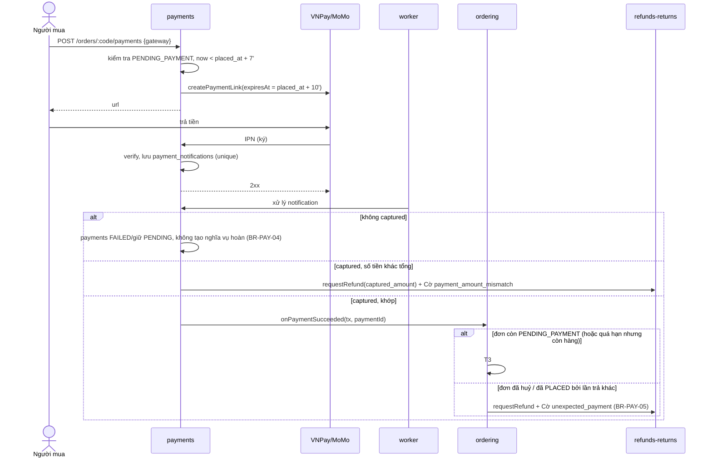

# Module `payments`

> Trạng thái: **Đã chốt cho MVP**. Nguồn nghiệp vụ: [`../../business/04-business-rules.md`](../../business/04-business-rules.md) §7, [`../../business/05-order-lifecycle.md`](../../business/05-order-lifecycle.md) §4.1, §4.6. Quyết định: [ADR 0004](../../adr/0004-payment-gateways-vnpay-momo-cod.md), [ADR 0006](../../adr/0006-manual-refund-mvp-scope.md). Tích hợp: [`../06-integrations.md`](../06-integrations.md) §2.

## 1. Trách nhiệm

- Sở hữu: Thanh toán online (mỗi lần thử một bản ghi), thông báo thô từ Cổng (IPN, kết quả Đối soát), khoản thu COD.
- Adapter `PaymentGateway` cho VNPay và MoMo; tạo link thanh toán; xác minh chữ ký; Đối soát.
- Quyết định một thông báo có phải **bằng chứng đã thu tiền** (chỉ `captured`) và số tiền có khớp không (BR-PAY-04).
- Không sở hữu: trạng thái Đơn (`ordering`), Hoàn tiền (`refunds-returns`). Thanh toán thành công được báo cho `ordering` qua interface `ordering.onPaymentSucceeded` (ordering khai báo, payments gọi — không import ngược, [`../02-modules.md`](../02-modules.md) §3); khoản thu sai gọi `refunds-returns.requestRefund`.

## 2. Mô hình

Chi tiết cột: [`../../database-design.md`](../../database-design.md).

| Bảng | Ghi chú |
|---|---|
| `payments` | `order_id`, `gateway` (`VNPAY`/`MOMO`), `amount` (VND nguyên), `status` (`PENDING → CAPTURED \| FAILED \| EXPIRED`), `provider_ref`, `provider_transaction_id`, `captured_amount`, `link_expires_at`, `captured_at`. Một đơn có nhiều bản ghi (thử lại, đổi Cổng — BR-PAY-01) |
| `payment_notifications` | Inbox thô: `gateway`, `provider_transaction_id`, `source` (`IPN`/`RECONCILIATION`), `raw_payload`, `status` (`RECEIVED`, `APPLIED`, `IGNORED`, `REJECTED`), `received_at`. Unique `(gateway, provider_transaction_id, provider_status)` — xử lý một lần (BR-PAY-03) |
| `cod_collections` | Một dòng mỗi đơn COD: `order_id` unique, `amount` = Tổng tiền đơn (BR-SHP-07), `status` (`PENDING → COLLECTED \| CANCELLED`), `collected_at` |

Ràng buộc: tối đa một `payments` ở `CAPTURED` được dùng để đưa đơn vào `PLACED`; các khoản captured khác của cùng đơn đều sinh yêu cầu Hoàn tiền (BR-PAY-05).

## 3. Interface public

| Hàm | Gọi bởi | Ghi chú |
|---|---|---|
| `createPending(tx, order)` | `ordering` (T1) | Ghi nhận đơn online chờ thanh toán; chưa tạo link |
| `createCodReceivable(tx, order)` | `ordering` (T2) | Tạo `cod_collections` `PENDING` |
| `markCodCollected(tx, orderId)` / `cancelCodReceivable(tx, orderId)` | `ordering` (T11 / T7, T9, T12, T14) | |
| `capturedPaymentsOf(orderId)` | `refunds-returns` | Thanh toán đã nhận tiền để gắn Hoàn tiền (BR-REF-01) |

## 4. API

Prefix `/api/v1`, quy ước ở [`../03-api.md`](../03-api.md).

| Method | Path | Actor | Ghi chú |
|---|---|---|---|
| `POST` | `/orders/:code/payments` | owner / guest có grant | Body `{ gateway }`. Tạo `payments` + link. Từ chối nếu đơn không `PENDING_PAYMENT` hoặc đã qua phút 7 (BR-INV-05). Bắt buộc `Idempotency-Key` |
| `GET` | `/orders/:code/payments/latest` | owner / guest có grant | Trang Return URL hỏi trạng thái; chỉ đọc, không xác nhận (BR-PAY-02) |
| `POST` | `/webhooks/vnpay/ipn` | VNPay | Xác minh chữ ký, lưu inbox, trả đúng định dạng VNPay |
| `POST` | `/webhooks/momo/ipn` | MoMo | Như trên |
| `GET` | `/admin/payments?orderId=` | staff | Lịch sử thử thanh toán của đơn |

## 5. Luồng

### 5.1. Trả tiền online

Toàn bộ bước "xử lý notification" chạy trong một transaction có khoá dòng Order ([`../04-data-consistency.md`](../04-data-consistency.md)). Thông báo lặp của chính khoản đã đưa đơn vào `PLACED` bị bỏ qua (business/05 §4.1).

### 5.2. Đối soát

Job mỗi 5 phút gọi `gateway.query(provider_ref)` cho `payments` `PENDING` đã có link, kể cả sau khi link hết hạn (tới khi Cổng trả kết quả cuối). Kết quả ghi thành `payment_notifications` `source = RECONCILIATION` và đi cùng đường xử lý §5.1.

## 6. Sự kiện

Phát (qua outbox, [`../07-async-events-jobs.md`](../07-async-events-jobs.md) §2): `payments.amount-mismatch`. `ordering.order-paid` và `ordering.unexpected-payment-received` do `ordering` phát trong cùng transaction.

Lắng nghe: không có — mọi thay đổi đến từ IPN/Đối soát hoặc lời gọi đồng bộ của `ordering`.

## 7. Job

| Job | Tần suất |
|---|---|
| Đối soát Thanh toán treo | Mỗi 5 phút |
| Xử lý `payment_notifications` `RECEIVED` tồn đọng | Liên tục (consumer) |

Khi inbox dồn ứ, `payments` báo cờ "backlog" để job huỷ đơn hết hạn của `ordering` tạm dừng ([`../07-async-events-jobs.md`](../07-async-events-jobs.md) §1.2).

## 8. Bao phủ nghiệp vụ

BR-PAY-01..06, BR-SHP-07, BR-INV-05 (phút 7/10), US-305, US-306, US-608 (phần tạo yêu cầu), business/05 §4.1, §4.6; ADR 0004, 0006.

## 9. Câu hỏi mở

- Định dạng và danh sách `provider_status` thực tế của VNPay/MoMo (pending/authorized/captured) — chốt khi nghiệm thu sandbox.
- Cổng có cho truyền `expiresAt` tuyệt đối không; nếu chỉ nhận thời lượng thì tính lại tại lúc tạo link.
