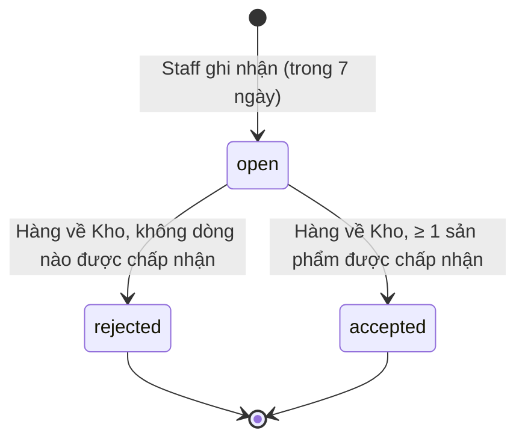

# Module `refunds-returns`

> Trạng thái: **Đã chốt cho MVP**. Nguồn nghiệp vụ: [`../../business/04-business-rules.md`](../../business/04-business-rules.md) §8–9, [`../../business/05-order-lifecycle.md`](../../business/05-order-lifecycle.md) §4.4. Quyết định: [ADR 0006](../../adr/0006-manual-refund-mvp-scope.md), [ADR 0012](../../adr/0012-order-line-snapshot-and-voucher-allocation.md). Bảng: [`../11-database.md`](../11-database.md).

## 1. Trách nhiệm

- Sở hữu: yêu cầu Hoàn tiền và việc ghi nhận Hoàn tiền thủ công; yêu cầu Đổi trả và các dòng Đổi trả.
- Tính số tiền hoàn: toàn bộ (huỷ/Hoàn hàng), đúng số đã nhận (BR-PAY-04/05), hoặc lũy kế theo dòng khi Đổi trả (BR-RET-07).
- Đảm bảo một thao tác chỉ tạo một yêu cầu cho mỗi Thanh toán và tổng hoàn không vượt số thực nhận (BR-REF-06).
- Không sở hữu: Thanh toán (`payments`), trạng thái Đơn (`ordering` — Đổi trả **không** đổi `orders.status`), Tồn kho (`inventory` — chỉ gọi `restockReturned`).

## 2. Mô hình

Chi tiết cột, ràng buộc, enum: [`../11-database.md` §4.8](../11-database.md#48-refunds-returns).

- `refunds` — yêu cầu Hoàn tiền gắn một nguồn tiền đã nhận
- `returns` — Đổi trả do Staff ghi nhận
- `return_items` — dòng hàng trong một lần Đổi trả

## 3. Interface public

| Hàm | Gọi bởi | Ghi chú |
|---|---|---|
| `requestFullRefund(tx, orderId, reason)` (`reason` = `order_cancelled`/`returned_to_sender`) | `ordering` (T7, T9, T12, T14) | Chỉ khi đơn online đã có Thanh toán captured; số tiền = Tổng tiền đơn (BR-REF-05) |
| `requestRefund(tx, paymentId, amount, reason, returnId?)` | `payments` (BR-PAY-04/05, `reason` = `amount_mismatch`/`unexpected_payment`), chính module khi Đổi trả (`return_accepted`) | Đúng số tiền đã nhận |
| `hasOpen(orderId)` | `ordering` (guard T13) | Đổi trả **đang mở** = `returns.status = 'open'`, hoặc `accepted` mà còn `refunds` `requested` gắn `return_id` đó |

Ràng buộc tổng (BR-REF-06) kiểm tra trong transaction có khoá dòng `payments` (hoặc `cod_collections`): `SUM(refunds.amount WHERE status IN ('requested','refunded')) + amount <= amount_captured` (COD: `cod_collections.amount`); UK `(payment_id, reason, return_id)` (NULLS NOT DISTINCT) làm việc xử lý lại idempotent — insert trùng → coi như đã tạo ([`../04-data-consistency.md`](../04-data-consistency.md)).

## 4. API

| Method | Path | Actor | Ghi chú |
|---|---|---|---|
| `GET` | `/admin/refunds?status=requested&reason=` | staff | Danh sách chờ xử lý, gồm yêu cầu tự tạo (US-608) |
| `POST` | `/admin/refunds/:id/record` | staff | `{ gatewayRefundRef, refundedAt }` → `refunded`, ghi `gateway_refund_ref`, `recorded_by` (US-605, BR-REF-03) |
| `POST` | `/admin/orders/:id/returns` | staff | Ghi nhận Đổi trả (`open`, `requested_at`, `channel`): dòng + `quantity_returned`. Từ chối nếu quá 7×24h từ `delivered_at` (BR-RET-01) hoặc dòng có Giá khuyến mãi giảm > 50% (BR-RET-03) |
| `POST` | `/admin/returns/:id/decide` | staff | Sau khi hàng đã về Kho; theo từng dòng: `quantityAccepted`, `restock` (BR-RET-08) → `accepted`/`rejected`, ghi `decided_by`, `decided_at` |
| `PATCH` | `/admin/returns/:id/notes` | staff | Ghi chú gửi lại hàng (BR-RET-09) |

## 5. Luồng

### 5.1. Đổi trả

Schema chỉ có `open`/`accepted`/`rejected`: bước "Đã nhận hàng" không lưu trạng thái riêng (Staff chỉ `decide` khi hàng đã về Kho), "Đã hoàn tiền" suy ra từ `refunds.status = 'refunded'` gắn `return_id` (hoặc số hoàn = 0). Khi `decide`, trong một transaction khoá dòng Order:

1. Với mỗi dòng, `k` = tổng `quantity_accepted` của các `returns` `accepted` trước đó; `N = unit_price × quantity − voucher_discount`; số hoàn dòng = `F(k + n) − F(k)` với `F(x) = (N × x) // quantity` (BR-RET-07 "Làm tròn…"). Không hoàn Phí ship, không tính lại Voucher.
2. Gọi `inventory.restockReturned(returnId, …)` cho phần `restock = true` (movement `return_restock`, BR-INV-08); lưu `return_items.refund_amount`.
3. Tổng > 0 → `requestRefund` (`reason = return_accepted`) gắn `return_id`; tổng = 0 → không tạo Hoàn tiền 0đ, yêu cầu `accepted` coi như đã xong (không còn đang mở).
4. Ghi audit. Khi Hoàn tiền gắn với yêu cầu được `record` (`refunded`), yêu cầu không còn đang mở.

"Đổi" size/màu = Đổi trả + Staff tạo đơn mới (BR-RET-05).

### 5.2. Ghi nhận Hoàn tiền

Staff hoàn trên trang quản trị VNPay/MoMo (hoặc chuyển khoản cho COD), rồi `record`. Phát `refunds.refund-recorded` → email "Hoàn tiền được ghi nhận" (BR-NTF-01).

## 6. Sự kiện

Phát: `refunds.refund-requested`, `refunds.refund-recorded`.

Lắng nghe: không — các nguồn tạo yêu cầu gọi đồng bộ trong transaction của chúng.

## 7. Job

Không có job riêng. Guard T13 của `ordering` đọc `hasOpen`.

## 8. Bao phủ nghiệp vụ

BR-REF-01..06, BR-RET-01..09, BR-INV-08 (phần Đổi trả), BR-NTF-01 (Hoàn tiền), US-604 AC2, US-605, US-606, US-608; business/05 §4.4; ADR 0006, 0012.

## 9. Câu hỏi mở

- Đổi trả đơn COD: lưu thông tin tài khoản ngân hàng người nhận ở đâu và thời hạn lưu (PII — [`../../business/06-compliance.md`](../../business/06-compliance.md)).
- Có cần chặn ghi nhận Đổi trả khi đơn đang có Yêu cầu xoá dữ liệu `processing` không.
