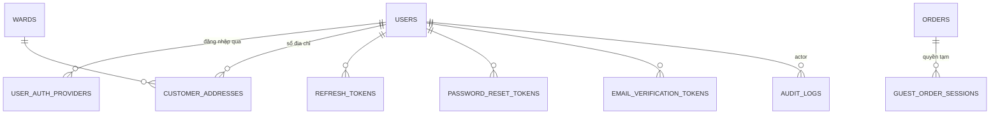
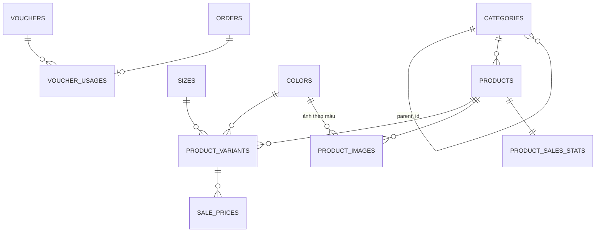
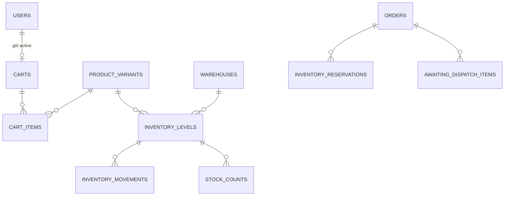
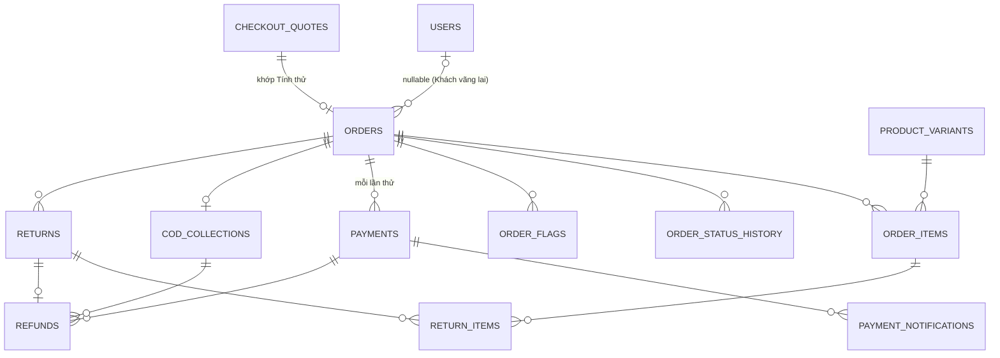
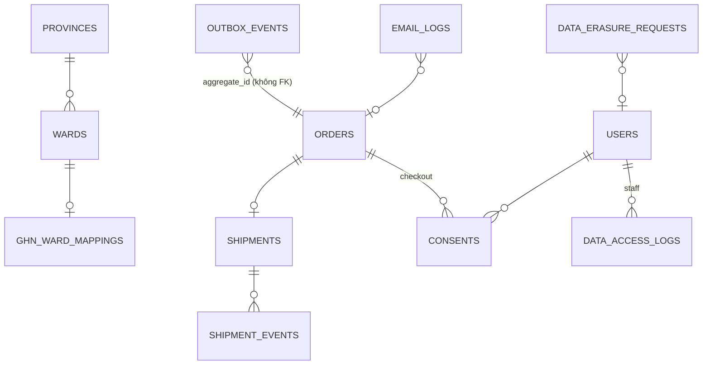

# Thiết kế Database (schema mục tiêu)

> Trạng thái: **Đã chốt cho MVP** ([quy ước](./README.md#trạng-thái-tài-liệu)). Đây là schema **mục tiêu** cho lần tái cấu trúc toàn bộ source, suy ra từ [`business/`](./business/) (nguồn ưu tiên), [`adr/`](./adr/) và [`architecture/`](./architecture/). Không mô tả schema đang migrate. Thuật ngữ theo [GLOSSARY.md](../GLOSSARY.md). Quy tắc nghiệp vụ được **tham chiếu** bằng mã `BR-*`, `US-*`, `CMP-*`, ADR và không chép lại ở đây.

## 1. Tổng quan

PostgreSQL, 49 bảng chia theo module (xem [`architecture/02-modules.md`](./architecture/02-modules.md)). Mỗi bảng chỉ do **một** module ghi.

| Module | Bảng |
|---|---|
| identity | `users`, `user_auth_providers`, `customer_addresses`, `refresh_tokens`, `password_reset_tokens`, `email_verification_tokens`, `guest_order_sessions` |
| catalog | `categories`, `products`, `sizes`, `colors`, `product_variants`, `product_images`, `product_sales_stats` |
| pricing | `sale_prices`, `vouchers`, `voucher_usages` |
| cart | `carts`, `cart_items` |
| inventory | `warehouses`, `inventory_levels`, `inventory_reservations`, `awaiting_dispatch_items`, `inventory_movements`, `stock_counts` |
| ordering | `checkout_quotes`, `orders`, `order_items`, `order_status_history`, `order_flags` |
| payments | `payments`, `payment_notifications`, `cod_collections` |
| refunds-returns | `refunds`, `returns`, `return_items` |
| fulfillment | `provinces`, `wards`, `ghn_ward_mappings`, `shipments`, `shipment_events` |
| notifications | `outbox_events`, `email_logs` |
| compliance | `consents`, `data_erasure_requests`, `data_access_logs` |
| admin-config | `settings` |

---

## 2. Sơ đồ quan hệ

Chỉ vẽ khoá và quan hệ; cột đầy đủ ở mục 4.

### 2.1. Identity

### 2.2. Catalog & pricing

### 2.3. Cart & inventory

### 2.4. Ordering, payments, refunds-returns

### 2.5. Fulfillment, notifications, compliance

---

## 3. Nguyên tắc

### 3.1. Khoá và kiểu

- **PK**: `id uuid` (UUID v7, sinh ở app để có thứ tự thời gian), trừ bảng tra cứu có mã tự nhiên ổn định (`provinces.code`, `wards.code`, `settings.key`) và bảng nối. PK tự có index.
- **Mã hiển thị** tách khỏi PK: `orders.code` (BR-ORD-03), `product_variants.sku` (BR-CAT-03), `vouchers.code` (BR-VCH-09). Không lộ UUID nội bộ làm mã nghiệp vụ.
- **Tiền** là `bigint` VND, số nguyên, `CHECK (>= 0)` hoặc `> 0` theo quy tắc. Không dùng `numeric`/float (BR-CAT-04, BR-VCH-10).
- **Thời gian**: `timestamptz`, lưu UTC; ngày nghiệp vụ (doanh thu) quy đổi sang giờ Việt Nam khi truy vấn (BR-REV-01). Mọi bảng ghi có `created_at`, `updated_at`.
- **Enum**: PostgreSQL enum (Prisma `enum`) cho tập giá trị đóng do code quyết định (trạng thái Đơn, Thanh toán…). Danh sách do Admin quản lý (size, màu) là **bảng**, không phải enum.
- **JSON**: `jsonb` chỉ cho dữ liệu thô từ bên ngoài (`raw_payload`), snapshot không truy vấn theo field, và cấu hình.

### 3.2. Xoá dữ liệu

- Không xoá cứng dữ liệu đã xuất hiện trong đơn: Sản phẩm/Biến thể → `archived` (BR-CAT-09); size/màu → `is_hidden` (BR-CAT-11); Tài khoản Staff → `status = disabled`.
- Xoá dữ liệu cá nhân = **ẩn danh** tại chỗ, không xoá dòng (CMP-05).

### 3.3. FK và `ON DELETE`

| Loại quan hệ | Hành vi | Ví dụ |
|---|---|---|
| Dữ liệu tài chính / lịch sử | `RESTRICT` | `orders.user_id`, `order_items.variant_id`, `payments.order_id`, `refunds.*` |
| Cây và danh mục | `RESTRICT` (ADR 0001) | `products.category_id`, `categories.parent_id` |
| Con thuần tuý, vô nghĩa khi cha mất | `CASCADE` | `cart_items.cart_id`, `refresh_tokens.user_id`, `customer_addresses.user_id` |
| Bảng log tham chiếu mềm | không FK, lưu `aggregate_id` | `outbox_events`, `audit_logs.entity_id` |

PostgreSQL **không** tự tạo index cho FK. Mọi FK đều có index, riêng hoặc là cột dẫn đầu của một composite index.

### 3.4. Index và ràng buộc

- **Composite index cho listing**: đặt theo đúng cột filter + sort, ví dụ `orders(status, created_at DESC)`, `orders(user_id, created_at DESC)`, `products(category_id, status, created_at DESC)`.
- **Partial unique**: viết bằng migration SQL tay nếu Prisma đang dùng chưa hỗ trợ `where` (Preview `partialIndexes` từ v7.4.0). Danh sách ở mục 5.2.
- **CHECK** cho bất biến cục bộ một dòng (số lượng > 0, tồn kho ≥ 0, giá KM < giá bán…). Bất biến **liên dòng** nằm ở service trong transaction có khoá ([04-data-consistency.md](./architecture/04-data-consistency.md)).
- **Tìm kiếm tên không dấu** (BR-CAT-13): cột sinh `products.search_name` = `lower(unaccent(name))` + index `pg_trgm` GIN.

---

## 4. Chi tiết từng bảng

Ký hiệu: **PK**, **FK**, **UK** (unique), **NN** (not null), **IX** (index).

### 4.1. Identity

#### `users`

Một dòng cho mỗi Tài khoản: Khách hàng, Staff hoặc Admin (`business/02` §1). Mỗi email chỉ thuộc một Tài khoản.

| Cột | Kiểu | Ràng buộc | Ghi chú |
|---|---|---|---|
| id | uuid | PK | |
| role | enum `customer`/`staff`/`admin` | NN | ADR 0005. `guest` không có dòng |
| email | citext | UK, NN | so khớp không phân biệt hoa thường (BR-ORD-08) |
| email_verified_at | timestamptz | | |
| password_hash | text | | null nếu chỉ đăng nhập Google |
| full_name | text | NN | |
| phone | text | | |
| locale | enum `vi`/`en` | NN, default `vi` | BR-NTF-02, US-505 |
| status | enum `active`/`disabled` | NN | |
| session_version | int | NN, default 0 | tăng khi vô hiệu hoá/đổi mật khẩu → mọi phiên mất hiệu lực ngay (`business/02` §4, ADR 0005) |
| marketing_opt_in | boolean | NN, default false | CMP-03 (bằng chứng ở `consents`) |
| anonymized_at | timestamptz | | CMP-05 |
| created_at, updated_at | timestamptz | NN | |

#### `user_auth_providers`

| Cột | Kiểu | Ràng buộc | Ghi chú |
|---|---|---|---|
| id | uuid | PK | |
| user_id | uuid | FK → users CASCADE, NN, IX | |
| provider | enum `google` | NN | US-502 |
| provider_subject | text | NN | `sub` của Google |
| created_at | timestamptz | NN | |

UK `(provider, provider_subject)`. Tài khoản nội bộ không được liên kết Google (`business/02` §1).

#### `customer_addresses`

| Cột | Kiểu | Ràng buộc | Ghi chú |
|---|---|---|---|
| id | uuid | PK | |
| user_id | uuid | FK → users CASCADE, NN, IX | US-504 |
| recipient_name, phone | text | NN | |
| province_code | text | FK → provinces, NN | BR-ORD-04 (2 cấp) |
| ward_code | text | FK → wards, NN | |
| street_address | text | NN | |
| is_default | boolean | NN | partial UK `(user_id) WHERE is_default` |
| created_at, updated_at | timestamptz | NN | |

#### `refresh_tokens`, `password_reset_tokens`, `email_verification_tokens`

Cùng khuôn: chỉ lưu **hash** token, không lưu token thô.

| Cột | Kiểu | Ràng buộc | Ghi chú |
|---|---|---|---|
| id | uuid | PK | |
| user_id | uuid | FK → users CASCADE, NN, IX | |
| token_hash | text | UK, NN | |
| expires_at | timestamptz | NN | |
| session_version | int | NN | *(chỉ `refresh_tokens`)* khác `users.session_version` → token vô hiệu |
| revoked_at / used_at / verified_at | timestamptz | | tương ứng từng bảng |
| user_agent, ip_hmac | text | | *(chỉ `refresh_tokens`)* IP dạng HMAC ([05-auth-security.md](./architecture/05-auth-security.md) §8) |
| created_at | timestamptz | NN | |

#### `guest_order_sessions`

Quyền thao tác 30 phút của Khách vãng lai với **một** đơn (`business/02` §2, ADR 0011).

| Cột | Kiểu | Ràng buộc | Ghi chú |
|---|---|---|---|
| id | uuid | PK | |
| order_id | uuid | FK → orders CASCADE, NN, IX | |
| token_hash | text | UK, NN | |
| origin | enum `checkout`/`lookup` | NN | tạo ngay sau đặt đơn hoặc sau tra cứu đúng (US-401) |
| expires_at | timestamptz | NN | +30 phút |
| created_at | timestamptz | NN | |

#### `audit_logs`

Mọi thao tác ghi trên back-office (`business/02` §4).

| Cột | Kiểu | Ràng buộc | Ghi chú |
|---|---|---|---|
| id | uuid | PK | |
| actor_user_id | uuid | FK → users RESTRICT, IX | null nếu là hệ thống |
| action | text | NN | ví dụ `order.cancel`, `inventory.adjust` |
| entity_type, entity_id | text, uuid | NN | IX `(entity_type, entity_id)`, không FK |
| before, after | jsonb | | giá trị trước/sau |
| reason | text | | bắt buộc với huỷ đơn của Staff, điều chỉnh tồn kho |
| request_id | text | | truy vết log |
| created_at | timestamptz | NN, IX | |

### 4.2. Catalog

#### `categories`

| Cột | Kiểu | Ràng buộc | Ghi chú |
|---|---|---|---|
| id | uuid | PK | |
| parent_id | uuid | FK → categories RESTRICT, IX | cây nhiều cấp; ADR 0001 |
| name | text | NN | chỉ tiếng Việt (BR-CAT-10) |
| slug | text | UK, NN | |
| sort_order | int | NN | |
| is_visible | boolean | NN | |
| created_at, updated_at | timestamptz | NN | |

Chống vòng lặp cây (A là cha của B là cha của A) ở service.

#### `products`

| Cột | Kiểu | Ràng buộc | Ghi chú |
|---|---|---|---|
| id | uuid | PK | |
| category_id | uuid | FK → categories RESTRICT, NN | |
| name | text | NN | BR-CAT-10 |
| search_name | text | generated, IX GIN trgm | BR-CAT-13 |
| slug | text | UK, NN | |
| description | text | | |
| weight_grams | int | NN, CHECK > 0 | BR-CAT-06 |
| status | enum `draft`/`active`/`archived` | NN | BR-CAT-07, BR-CAT-09 |
| published_at | timestamptz | | sắp xếp "mới nhất" |
| created_at, updated_at | timestamptz | NN | |

IX `(category_id, status, published_at DESC)`.

#### `sizes`, `colors`

Danh sách dùng chung do Admin quản lý (BR-CAT-11, US-805).

| Cột | Kiểu | Ràng buộc | Ghi chú |
|---|---|---|---|
| id | uuid | PK | |
| code | text | UK, NN | lọc storefront theo mã; size có `FREESIZE` (BR-CAT-02) |
| name | text | NN | |
| hex | char(7) | NN | *(chỉ `colors`)* |
| sort_order | int | NN | *(chỉ `sizes`)* |
| is_hidden | boolean | NN | đã có Biến thể dùng thì chỉ ẩn |

#### `product_variants`

| Cột | Kiểu | Ràng buộc | Ghi chú |
|---|---|---|---|
| id | uuid | PK | |
| product_id | uuid | FK → products RESTRICT, NN | |
| size_id | uuid | FK → sizes RESTRICT, NN | |
| color_id | uuid | FK → colors RESTRICT, NN | |
| sku | text | UK, NN, CHECK `^[A-Z0-9-]+$` | BR-CAT-03; không đổi sau khi đã có đơn |
| price | bigint | NN, CHECK > 0 | Giá bán, BR-CAT-04 |
| status | enum `active`/`archived` | NN | |
| created_at, updated_at | timestamptz | NN | |

UK `(product_id, size_id, color_id)` (BR-CAT-02).

#### `product_images`

| Cột | Kiểu | Ràng buộc | Ghi chú |
|---|---|---|---|
| id | uuid | PK | |
| product_id | uuid | FK → products CASCADE, NN | |
| color_id | uuid | FK → colors RESTRICT, NN | ảnh theo màu (BR-CAT-05) |
| storage_key | text | NN | key object storage, không lưu URL tuyệt đối |
| sort_order | int | NN | |
| is_primary | boolean | NN | partial UK `(product_id, color_id) WHERE is_primary` |

IX `(product_id, color_id, sort_order)`.

#### `product_sales_stats`

Số liệu "bán chạy" cập nhật mỗi đêm (BR-CAT-12).

| Cột | Kiểu | Ràng buộc | Ghi chú |
|---|---|---|---|
| product_id | uuid | PK, FK → products CASCADE | |
| sold_qty_30d | int | NN | |
| computed_at | timestamptz | NN | |

### 4.3. Pricing-promotions

#### `sale_prices`

| Cột | Kiểu | Ràng buộc | Ghi chú |
|---|---|---|---|
| id | uuid | PK | |
| variant_id | uuid | FK → product_variants RESTRICT, NN | |
| price | bigint | NN, CHECK > 0 | < Giá bán (BR-PRC-01, BR-PRC-05) kiểm tra ở service |
| starts_at, ends_at | timestamptz | NN, CHECK ends_at > starts_at | |
| created_by | uuid | FK → users | |

Tối đa một Giá khuyến mãi hiệu lực mỗi thời điểm (BR-PRC-02): exclusion constraint `EXCLUDE USING gist (variant_id WITH =, tstzrange(starts_at, ends_at) WITH &&)` (extension `btree_gist`).

#### `vouchers`

| Cột | Kiểu | Ràng buộc | Ghi chú |
|---|---|---|---|
| id | uuid | PK | |
| code | text | UK, NN, CHECK = upper(code) | BR-VCH-09 |
| type | enum `percent`/`fixed` | NN | BR-VCH-03 |
| value | bigint | NN, CHECK > 0 | % (1–100) hoặc số tiền |
| max_discount | bigint | | chỉ `percent` |
| min_subtotal | bigint | NN, default 0 | BR-VCH-04 |
| total_limit | int | | null = không giới hạn |
| per_buyer_limit | int | | BR-VCH-07 |
| used_count | int | NN, default 0, CHECK ≥ 0 | đếm có khoá dòng ([04-data-consistency.md](./architecture/04-data-consistency.md)) |
| starts_at, ends_at | timestamptz | NN | |
| is_active | boolean | NN | |

#### `voucher_usages`

| Cột | Kiểu | Ràng buộc | Ghi chú |
|---|---|---|---|
| id | uuid | PK | |
| voucher_id | uuid | FK → vouchers RESTRICT, NN | |
| order_id | uuid | FK → orders RESTRICT, UK, NN | tối đa một Voucher mỗi đơn (BR-VCH-01) |
| user_id | uuid | FK → users, IX | |
| phone | text | NN, IX | đếm theo Tài khoản **hoặc** SĐT (BR-VCH-07) |
| discount_amount | bigint | NN | |
| released_at | timestamptz | | trả lượt khi huỷ trước Đang giao (BR-VCH-08) |
| created_at | timestamptz | NN | |

IX `(voucher_id, user_id) WHERE released_at IS NULL`, `(voucher_id, phone) WHERE released_at IS NULL`.

### 4.4. Cart

#### `carts`

| Cột | Kiểu | Ràng buộc | Ghi chú |
|---|---|---|---|
| id | uuid | PK | |
| user_id | uuid | FK → users CASCADE | null với Khách vãng lai (BR-CRT-01, ADR 0011) |
| guest_token_hash | text | UK | cookie Khách vãng lai |
| status | enum `active`/`merged`/`checked_out`/`expired` | NN | |
| last_activity_at | timestamptz | NN, IX | hết hạn 30 ngày (BR-CRT-02) |
| created_at, updated_at | timestamptz | NN | |

CHECK `(user_id IS NOT NULL) <> (guest_token_hash IS NOT NULL)`. Partial UK `(user_id) WHERE status = 'active'`. Khoá dòng khi checkout và gộp giỏ (ADR 0009).

#### `cart_items`

| Cột | Kiểu | Ràng buộc | Ghi chú |
|---|---|---|---|
| id | uuid | PK | |
| cart_id | uuid | FK → carts CASCADE, NN | |
| variant_id | uuid | FK → product_variants RESTRICT, NN | |
| quantity | int | NN, CHECK 1..10 | BR-CRT-05 |
| price_seen | bigint | NN | Giá áp dụng lúc thêm, chỉ để báo giá đổi (BR-CRT-04); **không** dùng để tính tiền |
| created_at, updated_at | timestamptz | NN | |

UK `(cart_id, variant_id)`.

### 4.5. Inventory

#### `warehouses`

MVP có một Kho (BR-INV-01).

| Cột | Kiểu | Ràng buộc | Ghi chú |
|---|---|---|---|
| id | uuid | PK | |
| code | text | UK, NN | |
| name | text | NN | |
| ghn_shop_id | text | | dùng khi tạo Vận đơn |

#### `inventory_levels`

| Cột | Kiểu | Ràng buộc | Ghi chú |
|---|---|---|---|
| id | uuid | PK | |
| variant_id | uuid | FK → product_variants RESTRICT, NN | |
| warehouse_id | uuid | FK → warehouses RESTRICT, NN | |
| on_hand | int | NN, CHECK ≥ 0 | Tồn kho (đã trừ hàng đã bán, ADR 0010) |
| reserved | int | NN, CHECK ≥ 0 | tổng Giữ hàng còn hiệu lực (bộ đếm, đồng bộ với `inventory_reservations`) |
| updated_at | timestamptz | NN | |

UK `(variant_id, warehouse_id)`. CHECK `reserved <= on_hand` → Số lượng bán được = `on_hand − reserved` ≥ 0 (BR-INV-02).

#### `inventory_reservations`

Giữ hàng 15 phút của đơn online (BR-INV-05, ADR 0003).

| Cột | Kiểu | Ràng buộc | Ghi chú |
|---|---|---|---|
| id | uuid | PK | |
| order_id | uuid | FK → orders RESTRICT, NN | |
| variant_id | uuid | FK → product_variants, NN | |
| warehouse_id | uuid | FK → warehouses, NN | |
| quantity | int | NN, CHECK > 0 | |
| status | enum `active`/`converted`/`released`/`expired` | NN | |
| expires_at | timestamptz | NN | |
| resolved_at | timestamptz | | |

Partial UK `(order_id, variant_id) WHERE status = 'active'`. IX `(status, expires_at)` cho job hết hạn.

#### `awaiting_dispatch_items`

Hàng chờ xuất theo Mã đơn (BR-INV-10, ADR 0010).

| Cột | Kiểu | Ràng buộc | Ghi chú |
|---|---|---|---|
| id | uuid | PK | |
| order_id | uuid | FK → orders RESTRICT, NN | |
| variant_id | uuid | FK → product_variants, NN | |
| warehouse_id | uuid | FK → warehouses, NN | |
| quantity | int | NN, CHECK > 0 | |
| created_at | timestamptz | NN | |

UK `(order_id, variant_id)`. Dòng bị **xoá** khi Vận đơn tạo xong hoặc trả về Tồn kho khi huỷ (BR-INV-07). Hàng trên kệ = `on_hand` + tổng dòng ở đây.

#### `inventory_movements`

Sổ biến động, chỉ thêm không sửa (BR-INV-09).

| Cột | Kiểu | Ràng buộc | Ghi chú |
|---|---|---|---|
| id | uuid | PK | |
| inventory_level_id | uuid | FK → inventory_levels RESTRICT, NN | |
| type | enum `receipt`/`adjustment`/`stock_count`/`sale`/`cancel_restock`/`return_restock` | NN | |
| quantity_delta | int | NN, CHECK ≠ 0 | |
| order_id | uuid | FK → orders | |
| return_id | uuid | FK → returns | |
| reason | text | | bắt buộc với điều chỉnh thủ công (`business/02` §4) |
| actor_user_id | uuid | FK → users | |
| created_at | timestamptz | NN | |

IX `(inventory_level_id, created_at DESC)`.

#### `stock_counts`

Kiểm kê (BR-INV-12, US-703).

| Cột | Kiểu | Ràng buộc | Ghi chú |
|---|---|---|---|
| id | uuid | PK | |
| inventory_level_id | uuid | FK → inventory_levels RESTRICT, NN | |
| counted_qty | int | NN, CHECK ≥ 0 | |
| expected_qty | int | NN | Tồn kho + Hàng chờ xuất lúc xác nhận |
| difference | int | NN | |
| movement_id | uuid | FK → inventory_movements | |
| actor_user_id | uuid | FK → users, NN | |
| confirmed_at | timestamptz | NN | |

### 4.6. Ordering

#### `checkout_quotes`

Tính thử có hạn (BR-ORD-07, ADR 0013).

| Cột | Kiểu | Ràng buộc | Ghi chú |
|---|---|---|---|
| id | uuid | PK | |
| cart_id | uuid | FK → carts CASCADE, NN | |
| lines | jsonb | NN | snapshot dòng, giá, Voucher phân bổ |
| subtotal, discount_amount, shipping_fee, total | bigint | NN | |
| voucher_code | text | | |
| shipping_fee_fallback | boolean | NN | BR-SHP-02 |
| fingerprint | text | NN | hash nội dung để so khớp khi đặt đơn |
| expires_at | timestamptz | NN | |
| created_at | timestamptz | NN | |

#### `orders`

| Cột | Kiểu | Ràng buộc | Ghi chú |
|---|---|---|---|
| id | uuid | PK | |
| code | text | UK, NN | `FS<YYMM>-XXXXXX` ngẫu nhiên (BR-ORD-03) |
| user_id | uuid | FK → users RESTRICT, IX | null với Khách vãng lai; gắn sau theo BR-ORD-08 |
| quote_id | uuid | FK → checkout_quotes, UK | |
| status | enum `PENDING_PAYMENT`/`PLACED`/`CONFIRMED`/`PACKING`/`SHIPPING`/`DELIVERED`/`COMPLETED`/`CANCELLED`/`RETURNED_TO_SENDER` | NN | `business/05` §1 |
| payment_method | enum `cod`/`online` | NN | BR-PAY-01 |
| contact_name, contact_phone | text | NN | IX `contact_phone` (tra cứu US-401) |
| contact_email | citext | IX | tuỳ chọn với Khách vãng lai |
| locale | enum `vi`/`en` | NN | BR-NTF-02 |
| shipping_province_code, shipping_ward_code | text | FK → provinces / wards, NN | BR-ORD-04 |
| shipping_street, shipping_recipient, shipping_phone | text | NN | snapshot, không tham chiếu sổ địa chỉ |
| subtotal | bigint | NN | |
| discount_amount | bigint | NN, default 0 | |
| shipping_fee | bigint | NN | 0 nếu miễn phí ship (BR-SHP-03) |
| total | bigint | NN, CHECK > 0 | BR-ORD-01, BR-ORD-09 |
| total_weight_grams | int | NN | |
| invoice_info | jsonb | | tên công ty, MST, địa chỉ, email (`business/06` §3) |
| placed_at, confirmed_at, delivered_at, completed_at, cancelled_at | timestamptz | | |
| cancel_reason | text | | bắt buộc nếu Staff huỷ |
| cancelled_by | enum `buyer`/`staff`/`system` | | |
| anonymized_at | timestamptz | | CMP-05 |
| created_at, updated_at | timestamptz | NN | |

CHECK `total = subtotal - discount_amount + shipping_fee`. IX `(status, created_at DESC)`, `(user_id, created_at DESC)`, `(status, delivered_at)` cho job T13, `(status, created_at) WHERE status = 'PENDING_PAYMENT'` cho job T4.

#### `order_items`

Bản chụp lúc đặt (BR-ORD-02, ADR 0012).

| Cột | Kiểu | Ràng buộc | Ghi chú |
|---|---|---|---|
| id | uuid | PK | |
| order_id | uuid | FK → orders RESTRICT, NN | |
| variant_id | uuid | FK → product_variants RESTRICT, NN | |
| product_name, sku, size_name, color_name | text | NN | snapshot |
| list_price | bigint | NN | Giá bán lúc đặt |
| unit_price | bigint | NN | Giá áp dụng lúc đặt (BR-PRC-03) |
| quantity | int | NN, CHECK > 0 | |
| line_total | bigint | NN | `unit_price × quantity` |
| voucher_discount | bigint | NN, CHECK 0..line_total | phân bổ một lần (BR-ORD-02) |

UK `(order_id, variant_id)`. Mức giảm KM (BR-PRC-04) tính từ `list_price` và `unit_price`, không lưu số đã làm tròn.

#### `order_status_history`

| Cột | Kiểu | Ràng buộc | Ghi chú |
|---|---|---|---|
| id | uuid | PK | |
| order_id | uuid | FK → orders RESTRICT, NN, IX | |
| from_status, to_status | enum trạng thái Đơn | to NN | |
| transition | text | NN | mã T1–T14 (`business/05` §3) |
| actor_type | enum `buyer`/`staff`/`system` | NN | |
| actor_user_id | uuid | FK → users | |
| reason | text | | |
| created_at | timestamptz | NN | |

#### `order_flags`

Cờ cần xử lý cho Staff.

| Cột | Kiểu | Ràng buộc | Ghi chú |
|---|---|---|---|
| id | uuid | PK | |
| order_id | uuid | FK → orders RESTRICT, NN | |
| type | enum `shipping_fee_fallback`/`amount_mismatch`/`unexpected_payment`/`shipment_creation_failed`/`shipment_exception`/`out_of_order_event` | NN | BR-SHP-02, BR-PAY-04, BR-PAY-05, BR-SHP-05, BR-SHP-08 |
| details | jsonb | | |
| resolved_at | timestamptz | | |
| resolved_by | uuid | FK → users | |
| created_at | timestamptz | NN | |

Partial IX `(created_at) WHERE resolved_at IS NULL` cho danh sách cần xử lý.

#### `idempotency_keys`

| Cột | Kiểu | Ràng buộc | Ghi chú |
|---|---|---|---|
| id | uuid | PK | |
| scope | text | NN | ví dụ `checkout.place-order`, `payments.create-link` |
| key | text | NN | header `Idempotency-Key` ([03-api.md](./architecture/03-api.md)) |
| request_hash | text | NN | cùng key khác body → `409` |
| response_status | int | | |
| response_body | jsonb | | |
| expires_at | timestamptz | NN | |
| created_at | timestamptz | NN | |

UK `(scope, key)`.

### 4.7. Payments

#### `payments`

Một dòng cho **mỗi lần thử** thanh toán online (ADR 0004).

| Cột | Kiểu | Ràng buộc | Ghi chú |
|---|---|---|---|
| id | uuid | PK | |
| order_id | uuid | FK → orders RESTRICT, NN, IX | |
| gateway | enum `vnpay`/`momo` | NN | BR-PAY-01 |
| gateway_txn_ref | text | UK, NN | mã gửi Cổng |
| gateway_txn_id | text | | mã giao dịch Cổng trả về |
| amount_requested | bigint | NN | |
| amount_captured | bigint | | BR-PAY-04 |
| status | enum `pending`/`succeeded`/`failed`/`expired` | NN | |
| payment_url_expires_at | timestamptz | NN | phút thứ 10 (BR-INV-05) |
| confirmed_via | enum `ipn`/`reconciliation` | | không bao giờ Return URL (BR-PAY-02) |
| succeeded_at | timestamptz | | |
| created_at, updated_at | timestamptz | NN | |

IX `(status, created_at)` cho job Đối soát 5 phút.

#### `payment_notifications`

| Cột | Kiểu | Ràng buộc | Ghi chú |
|---|---|---|---|
| id | uuid | PK | |
| payment_id | uuid | FK → payments RESTRICT | null nếu không khớp được |
| gateway | enum `vnpay`/`momo` | NN | |
| dedup_key | text | NN | UK `(gateway, dedup_key)` → xử lý một lần (BR-PAY-03) |
| signature_valid | boolean | NN | |
| raw_payload | jsonb | NN | thời hạn lưu chờ chốt (`business/06` §5) |
| processed_at | timestamptz | | |
| received_at | timestamptz | NN | |

#### `cod_collections`

Khoản thu COD (`business/05` T2, T7, T11).

| Cột | Kiểu | Ràng buộc | Ghi chú |
|---|---|---|---|
| id | uuid | PK | |
| order_id | uuid | FK → orders RESTRICT, UK, NN | |
| amount | bigint | NN | = Tổng tiền đơn (BR-SHP-07) |
| status | enum `pending`/`collected`/`cancelled` | NN | |
| collected_at | timestamptz | | |

### 4.8. Refunds-returns

#### `refunds`

ADR 0006. Gắn với đúng **một** nguồn tiền đã nhận (BR-REF-01).

| Cột | Kiểu | Ràng buộc | Ghi chú |
|---|---|---|---|
| id | uuid | PK | |
| order_id | uuid | FK → orders RESTRICT, NN, IX | |
| payment_id | uuid | FK → payments RESTRICT | đơn online |
| cod_collection_id | uuid | FK → cod_collections RESTRICT | đơn COD Đổi trả (BR-REF-04) |
| return_id | uuid | FK → returns RESTRICT | |
| reason | enum `order_cancelled`/`returned_to_sender`/`return_accepted`/`amount_mismatch`/`unexpected_payment` | NN | BR-REF-02 |
| amount | bigint | NN, CHECK > 0 | BR-REF-05, BR-RET-07 |
| status | enum `requested`/`refunded` | NN | |
| gateway_refund_ref | text | | mã giao dịch hoàn, bắt buộc khi `refunded` (BR-REF-03) |
| recorded_by | uuid | FK → users | |
| refunded_at | timestamptz | | |
| created_at | timestamptz | NN | |

CHECK đúng một trong `payment_id`/`cod_collection_id`. UK `(payment_id, reason, return_id)` (NULLS NOT DISTINCT) → một thao tác một yêu cầu (BR-REF-06). Tổng ≤ số thực nhận: kiểm tra ở service ([04-data-consistency.md](./architecture/04-data-consistency.md)).

#### `returns`

Đổi trả do Staff ghi nhận (BR-RET-04).

| Cột | Kiểu | Ràng buộc | Ghi chú |
|---|---|---|---|
| id | uuid | PK | |
| order_id | uuid | FK → orders RESTRICT, NN, IX | |
| status | enum `open`/`accepted`/`rejected` | NN | BR-RET-08 |
| requested_at | timestamptz | NN | trong 7 ngày từ `delivered_at` (BR-RET-01) |
| channel | enum `hotline`/`zalo` | NN | |
| return_shipping_paid_by | enum `store`/`buyer` | | BR-RET-06 |
| notes | text | | gửi lại hàng không chấp nhận (BR-RET-09) |
| created_by, decided_by | uuid | FK → users | |
| decided_at | timestamptz | | |

Partial IX `(order_id) WHERE status = 'open'` để chặn T13.

#### `return_items`

| Cột | Kiểu | Ràng buộc | Ghi chú |
|---|---|---|---|
| id | uuid | PK | |
| return_id | uuid | FK → returns CASCADE, NN | |
| order_item_id | uuid | FK → order_items RESTRICT, NN | |
| quantity_returned | int | NN, CHECK > 0 | |
| quantity_accepted | int | CHECK 0..quantity_returned | BR-RET-08 |
| restock | boolean | | hàng lỗi = false (BR-INV-08) |
| refund_amount | bigint | | BR-RET-07 |

UK `(return_id, order_item_id)`. Tổng `quantity_accepted` qua mọi lần Đổi trả ≤ `order_items.quantity` (service).

### 4.9. Fulfillment

#### `provinces`, `wards`

Đơn vị hành chính 2 cấp sau 07/2025 (BR-ORD-04).

| Cột | Kiểu | Ràng buộc | Ghi chú |
|---|---|---|---|
| code | text | PK | mã hành chính |
| province_code | text | FK → provinces, NN, IX | *(chỉ `wards`)* |
| name | text | NN | |
| is_active | boolean | NN | |

#### `ghn_ward_mappings`

US-1004, [06-integrations.md](./architecture/06-integrations.md) §4.2.

| Cột | Kiểu | Ràng buộc | Ghi chú |
|---|---|---|---|
| ward_code | text | PK, FK → wards | |
| ghn_province_id, ghn_district_id | int | NN | |
| ghn_ward_code | text | NN | |
| verified_by | uuid | FK → users | |
| updated_at | timestamptz | NN | |

#### `shipments`

| Cột | Kiểu | Ràng buộc | Ghi chú |
|---|---|---|---|
| id | uuid | PK | |
| order_id | uuid | FK → orders RESTRICT, UK, NN | bàn giao lại dùng lại Vận đơn (BR-SHP-05) |
| ghn_order_code | text | UK | null tới khi GHN tạo xong |
| status | enum `creating`/`created`/`creation_failed`/`picked`/`delivering`/`delivered`/`returning`/`returned`/`exception`/`cancelled` | NN | |
| cod_amount | bigint | NN | BR-SHP-07 |
| carrier_fee | bigint | | Cước vận chuyển cửa hàng trả (BR-SHP-03) |
| creation_input | jsonb | | thời hạn lưu chờ chốt (`business/06` §5) |
| last_event_at | timestamptz | | sắp thứ tự sự kiện ([07-async-events-jobs.md](./architecture/07-async-events-jobs.md) §1.3) |
| handed_over_by | uuid | FK → users | |
| created_at, updated_at | timestamptz | NN | |

IX `(status, updated_at)` cho Đối soát 15 phút.

#### `shipment_events`

| Cột | Kiểu | Ràng buộc | Ghi chú |
|---|---|---|---|
| id | uuid | PK | |
| shipment_id | uuid | FK → shipments RESTRICT, NN | |
| source | enum `webhook`/`reconciliation` | NN | BR-SHP-06 |
| dedup_key | text | NN | UK `(shipment_id, dedup_key)` |
| ghn_status | text | NN | |
| occurred_at | timestamptz | NN | |
| raw_payload | jsonb | NN | |
| applied_at | timestamptz | | null = đang giữ chờ áp dụng (`business/05` §4.2) |
| attempts | int | NN, default 0 | |

### 4.10. Notifications

#### `outbox_events`

ADR 0003, ADR 0007, [07-async-events-jobs.md](./architecture/07-async-events-jobs.md) §2.

| Cột | Kiểu | Ràng buộc | Ghi chú |
|---|---|---|---|
| id | uuid | PK | |
| type | text | NN | ví dụ `ordering.unexpected-payment-received` |
| aggregate_type, aggregate_id | text, uuid | NN | không FK |
| payload | jsonb | NN | không chứa PII |
| status | enum `pending`/`enqueued`/`done`/`failed` | NN | `done` = downstream ack |
| attempts | int | NN | |
| next_attempt_at | timestamptz | | |
| processed_at | timestamptz | | |
| created_at | timestamptz | NN | |

Partial IX `(next_attempt_at) WHERE status IN ('pending','enqueued')`.

#### `email_logs`

[07-async-events-jobs.md](./architecture/07-async-events-jobs.md) §3.2.

| Cột | Kiểu | Ràng buộc | Ghi chú |
|---|---|---|---|
| id | uuid | PK | |
| outbox_event_id | uuid | FK → outbox_events | |
| order_id | uuid | FK → orders | |
| template | text | NN | |
| locale | enum `vi`/`en` | NN | BR-NTF-02 |
| recipient | citext | | xoá sau 90 ngày |
| amount | bigint | | xoá sau 90 ngày |
| status | enum `sent`/`failed`/`cancelled` | NN | |
| provider_message_id | text | | |
| created_at | timestamptz | NN, IX | |

### 4.11. Compliance

#### `consents`

CMP-01..03.

| Cột | Kiểu | Ràng buộc | Ghi chú |
|---|---|---|---|
| id | uuid | PK | |
| user_id | uuid | FK → users RESTRICT | |
| order_id | uuid | FK → orders RESTRICT | đồng ý lúc checkout của Khách vãng lai |
| purpose | enum `data_processing`/`marketing_email` | NN | |
| granted | boolean | NN | |
| policy_version | text | NN | |
| channel | enum `signup`/`checkout`/`account` | NN | |
| ip_hmac | text | | |
| created_at | timestamptz | NN | |

CHECK ít nhất một trong `user_id`/`order_id`.

#### `data_erasure_requests`

CMP-05, CMP-06, US-1101.

| Cột | Kiểu | Ràng buộc | Ghi chú |
|---|---|---|---|
| id | uuid | PK | |
| user_id | uuid | FK → users RESTRICT | null với đơn vãng lai |
| guest_phone, guest_order_code | text | | yêu cầu riêng cho đơn vãng lai |
| status | enum `received`/`verified`/`processing`/`completed`/`rejected` | NN | |
| steps | jsonb | NN | trạng thái từng bước ẩn danh |
| verified_by | uuid | FK → users | |
| received_at | timestamptz | NN | |
| completed_at | timestamptz | | chỉ khi mọi bước thành công |

#### `data_access_logs`

CMP-07, US-1102.

| Cột | Kiểu | Ràng buộc | Ghi chú |
|---|---|---|---|
| id | uuid | PK | |
| staff_user_id | uuid | FK → users RESTRICT, NN | |
| action | enum `view_customer`/`view_order`/`search_by_phone` | NN | |
| subject_user_id | uuid | FK → users | |
| order_id | uuid | FK → orders | |
| query_hmac | text | | SĐT tìm kiếm, không lưu thô |
| created_at | timestamptz | NN, IX | |

### 4.12. Admin-config

#### `settings`

US-1002. Giá trị cấu hình được: hạn mức COD (BR-PAY-06), Phí ship dự phòng, ngưỡng miễn phí ship (BR-SHP-04), kích thước gói mặc định (BR-SHP-01). Các thời hạn cố định (15/10/7 phút, 7 ngày) **không** nằm ở đây (BR-INV-05).

| Cột | Kiểu | Ràng buộc | Ghi chú |
|---|---|---|---|
| key | text | PK | ví dụ `cod.max_order_total` |
| value | jsonb | NN | |
| updated_by | uuid | FK → users | |
| updated_at | timestamptz | NN | thay đổi ghi `audit_logs` |

---

## 5. Ràng buộc toàn vẹn & concurrency

Chi tiết cơ chế (transaction, khoá, thứ tự khoá, cuộc đua thanh toán–hết hạn) ở [`architecture/04-data-consistency.md`](./architecture/04-data-consistency.md). Tóm tắt những gì database tự đảm bảo:

### 5.1. CHECK

- `inventory_levels`: `on_hand >= 0`, `reserved >= 0`, `reserved <= on_hand`.
- `cart_items.quantity BETWEEN 1 AND 10`; số lượng ở mọi bảng dòng `> 0`.
- `orders.total > 0` và `total = subtotal - discount_amount + shipping_fee`.
- `order_items.voucher_discount BETWEEN 0 AND line_total`.
- `carts`: đúng một trong `user_id`/`guest_token_hash`; `refunds`: đúng một nguồn tiền.

### 5.2. Unique một phần và exclusion

| Ràng buộc | Mục đích |
|---|---|
| `carts(user_id) WHERE status = 'active'` | một giỏ active mỗi Tài khoản |
| `product_images(product_id, color_id) WHERE is_primary` | một ảnh chính mỗi màu |
| `customer_addresses(user_id) WHERE is_default` | một địa chỉ mặc định |
| `inventory_reservations(order_id, variant_id) WHERE status = 'active'` | không giữ trùng |
| `sale_prices` EXCLUDE theo khoảng thời gian | BR-PRC-02 |
| `payment_notifications(gateway, dedup_key)`, `shipment_events(shipment_id, dedup_key)` | xử lý thông báo một lần (BR-PAY-03) |
| `idempotency_keys(scope, key)` | retry không tạo đơn/link trùng |

### 5.3. Bất biến kiểm tra ở service (trong transaction có khoá)

Tổng Hoàn tiền ≤ số thực nhận (BR-REF-06); lượt Voucher (BR-VCH-04, BR-VCH-07); Giá khuyến mãi < Giá bán (BR-PRC-05); chuyển trạng thái Đơn hợp lệ (`business/05` §3); điều chỉnh giảm Tồn kho ≤ Số lượng bán được (BR-INV-11); chống vòng lặp cây Danh mục.

---

## 6. Retention & cleanup

Thời hạn theo [`business/06-compliance.md`](./business/06-compliance.md) §5; job ở [`architecture/07-async-events-jobs.md`](./architecture/07-async-events-jobs.md) §4.

| Bảng | Xử lý |
|---|---|
| `outbox_events` | xoá dòng `done` sau 90 ngày |
| `email_logs` | sau 90 ngày đặt `recipient`, `amount` = null, giữ dòng |
| `refresh_tokens`, `password_reset_tokens`, `email_verification_tokens`, `guest_order_sessions` | xoá dòng hết hạn/đã dùng (job định kỳ) |
| `checkout_quotes` | xoá dòng hết hạn không gắn đơn |
| `idempotency_keys` | xoá sau `expires_at` |
| `carts` | `expired` sau 30 ngày không hoạt động (BR-CRT-02), xoá sau đó |
| `payment_notifications.raw_payload`, `shipments.creation_input`, địa chỉ trên `orders` | **[Cần xác minh trước go-live]**, chỉ ẩn danh khi có Yêu cầu xoá dữ liệu |
| `users`, `orders`, `customer_addresses`, `consents` | ẩn danh theo CMP-05, không xoá dòng |
