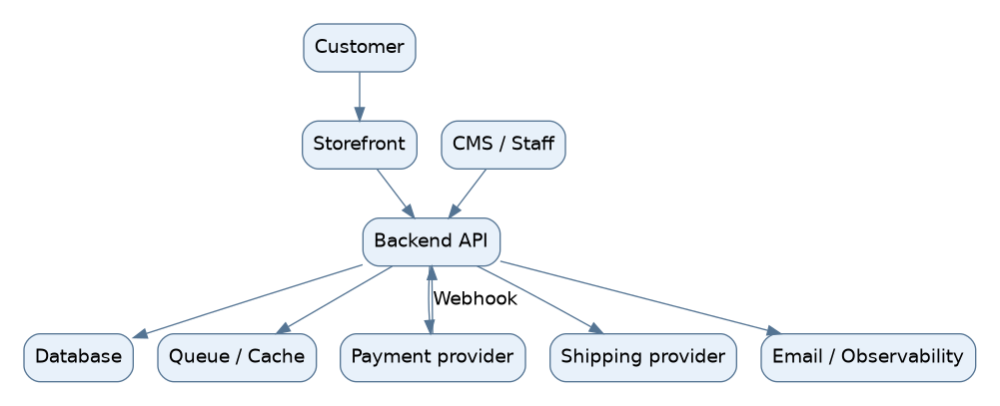

# Chiến lược kiểm thử thương mại điện tử

**Trạng thái:** Nháp (tài liệu tham khảo).

[Mã Mermaid](diagrams/architecture.mmd) · [SVG](diagrams/architecture.svg)

## Phạm vi và giả định

B2C bán hàng vật lý, có biến thể SKU, kho, thanh toán online/COD, vận chuyển, khách hàng và nhân viên. Marketplace, đa kho, đa tiền tệ, subscription là mở rộng tùy dự án. Quy tắc thuế, hoàn tiền, giữ kho, guest checkout và trạng thái phải được BA xác nhận; không coi ví dụ là đặc tả bắt buộc.

| Ưu tiên | Rủi ro                                           | Bằng chứng cần có                                        |
| ------- | ------------------------------------------------ | -------------------------------------------------------- |
| P0      | Mất tiền, sai giá, mất đơn, vượt tồn, lộ dữ liệu | Unit + real integration + API + critical E2E theo rủi ro |
| P1      | Sai voucher, vận chuyển, CMS, tìm kiếm           | Integration, component, API, E2E chọn lọc                |
| P2      | Hiển thị, nội dung, UX ít nghiêm trọng           | Component, visual, exploratory                           |
| P3      | Nội dung tĩnh ít rủi ro                          | Smoke hoặc review                                        |

Mỗi requirement có ID, risk, expected result, tầng test, owner và evidence. Chọn tầng thấp nhất phát hiện lỗi đáng tin cậy; FE validation không thay thế BE. Không test mọi biến thể ở E2E. Test trước khi code nếu khả thi, review assertion, chạy CI, học từ production. Coverage không chứng minh correctness.

## Invariants xuyên module

- Tổng tiền do server tính từ snapshot hợp lệ; dùng decimal hoặc minor units, quy tắc làm tròn rõ ràng.
- Không bán vượt tồn theo chính sách; reservation, release, fulfillment không làm lệch ledger.
- Một ý định checkout không tạo nhiều đơn/charge ngoài chủ đích; idempotency có scope và payload binding.
- Chỉ xác nhận thanh toán từ bằng chứng đáng tin cậy; callback trình duyệt không đủ.
- Người dùng chỉ truy cập dữ liệu được phép; CMS có audit trail.
- Không mất dữ liệu khi lỗi giữa DB và external service; reconciliation/compensation có thể tái chạy.
