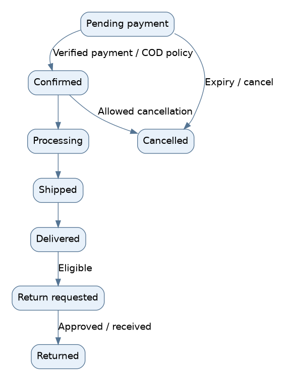

# Checkout và đơn hàng

**Trạng thái:** Nháp (tài liệu tham khảo).

[Mã Mermaid](diagrams/order-state.mmd) · [SVG](diagrams/order-state.svg)

## Test inventory

Mỗi dòng là một scenario cần xác định expected result theo policy đã duyệt, không phải yêu cầu chạy ở mọi tầng.

| ID          | Scenario                          | Tầng ưu tiên    | Risk |
| ----------- | --------------------------------- | --------------- | ---- |
| CHECKOUT-01 | Giỏ rỗng                          | Integration/API | P0   |
| CHECKOUT-02 | địa chỉ thiếu                     | Integration/API | P0   |
| CHECKOUT-03 | phí ship đổi                      | Integration/API | P0   |
| CHECKOUT-04 | voucher hết hạn                   | Integration/API | P0   |
| CHECKOUT-05 | server tính lại tổng              | Integration/API | P0   |
| CHECKOUT-06 | double submit                     | Integration/API | P0   |
| CHECKOUT-07 | cùng idempotency key khác payload | Integration/API | P0   |
| CHECKOUT-08 | rollback giữa các bước DB         | Integration/API | P0   |
| CHECKOUT-09 | timeout sau commit                | Integration/API | P0   |
| CHECKOUT-10 | snapshot giá/SKU/địa chỉ          | Integration/API | P0   |
| CHECKOUT-11 | chuyển trạng thái sai             | Integration/API | P0   |
| CHECKOUT-12 | hủy đơn đúng policy               | Integration/API | P0   |
| CHECKOUT-13 | COD                               | Integration/API | P0   |
| CHECKOUT-14 | đơn người khác                    | Integration/API | P0   |
| CHECKOUT-15 | outbox event không mất            | Integration/API | P0   |

## Checklist review

- [ ] Happy path, negative, boundary và state transition phù hợp.
- [ ] Expected result xác định độc lập với implementation.
- [ ] API kiểm tra status, error code, response schema và quyền truy cập.
- [ ] Integration xác minh dữ liệu thực, side effects và không có thay đổi ngoài ý muốn.
- [ ] Test data độc lập, clock kiểm soát được, không dùng dữ liệu khách thật.
- [ ] Retry, concurrency, timeout được kiểm tra nếu có rủi ro.
- [ ] FE kiểm tra loading/error/empty/success nếu có UI.
- [ ] E2E chỉ giữ hành trình quan trọng và failure/recovery có giá trị.
- [ ] Traceability và bằng chứng thực thi được ghi nhận.
