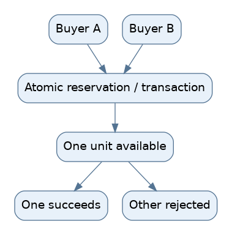

# Tồn kho

**Trạng thái:** Nháp (tài liệu tham khảo).

[Mã Mermaid](diagrams/inventory-race.mmd) · [SVG](diagrams/inventory-race.svg)

## Test inventory

Mỗi dòng là một scenario cần xác định expected result theo policy đã duyệt, không phải yêu cầu chạy ở mọi tầng.

| ID           | Scenario                         | Tầng ưu tiên    | Risk |
| ------------ | -------------------------------- | --------------- | ---- |
| INVENTORY-01 | SKU cuối cùng có hai người mua   | Integration/API | P0   |
| INVENTORY-02 | reservation hết hạn              | Integration/API | P0   |
| INVENTORY-03 | release lặp                      | Integration/API | P0   |
| INVENTORY-04 | fulfillment lặp                  | Integration/API | P0   |
| INVENTORY-05 | điều chỉnh kho đồng thời         | Integration/API | P0   |
| INVENTORY-06 | rollback khi tạo đơn lỗi         | Integration/API | P0   |
| INVENTORY-07 | tồn không âm                     | Integration/API | P0   |
| INVENTORY-08 | stock ledger khớp                | Integration/API | P0   |
| INVENTORY-09 | cache stale                      | Integration/API | P0   |
| INVENTORY-10 | trả hàng chỉ restock theo policy | Integration/API | P0   |
| INVENTORY-11 | worker restart                   | Integration/API | P0   |
| INVENTORY-12 | deadlock retry                   | Integration/API | P0   |

## Checklist review

- [ ] Happy path, negative, boundary và state transition phù hợp.
- [ ] Expected result xác định độc lập với implementation.
- [ ] API kiểm tra status, error code, response schema và quyền truy cập.
- [ ] Integration xác minh dữ liệu thực, side effects và không có thay đổi ngoài ý muốn.
- [ ] Test data độc lập, clock kiểm soát được, không dùng dữ liệu khách thật.
- [ ] Retry, concurrency, timeout được kiểm tra nếu có rủi ro.
- [ ] FE kiểm tra loading/error/empty/success nếu có UI.
- [ ] E2E chỉ giữ hành trình quan trọng và failure/recovery có giá trị.
- [ ] Traceability và bằng chứng thực thi được ghi nhận.
