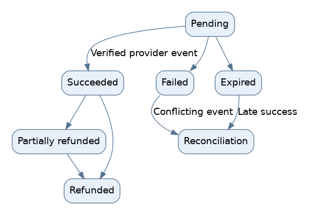

# Thanh toán và hoàn tiền

[Mã Mermaid](diagrams/payment-state.mmd) · [SVG](diagrams/payment-state.svg)

## Test inventory

Mỗi dòng là một scenario cần xác định expected result theo policy đã duyệt, không phải yêu cầu chạy ở mọi tầng.

| ID         | Scenario                        | Tầng ưu tiên    | Risk |
| ---------- | ------------------------------- | --------------- | ---- |
| PAYMENT-01 | Chữ ký webhook sai              | Integration/API | P0   |
| PAYMENT-02 | amount/currency/order mismatch  | Integration/API | P0   |
| PAYMENT-03 | callback browser giả            | Integration/API | P0   |
| PAYMENT-04 | webhook trùng                   | Integration/API | P0   |
| PAYMENT-05 | event đến sai thứ tự            | Integration/API | P0   |
| PAYMENT-06 | timeout provider                | Integration/API | P0   |
| PAYMENT-07 | retry không double charge       | Integration/API | P0   |
| PAYMENT-08 | payment success sau expiry      | Integration/API | P0   |
| PAYMENT-09 | thất bại không đánh dấu paid    | Integration/API | P0   |
| PAYMENT-10 | partial refund                  | Integration/API | P0   |
| PAYMENT-11 | refund vượt số đã thu           | Integration/API | P0   |
| PAYMENT-12 | refund trùng                    | Integration/API | P0   |
| PAYMENT-13 | reconciliation lệch             | Integration/API | P0   |
| PAYMENT-14 | log không chứa secret/card data | Integration/API | P0   |

## Checklist review

- [ ] Happy path, negative, boundary và state transition phù hợp.
- [ ] Expected result xác định độc lập với implementation.
- [ ] API kiểm tra status, error code, response schema và quyền truy cập.
- [ ] Integration xác minh dữ liệu thực, side effects và không có thay đổi ngoài ý muốn.
- [ ] Test data độc lập, clock kiểm soát được, không dùng dữ liệu khách thật.
- [ ] Retry, concurrency, timeout được kiểm tra nếu có rủi ro.
- [ ] FE kiểm tra loading/error/empty/success nếu có UI.
- [ ] E2E chỉ giữ hành trình quan trọng và failure/recovery có giá trị.
- [ ] Traceability và bằng chứng thực thi được ghi nhận.
