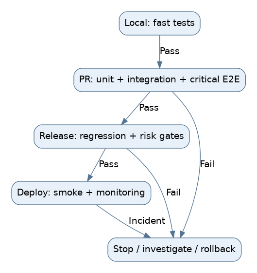

# Quality gates, audit và tối ưu

**Trạng thái:** Nháp (tài liệu tham khảo).

[Mã Mermaid](diagrams/ci-gates.mmd) · [SVG](diagrams/ci-gates.svg)

| Dimension            | Weight |
| -------------------- | -----: |
| Requirement coverage |     10 |
| Risk coverage        |     10 |
| Fault detection      |     12 |
| Assertion quality    |     10 |
| Test design          |      8 |
| Architecture         |      6 |
| Code coverage        |      4 |
| Integration fidelity |      8 |
| Reliability          |      7 |
| Maintainability      |      5 |
| Efficiency           |      5 |
| Non-functional       |      5 |
| Test data            |      3 |
| CI/CD                |      4 |
| Production feedback  |      3 |

Chấm 0–5 theo evidence: 0 chưa có, 1 ad hoc, 2 basic, 3 defined, 4 managed, 5 optimized. Score = sum(weight × rating/5) / sum(applicable weights) × 100. Unknown không phải N/A; báo điểm chưa hoàn chỉnh. Ngưỡng tham khảo 90 excellent, 80 very good, 70 good; không phải chuẩn ngành.

## Gates không thể bù bằng điểm

- [ ] Known critical business rules/risk có test và PASS.
- [ ] Không có lỗi nghiêm trọng đã biết về tiền, tồn kho, quyền, dữ liệu.
- [ ] Payment/stock/order reconciliation và retry được kiểm tra.
- [ ] Critical E2E ổn định, migration/rollback plan được xác minh khi áp dụng.
- [ ] Không bypass gate; evidence có commit, môi trường, thời điểm.

## Anti over-testing

Không lặp mọi voucher boundary ở UI, API và E2E. Unit kiểm tra công thức, API kiểm tra enforcement, integration kiểm tra quota concurrent, E2E kiểm tra một hành trình. Giữ regression nếu risk còn. Xóa/hợp nhất chỉ khi chứng minh coverage rủi ro không giảm. Theo dõi mutation score, branch coverage, known requirement/risk coverage, flaky rate, CI duration, escaped defects, maintenance effort. Ngưỡng coverage 80–95% và mutation 75–90% chỉ là tham khảo, không bắt buộc. Critical known risk hướng tới 100%.

Local: fast tests. PR: unit, integration, API, contract, critical E2E. Nightly: extended E2E, browser matrix, mutation, property-based. Release: migration, load, security, recovery theo risk. Post-deploy: safe smoke và observability. Không trì hoãn critical gate chỉ để CI nhanh.
