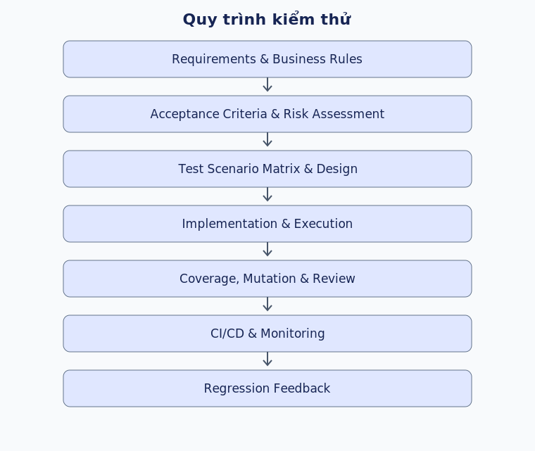

# Testing Strategy

## Vì sao coverage 100% vẫn có bug?

Coverage đo code được thực thi (statement, line, function, branch), không đo đầy đủ input, yêu cầu, assertion hay mọi tổ hợp trạng thái. E2E pass toàn bộ kịch bản đã viết không có nghĩa là mọi hành vi đã được kiểm tra.

| Rủi ro                     | Ví dụ                                           |
| -------------------------- | ----------------------------------------------- |
| Business logic / edge case | Giảm giá 150% tạo giá âm                        |
| Race condition             | Hai khách mua sản phẩm cuối cùng                |
| Environment / deployment   | Sai biến môi trường, version, migration         |
| Third-party / network      | Payment timeout, webhook trùng                  |
| Database                   | Deadlock, rollback, constraint                  |
| Performance                | Quá tải, connection pool                        |
| Security                   | IDOR, XSS, SQL injection                        |
| Test quality / data        | Assertion yếu, mock sai, dữ liệu không đại diện |

## Mục tiêu

Correctness, reliability, maintainability, risk coverage, fast feedback. FIRST: Fast, Independent, Repeatable, Self-validating, Timely.

## Quy trình

Requirement → Business Rules → Acceptance Criteria → Risk Assessment → Test Scenario Matrix → Test Design → Implementation → Execution → Coverage/Mutation → Review → CI/CD → Monitoring → Regression.

## Risk-based testing

P0: Payment, Order, Inventory, Auth/Permission. P1: Promotion, Cart, Shipping. P2: Product, Category, Review. P3: Static UI. Đánh giá lại xác suất và tác động theo dự án, ưu tiên mất tiền, mất dữ liệu, lộ dữ liệu.

## Lộ trình

1. Strategy, standards, risk matrix.
2. Unit, factory, fixture, coverage.
3. Integration, Testcontainers, API.
4. E2E, contract, visual, accessibility.
5. Mutation, concurrency, security, performance.
6. CI/CD, monitoring, regression feedback.

## Nguyên tắc áp dụng chung

Test chất lượng cao phát hiện hành vi sai, không chỉ thực thi code. Correctness: kiểm tra đúng yêu cầu; Reliability: kết quả nhất quán; Maintainability: dễ đọc và sửa; Risk coverage: ưu tiên hậu quả nghiêm trọng; Fast feedback: phản hồi sớm. Production-ready không có nghĩa là không có bug: giảm xác suất, phát hiện sớm, giảm phạm vi ảnh hưởng, khôi phục nhanh. Phân biệt code coverage, requirement coverage, risk coverage, test quality, observability, resilience và recovery.

Risk matrix: đánh giá xác suất thấp/trung bình/cao và tác động thấp/trung bình/cao; rủi ro cao nhất được ưu tiên. Các module thương mại điện tử ở trên chỉ là ví dụ; với hệ thống khác, ưu tiên tính toàn vẹn, an toàn, bảo mật, tính sẵn sàng và yêu cầu pháp lý tương ứng.

## Sơ đồ minh họa: Quy trình kiểm thử

[Mã Mermaid](diagrams/strategy-workflow.mmd) · [SVG](diagrams/strategy-workflow.svg)
