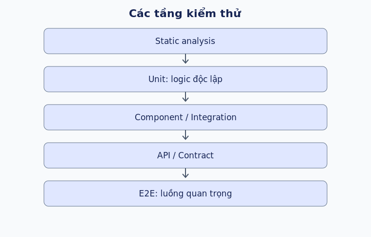

# Testing Architecture

| Layer                   | Mục đích                        | Công cụ                     |
| ----------------------- | ------------------------------- | --------------------------- |
| Unit                    | Logic độc lập                   | Jest/Vitest                 |
| Component               | Hành vi UI                      | Testing Library             |
| Integration             | Module, DB, cache, queue thật   | Jest, Testcontainers        |
| API                     | HTTP, validation, auth          | Supertest, Playwright API   |
| Contract                | Tương thích FE/BE, provider     | Pact                        |
| E2E                     | Critical user journeys          | Playwright                  |
| Visual                  | Regression giao diện            | Playwright, Chromatic       |
| Accessibility           | Keyboard, accessible name       | axe                         |
| Property-based          | Invariants                      | fast-check                  |
| Mutation                | Khả năng phát hiện thay đổi sai | StrykerJS                   |
| Load/stress/concurrency | Tải và xử lý đồng thời          | k6, Artillery, custom tests |
| Security                | Lỗ hổng                         | OWASP ZAP                   |
| Smoke                   | Kiểm tra sau deploy             | Playwright                  |
| Chaos                   | Khả năng phục hồi               | Chaos Mesh khi phù hợp      |

Testing pyramid: nhiều unit, ít integration hơn, ít E2E nhất; 70/20/10 chỉ là ví dụ tỷ lệ số test, không phải coverage. Chọn tầng thấp nhất có thể phát hiện lỗi đáng tin cậy; không lặp test vô ích.

## Project tree đề xuất

```text
backend/
  src/modules/orders/domain/order.entity.spec.ts
  src/modules/orders/application/order.service.spec.ts
  test/
    integration/{orders,payments,inventory}/
    api/ contract/ concurrency/ security/ performance/
    fixtures/ factories/ builders/ helpers/ setup/
  jest.config.ts
  jest.integration.config.ts
  stryker.config.json
frontend/
  src/features/{cart,checkout,auth}/__tests__/
  tests/
    integration/ e2e/ visual/ accessibility/
    fixtures/ factories/ mocks/ page-objects/
  vitest.config.ts
  playwright.config.ts
```

Unit: mock dependency ở boundary, không mock logic đang test. Integration: PostgreSQL, Redis/Valkey, repository thật; Mailpit cho email; payment sandbox hoặc stub theo contract. Testcontainers tạo môi trường cô lập; dùng migration thật và cleanup. Không dùng production database. Kiểm tra mock với contract thật.

## Kiến trúc độc lập công nghệ

```text
project/
  src/                 # production code
  tests/
    unit/ component/ integration/ system/ acceptance/
    contract/ end-to-end/ regression/ smoke/
    concurrency/ security/ performance/ resilience/
    fixtures/ factories/ builders/ helpers/ setup/
  docs/testing/
  ci/
```

Có thể đặt unit test cạnh source. API test là kiểm tra qua interface, có thể thuộc integration hoặc system. Không bắt buộc có UI, HTTP, SQL hay microservices. Dùng dependency thật tương ứng với production khi cần xác minh tích hợp.

| Hệ sinh thái | Ví dụ công cụ (không bắt buộc)                      |
| ------------ | --------------------------------------------------- |
| Python       | pytest, unittest, Hypothesis                        |
| Java/JVM     | JUnit, jqwik, PIT                                   |
| .NET         | xUnit, NUnit, FsCheck, Stryker.NET                  |
| Go           | testing, fuzzing tích hợp                           |
| Rust         | cargo test, proptest                                |
| C/C++        | GoogleTest, Catch2, sanitizers                      |
| Mobile       | XCTest, Espresso, Appium                            |
| Đa nền tảng  | Testcontainers, Pact, k6, OWASP ZAP khi tương thích |

Chọn công cụ theo hệ thống, khả năng tái hiện lỗi, chi phí bảo trì và môi trường CI.

## Sơ đồ minh họa: Các tầng kiểm thử



[Mã Mermaid](diagrams/testing-layers.mmd) · [SVG](diagrams/testing-layers.svg)
