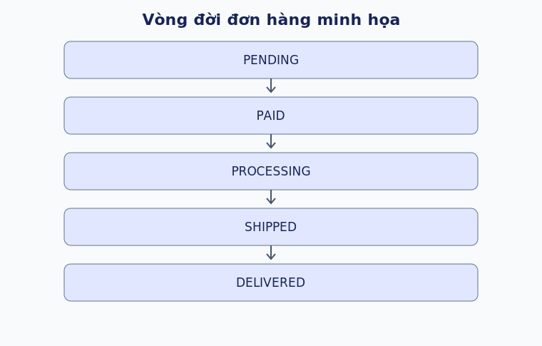

# Test Design Techniques

| Kỹ thuật              | Cách áp dụng                                                               |
| --------------------- | -------------------------------------------------------------------------- |
| Happy path            | Checkout hợp lệ                                                            |
| Negative              | Token hết hạn, giỏ rỗng, thiếu stock                                       |
| Boundary value        | Quantity 1–100: 0,1,2,99,100,101                                           |
| Equivalence partition | Âm, 0, hợp lệ, quá giới hạn, decimal, null, sai kiểu                       |
| Edge case             | Unicode, timezone, dữ liệu trùng                                           |
| Decision table        | Tổ hợp login, stock, voucher                                               |
| State transition      | PENDING → PAID → PROCESSING → SHIPPED → DELIVERED; cấm CANCELLED → SHIPPED |
| Pairwise              | Tổ hợp tham số theo cặp, không thay thế tổ hợp critical                    |
| Property-based        | Stock không âm, tổng tiền đúng                                             |
| Error guessing        | Double submit, retry                                                       |
| Exploratory           | Khám phá tình huống chưa biết                                              |
| Regression            | Tái hiện bug đã sửa                                                        |
| Concurrency           | Hai request tranh stock cuối                                               |
| Fault injection       | DB/cache/network/payment lỗi; kiểm tra rollback, retry, recovery           |

## Decision table minh họa

| Login | Stock  | Voucher | Kết quả                   |
| ----- | ------ | ------- | ------------------------- |
| Không | Bất kỳ | Bất kỳ  | 401                       |
| Có    | Thiếu  | Bất kỳ  | Từ chối order             |
| Có    | Đủ     | Sai     | Từ chối voucher theo spec |
| Có    | Đủ     | Đúng    | Tạo order                 |

Xác định expected result từ spec trước khi viết code. Kiểm tra hành vi được phép và bị cấm. Vòng đời order/payment thực tế cần tách trạng thái theo nghiệp vụ, sơ đồ trên chỉ minh họa.

## Sơ đồ minh họa: Vòng đời đơn hàng minh họa

[Mã Mermaid](diagrams/state-transition.mmd) · [SVG](diagrams/state-transition.svg)
