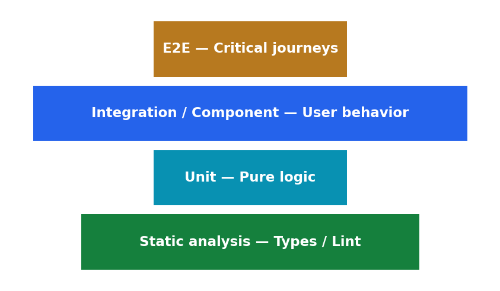
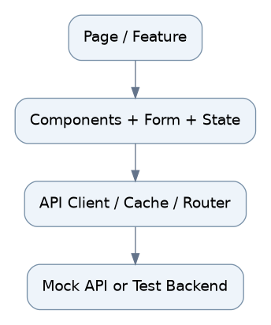

# Frontend Testing

**Trạng thái:** Nháp (tài liệu tham khảo).

FE bảo vệ hành vi người dùng, UI, state và trải nghiệm. BE bảo vệ nghiệp vụ, dữ liệu, API, bảo mật, đồng thời và phục hồi. Full-stack bảo vệ tích hợp và hành trình hoàn chỉnh. Áp dụng độc lập công nghệ.

## FE: ưu tiên và kiến trúc

P0: component, integration, unit, critical E2E, security. P1: accessibility, visual regression, contract, cross-browser, performance. P2: mutation, property-based (nâng ưu tiên nếu rủi ro cao). Testing Trophy: static analysis (lint/types) → unit (pure logic) → component/integration (trọng tâm) → E2E (critical journeys). Không có tỷ lệ bắt buộc.

## FE Unit checklist

- [ ] Utility/helper functions; data transformation; business calculations.
- [ ] Form validation schema; date/currency/number formatting.
- [ ] Hooks/composables có logic; reducers/state transitions.
- [ ] Client permission logic; sorting/filtering/pagination.
- [ ] URL query parameters; API response mapping; error transformation; cache keys.

Không test getter/setter/constant/wrapper hoặc UI tĩnh chỉ để tăng coverage.

## FE Component checklist

- [ ] Render đúng dữ liệu; loading, empty, error, success.
- [ ] Click, hover, focus, keyboard; nhập liệu và validation.
- [ ] Submit thành công/thất bại; disabled; double click/submit.
- [ ] Conditional rendering; callback/event quan trọng.
- [ ] Null/undefined; nội dung dài, ký tự đặc biệt.
- [ ] Accessibility; cập nhật khi input đổi; cleanup subscription/listener.

### Login form example

| Case                     | Expected                            |
| ------------------------ | ----------------------------------- |
| Email rỗng/sai định dạng | Validation error tương ứng          |
| Password rỗng            | Required error                      |
| Dữ liệu hợp lệ           | Gửi request                         |
| Pending                  | Loading                             |
| Click liên tục           | Không gửi trùng ngoài ý muốn        |
| 401/500/timeout          | Lỗi phù hợp, phục hồi theo thiết kế |
| Thành công               | Điều hướng đúng                     |
| Enter/Tab                | Submit/focus đúng thứ tự            |

## FE Integration checklist

Page/feature → components/form/state → API client/cache/router → mock API theo contract hoặc test backend.

- [ ] Page gọi đúng API theo hành vi; response hiển thị chính xác.
- [ ] Form kết hợp validation và submission.
- [ ] Global state cập nhật; đồng bộ nhiều component.
- [ ] Cache invalidation; optimistic update và rollback.
- [ ] Search debounce; filter/sort/pagination; URL đồng bộ filter.
- [ ] Routing/navigation; auth state; protected routes.
- [ ] Request cũ không ghi đè mới; timeout/network failure.
- [ ] Session hết hạn; stale data/refetch.

## FE E2E

Critical journeys: register/login/logout/reset password; protected pages/roles; CRUD; routing/redirect/deep link; search/filter/sort/pagination; form submission; upload/download/export; checkout/payment/order; expired/refresh session; retry/network/server error.

- [ ] Hành vi thực tế; locator role/label/test ID ổn định, tránh CSS dễ đổi.
- [ ] Không hard-coded sleep; dữ liệu cô lập; không phụ thuộc thứ tự.
- [ ] Kiểm tra kết quả nghiệp vụ cuối cùng, không chỉ URL/toast.
- [ ] Screenshot/video/trace khi fail; kịch bản thất bại và phục hồi.
- [ ] Browser thật; critical full-stack E2E dùng backend/database test thật.

## FE bổ sung

Visual: layout, spacing, font, màu, responsive. Accessibility: keyboard, focus, ARIA, contrast, screen reader. Cross-browser: Chrome/Firefox/Safari/Edge theo phạm vi. Responsive: mobile/tablet/desktop. Performance: LCP, INP, CLS, bundle, memory. Security: XSS, unsafe rendering, token leakage. SSR: rendering/hydration. I18n: locale/timezone/currency/translation. Contract: schema/types/compatibility.

Công cụ minh họa: Jest/Vitest; React Testing Library; Vue Testing Library/Vue Test Utils; Angular TestBed; MSW; Playwright/Cypress; Chromatic/Percy; axe-core/Pa11y; Lighthouse/WebPageTest; StrykerJS; fast-check; Pact.

## Definition of Done

BE: [ ] requirements/rules; [ ] domain unit; [ ] real integration; [ ] API happy/negative; [ ] boundary/edge; [ ] constraints/integrity; [ ] transaction/rollback; [ ] concurrency; [ ] idempotency; [ ] auth; [ ] security; [ ] timeout/retry/recovery; [ ] contract; [ ] mutation khi phù hợp; [ ] SLO; [ ] coverage; [ ] CI gates; [ ] monitoring/regression.

### Frontend Testing Trophy

[SVG](diagrams/01-frontend-testing-trophy.svg) · [Mermaid source](diagrams/01-frontend-testing-trophy.mmd)

### Frontend Integration

[SVG](diagrams/03-frontend-integration.svg) · [Mermaid source](diagrams/03-frontend-integration.mmd)
