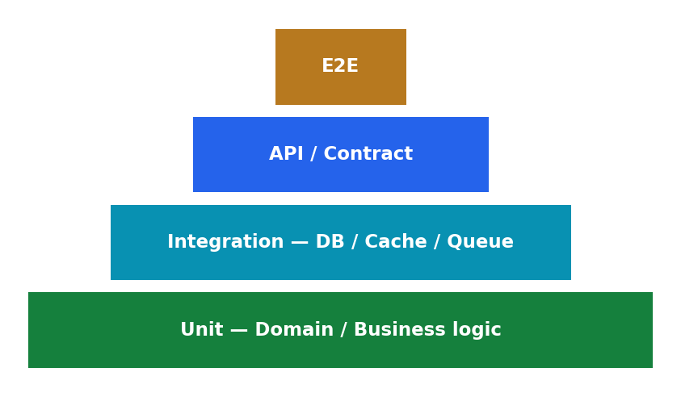
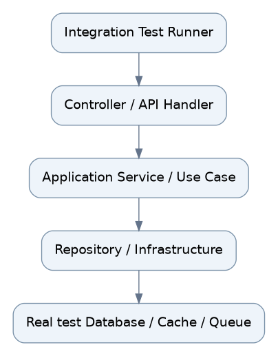

# Backend Testing

FE bảo vệ hành vi người dùng, UI, state và trải nghiệm. BE bảo vệ nghiệp vụ, dữ liệu, API, bảo mật, đồng thời và phục hồi. Full-stack bảo vệ tích hợp và hành trình hoàn chỉnh. Áp dụng độc lập công nghệ.

## BE: ưu tiên và kiến trúc

P0: unit, integration, database, API, security, concurrency, transaction khi áp dụng. P1: contract, performance, resilience, mutation, property-based. P2: chaos. Pyramid: domain unit → integration (DB/cache/queue) → API/contract → system E2E. Điều chỉnh theo rủi ro.

## BE Unit checklist

- [ ] Business rules, domain entities/value objects/services, application services/use cases.
- [ ] Input validation; business calculations, pricing, discount, tax.
- [ ] Permission logic; state transitions; error handling; data mapping.
- [ ] Date/time; invariants; boundaries; invalid inputs.
- [ ] Idempotency/retry decision logic; exception mapping.
      Ví dụ chuyển tiền: thành công, thiếu số dư, âm, 0, sai tiền tệ, giới hạn, làm tròn.

## BE Integration checklist

Runner → API handler/controller → service/use case → repository/infrastructure → DB/cache/queue thật trong môi trường cô lập.

- [ ] Service/repository; query; constraints; commit/rollback.
- [ ] Module communication; dependency injection.
- [ ] Cache read/write/invalidation; queue producer/consumer.
- [ ] Event đúng thời điểm; không mất event ngoài thiết kế; duplicate message.
- [ ] Email/notification; external API contract.
- [ ] Migration với dữ liệu hiện có; connection failure; consistency.

## BE API checklist

- [ ] Valid/invalid body; missing fields; invalid types; boundary; path/query params.
- [ ] Authentication; invalid/expired token; insufficient permissions; object-level authorization.
- [ ] Not found; duplicate resource; business violation.
- [ ] Status, body, schema, headers, error code.
- [ ] Pagination/filter/sort; rate limit; idempotency; concurrent requests.
- [ ] DB side effects; không lộ sensitive data; backward compatibility.
      Ví dụ POST resource: 201 thành công; 400 invalid; 401 thiếu token; 403 thiếu quyền; 404 resource liên quan; 409 duplicate; 429 rate limit; 500 internal failure theo contract. Retry cùng key không tạo trùng; DB lỗi không để dữ liệu dở dang.

## BE Database checklist

- [ ] PK/FK/unique/not null/check/default.
- [ ] Commit/rollback/atomicity/consistency/isolation.
- [ ] Locking/deadlock/concurrent update/lost update/duplicate prevention.
- [ ] Cascade/soft delete; migration; precision/decimal/money/timezone.
- [ ] Index/query performance; pagination consistency; backup/restore verification.

## BE Concurrency & Resilience

Concurrent requests: tránh race; duplicate: không lặp nghiệp vụ; lost update: không ghi đè; DB failure: không sai dữ liệu; cache failure: fallback; queue failure: retry/recovery; external timeout: không lặp side effect; duplicate webhook: idempotency; out-of-order events: state hợp lệ; partial failure: rollback/compensation; restart: không mất dữ liệu đã cam kết; deadlock: retry hoặc lỗi an toàn; traffic spike: chịu tải theo giới hạn; network partition: consistency theo thiết kế.

## BE Security

Authentication (login/token/session/MFA); authorization (RBAC/ABAC); object authorization (IDOR/BOLA); SQL/command injection; sensitive data; rate limit/mass assignment; upload type/size/content; webhook signature/replay; SSRF/TLS; session expiration/revocation/rotation; privilege escalation/business bypass; log không chứa secret. FE ẩn button không thay thế BE authorization.

Công cụ: Jest/Vitest, pytest/unittest, JUnit/Mockito, xUnit/NUnit, Go testing/testify, PHPUnit/Pest, Cargo Test; Supertest/REST Assured/Postman; Testcontainers/Docker; Pact; k6/JMeter/Gatling/Locust; OWASP ZAP/Burp Suite; Stryker/PIT/mutmut; Hypothesis/fast-check/jqwik; Toxiproxy; Chaos Mesh/LitmusChaos.

## Definition of Done

Tổ chức docs/testing/frontend và backend theo strategy, architecture, master checklist, từng loại test và DoD; shared gồm fullstack strategy, responsibility matrix, data, assertions, mutation, property-based, quality gates, AI guidelines. N/A phải có lý do. FE đảm bảo hành vi người dùng; BE đảm bảo nghiệp vụ/dữ liệu; full-stack đảm bảo toàn hệ thống.

### Backend Testing Pyramid

[SVG](diagrams/02-backend-testing-pyramid.svg) · [Mermaid source](diagrams/02-backend-testing-pyramid.mmd)

### Backend Integration

[SVG](diagrams/04-backend-integration.svg) · [Mermaid source](diagrams/04-backend-integration.mmd)
