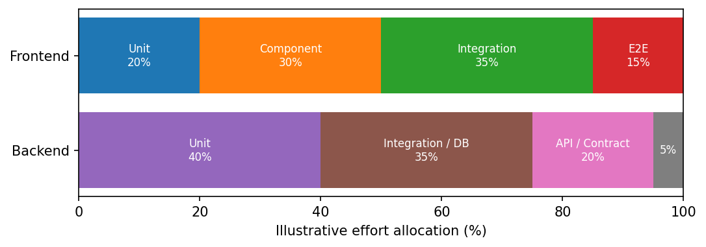

# Full-stack Testing

FE bảo vệ hành vi người dùng, UI, state và trải nghiệm. BE bảo vệ nghiệp vụ, dữ liệu, API, bảo mật, đồng thời và phục hồi. Full-stack bảo vệ tích hợp và hành trình hoàn chỉnh. Áp dụng độc lập công nghệ.

## So sánh và phân bổ

FE: component, UI state, visual, accessibility, browser, rendering; BE: domain, database, transaction, throughput, recovery; cả hai: unit, integration, security, contract, concurrency, performance, mutation/property-based và critical E2E theo trách nhiệm. FE là API consumer, BE provider. Phân bổ công sức functional test minh họa: FE unit 20%, component 30%, integration 35%, E2E 15%; BE unit 40%, integration/DB 35%, API/contract 20%, system E2E 5%. Không phải coverage hay quota; non-functional có ngân sách riêng.

## Checkout responsibility matrix

| Scenario                | FE               | BE                      |
| ----------------------- | ---------------- | ----------------------- |
| Cart rỗng               | Disable checkout | Reject                  |
| Quantity invalid        | Form validation  | Business validation     |
| Thiếu stock             | Hiển thị lỗi     | Kiểm tra stock thật     |
| Tổng tiền               | Hiển thị         | Tính giá chính thức     |
| Voucher hết hạn         | Hiển thị lỗi     | Xác minh                |
| Double submit           | Chặn UI          | Idempotency             |
| Payment success/failure | Success/error UI | Xác minh/cập nhật state |
| Timeout                 | Retry UI         | Retry an toàn           |
| Hai người mua món cuối  | Hiển thị kết quả | Chống overselling       |
| Thiếu quyền             | Ẩn chức năng     | Reject                  |
| Rollback                | Hiển thị lỗi     | Data integrity          |
| Checkout hoàn chỉnh     | Full-stack E2E   | Full-stack E2E          |

### Effort Allocation

[SVG](diagrams/10-effort-allocation.svg)
