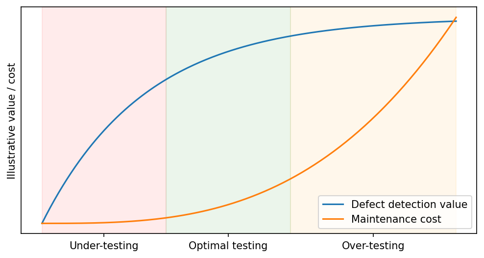
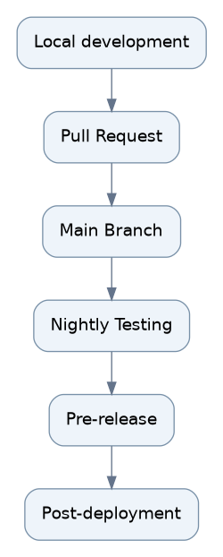
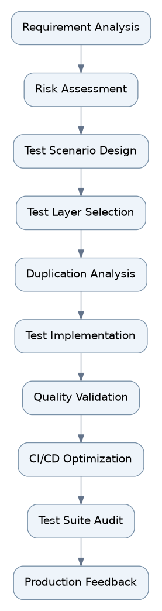
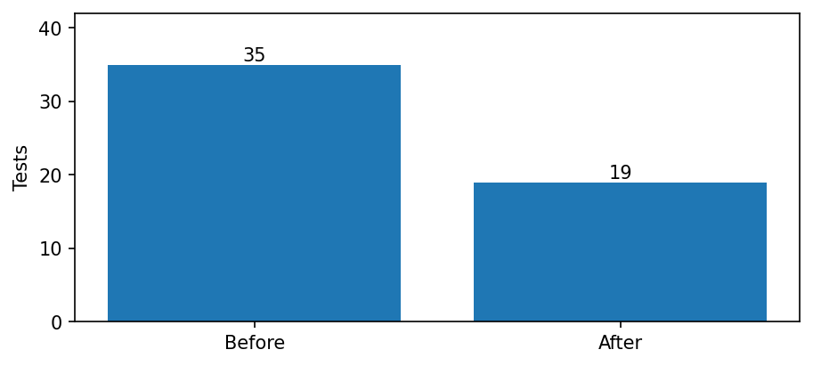

# Anti Over-testing & Test Optimization

Nhiều test không đồng nghĩa chất lượng. Over-testing gây duplicate, CI chậm, maintenance cao, brittle/flaky, over-mocking, false confidence, giảm productivity, infrastructure cost, technical debt và over-engineering. Under-testing bỏ sót rủi ro; optimal testing cân bằng giá trị và chi phí; over-testing có lợi ích giảm dần. Không có số lượng test tối ưu cố định.

## Ví dụ login

7 trường hợp email: rỗng, thiếu @, thiếu domain, khoảng trắng, quá dài, ký tự không hợp lệ, hợp lệ. Nếu mỗi case chạy ở unit/component/integration/API/E2E thì 35 lượt. Tối ưu: unit và API kiểm tra cả 7; component kiểm tra rỗng, thiếu @ và hợp lệ; integration và E2E kiểm tra hợp lệ. Tổng 19 lượt, giảm 45,7% (minh họa). FE/BE validation riêng vẫn cần thiết vì trách nhiệm khác nhau.

## Lowest Effective Level

| Risk                                      | Level                   |
| ----------------------------------------- | ----------------------- |
| Calculation, formatting, validation logic | Unit                    |
| Disabled button, error UI                 | Component               |
| Form/API, cache invalidation              | Integration             |
| Constraint, rollback                      | Database integration    |
| Authorization                             | API/integration         |
| Schema                                    | Contract/API            |
| Race                                      | Concurrency integration |
| Complete journey                          | E2E                     |
| Layout                                    | Visual                  |
| Load                                      | Performance             |
| Recovery                                  | Resilience              |

Cùng nghiệp vụ payment nhưng unit kiểm tra công thức, integration kiểm tra transaction, API kiểm tra auth/request/response, contract kiểm tra gateway, E2E kiểm tra hành trình. Đây không phải duplicate nếu mỗi test bảo vệ failure mode khác nhau.

## Anti-patterns

Coverage-driven; test everything everywhere; over-mocking; implementation testing; assertion-free; snapshot abuse; E2E abuse; trivial getter/setter/constant; framework testing; copy-paste; giant unrelated test; retry che flaky; test dependency; excessive setup; duplicated fixtures; testing private methods.

FE: tránh test UI tĩnh, mọi CSS class/props, snapshot toàn bộ, mock mọi child, E2E từng validation, internal state, test lại UI library, mọi browser mỗi commit. Ưu tiên observable behavior, visual, integration và browser matrix theo rủi ro.
BE: tránh getter/setter, từng dòng controller, mock mọi repository, test lại ORM, private methods, DTO chỉ vì coverage, mọi rule qua E2E, tổ hợp vô ích, load test toàn hệ thống mỗi commit. Ưu tiên domain, API, real DB, public behavior, boundary/decision table/pairwise.

## Test Value Assessment

- [ ] Bảo vệ requirement/risk cụ thể?
- [ ] Phát hiện được hành vi sai?
- [ ] Phát hiện loại lỗi chưa được test hiện tại bảo vệ?
- [ ] Tầng hiệu quả nhất?
- [ ] Assertion xác minh nghiệp vụ?
- [ ] Ổn định, độc lập?
- [ ] Tồn tại sau refactor không đổi nghiệp vụ?
- [ ] Giá trị tương xứng chi phí?
      Nếu hai câu đầu không đạt, xem lại mục đích; nhiều câu không đạt thì thiết kế lại hoặc loại bỏ có kiểm chứng. Không phải công thức chính thức.

## Risk-based example

| Module                                 | Unit | Integration | E2E  | Mutation | Concurrency | Security | Performance |
| -------------------------------------- | ---- | ----------- | ---- | -------- | ----------- | -------- | ----------- |
| Payment/Order                          | Cao  | Cao         | Cao  | Cao      | Cao         | Cao      | Cao         |
| Auth                                   | Cao  | Cao         | Cao  | Cao      | TB          | Cao      | TB          |
| Authorization                          | Cao  | Cao         | Cao  | Cao      | Thấp        | Cao      | TB          |
| Inventory                              | Cao  | Cao         | TB   | Cao      | Cao         | TB       | Cao         |
| Promotion                              | Cao  | Cao         | TB   | Cao      | TB          | TB       | TB          |
| CRUD                                   | TB   | Cao         | TB   | Thấp     | Tùy         | Cao      | TB          |
| Search                                 | TB   | Cao         | TB   | Thấp     | Thấp        | TB       | Cao         |
| Notification                           | TB   | Cao         | Thấp | Thấp     | TB          | TB       | TB          |
| Static content                         | Thấp | Thấp        | Thấp | N/A      | N/A         | Tùy      | Tùy         |
| UI components                          | TB   | Cao         | Thấp | Tùy      | N/A         | Tùy      | Tùy         |
| Minh họa e-commerce, không phải quota. |

## Execution strategy

Local: related unit/component, lint/types. PR: unit/integration/API/contract/critical E2E/security scan. Main: full functional regression/build/smoke. Nightly: mutation/full E2E/cross-browser/extended property-based/performance. Pre-release: regression/security/load/stress/migration/recovery theo risk. Post-deploy: safe smoke/synthetic monitoring/health/observability. Không trì hoãn critical gates chỉ để CI nhanh.

## 32-point checklist

### Design

- [ ] Không test mọi thứ mọi tầng.
- [ ] Mỗi test có requirement/risk.
- [ ] Lowest effective level.
- [ ] Không lặp mọi input ở E2E.
- [ ] Equivalence partitioning.
- [ ] Boundary analysis.
- [ ] Pairwise khi phù hợp.
- [ ] Risk-based priority.

### Implementation

- [ ] Không test chỉ vì coverage.
- [ ] Không test lại framework vô nghĩa.
- [ ] Không phụ thuộc implementation details.
- [ ] Không over-mock.
- [ ] Không lạm dụng snapshot.
- [ ] Parameterized tests.
- [ ] Factory/fixture/helper hợp lý.
- [ ] Không abstraction thừa.

### Maintenance

- [ ] Review duplicate.
- [ ] Xóa/cập nhật obsolete.
- [ ] Thay E2E bằng tầng thấp nếu giữ được risk coverage.
- [ ] Sửa flaky.
- [ ] Theo dõi maintenance cost.
- [ ] Theo dõi execution time.
- [ ] Mutation testing để kiểm chứng giá trị.
- [ ] Giữ regression nếu risk còn tồn tại.

### CI/CD

- [ ] Phân local/PR/nightly/release.
- [ ] Parallel an toàn.
- [ ] Change-based selection khi phù hợp.
- [ ] Không bỏ critical tests.
- [ ] Tách mutation/performance khỏi fast loop khi phù hợp.
- [ ] Theo dõi CI time.
- [ ] Time budget.
- [ ] Review strategy định kỳ.

## Removal policy

Rule/feature bị xóa: xóa hoặc cập nhật. Assertion vô nghĩa: viết lại/xóa. Trùng failure detection: hợp nhất/xóa. Implementation details: refactor. Flaky: điều tra/sửa. E2E thay được bằng integration: cân nhắc. Regression production, critical rule, security/data integrity: giữ nếu risk tồn tại. Chưa từng fail nhiều năm không phải lý do đủ để xóa. Test chậm nhưng quan trọng: tối ưu/lịch chạy. Kiểm chứng risk mapping và khả năng phát hiện lỗi trước/sau thay đổi.

## Metrics

Code/requirement/risk coverage, mutation score, escaped defects, flaky rate, execution time, CI feedback, maintenance effort, defect detection rate, duplicate rate qua audit, infrastructure cost.
Ví dụ giả định A: 10.000 test, coverage 100%, mutation 65%, CI 90 phút, flaky 8%, 15 bug/tháng. B: 3.000 test, coverage 90%, mutation 92%, CI 12 phút, flaky 0,2%, 2 bug/tháng. Chỉ so sánh khi phạm vi và mức sử dụng tương đương.

## Workflow

Requirements → risks → scenarios → layer selection → duplication analysis → implementation → coverage/mutation/reliability → CI optimization → suite audit → production feedback.
Tài liệu optimization: anti-over-testing-checklist, testing-anti-patterns, test-layer-selection, test-value-assessment, test-duplication-guidelines, test-suite-optimization, test-execution-strategy, test-maintenance-guidelines, test-removal-policy, test-cost-benefit-analysis, test-suite-audit.

6 nguyên tắc: high-quality, risk-based, optimal, maintainable, efficient, continuous improvement. 10.000 test vẫn có thể thiếu; 500 test vẫn có thể thừa.

## Phụ lục sơ đồ trực quan

### Over Testing Curve

[SVG](diagrams/05-over-testing-curve.svg)

### Execution Strategy

[SVG](diagrams/06-execution-strategy.svg) · [Mermaid source](diagrams/06-execution-strategy.mmd)

### Optimization Workflow

[SVG](diagrams/07-optimization-workflow.svg) · [Mermaid source](diagrams/07-optimization-workflow.mmd)

### Login Test Reduction

[SVG](diagrams/11-login-test-reduction.svg)
