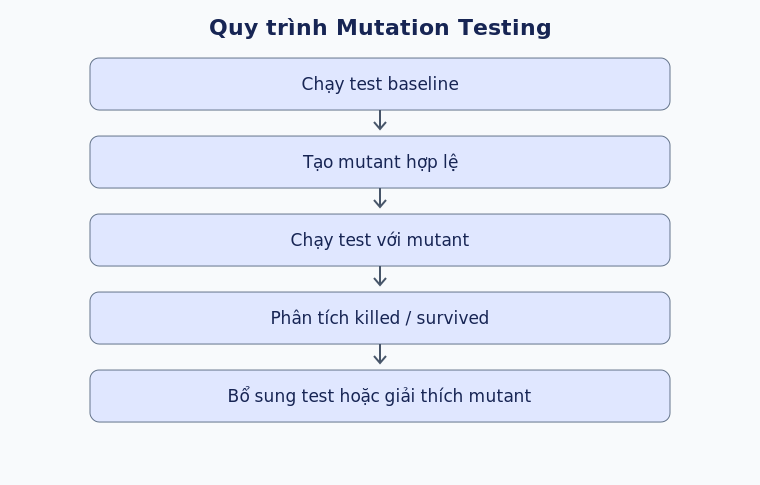

# Quality Measurement & Mutation Testing

Code coverage đo phạm vi thực thi. Mutation testing thay đổi code có chủ đích để đánh giá test phát hiện sai lệch. Dùng StrykerJS cho JS/TS. Phân tích surviving mutants: thiếu test, assertion yếu, mutant tương đương hoặc ngoài phạm vi. Không tối ưu score bằng test vô nghĩa.

| Metric                             | Minimum tham khảo | Target |
| ---------------------------------- | ----------------: | -----: |
| Statement/line/branch              |               80% |    95% |
| Function                           |               85% |    95% |
| Critical logic coverage            |               95% |   100% |
| Known requirement coverage         |               95% |   100% |
| Critical scenario coverage         |              100% |   100% |
| Mutation score                     |               75% |   90%+ |
| Critical E2E pass                  |              100% |   100% |
| Flaky rate                         |               <1% |     0% |
| Unresolved known critical security |                 0 |      0 |
| Known bug regression coverage      |              100% |   100% |

Có thể đặt gate line/branch 85%, mutation 80% ban đầu; P0 branch 95–100%, P1 90–95%, P2 80–90%. Điều chỉnh theo baseline và risk, không áp dụng cứng. Critical coverage chỉ tính các rule/scenario đã xác định. Theo dõi escaped defects, test runtime, false positive/negative và SLO.

Ví dụ giả định: Suite A coverage 100%, mutation 45%, requirement 60%, risk 50%; Suite B coverage 90%, mutation 90%, requirement/risk 100%. B có bằng chứng tốt hơn nhưng không đảm bảo hết bug.

6 phương pháp đánh giá: mutation, traceability, assertion review, real integration, property-based, fault injection. Ưu tiên 4 phương pháp đầu cho critical logic.

## Sơ đồ minh họa: Quy trình Mutation Testing

[Mã Mermaid](diagrams/mutation-workflow.mmd) · [SVG](diagrams/mutation-workflow.svg)
