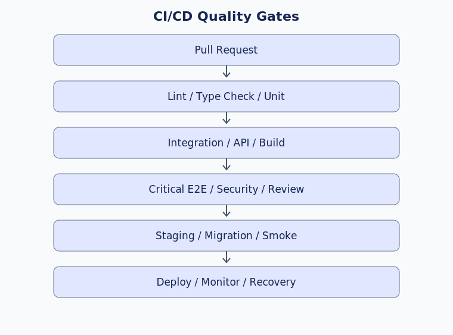

# CI/CD Quality Gates & Definition of Done

**Trạng thái:** Nháp (tài liệu tham khảo).

PR → lint/type check → unit/coverage → integration/API → production build → critical E2E → security scan → code/test review → staging/migration/smoke → canary hoặc rolling deployment → production monitoring → rollback/recovery nếu cần.

Mutation, full regression, load/security chuyên sâu có thể chạy nightly hoặc trước release theo risk. Theo dõi Sentry, OpenTelemetry, Grafana; alert, structured logs, RCA. Khi bug xuất hiện, tái hiện bằng test fail trước fix và pass sau fix khi khả thi.

## Definition of Done

- [ ] Requirement xác nhận
- [ ] Business rules và acceptance criteria đầy đủ
- [ ] Risk analysis
- [ ] Scenario matrix
- [ ] Happy/negative/edge/boundary
- [ ] Unit đã chạy
- [ ] Integration khi cần
- [ ] API validation/response
- [ ] Critical E2E
- [ ] Authorization/security
- [ ] Concurrency/transaction/idempotency đánh giá
- [ ] Assertion đúng nghiệp vụ
- [ ] Mutation critical logic đánh giá
- [ ] Coverage đạt gate
- [ ] Không flaky test bắt buộc chưa xử lý
- [ ] Không critical bug đã biết chưa xử lý
- [ ] Code và test review
- [ ] CI/CD pass
- [ ] Ghi rủi ro và trường hợp chưa test
- [ ] Monitoring/recovery đánh giá

## 5 câu hỏi review

1. Test bảo vệ business rule nào?
2. Logic sai thì test có fail không?
3. Dữ liệu/môi trường thay đổi thì test có đáng tin không?
4. Refactor không đổi nghiệp vụ thì test còn pass không?
5. Vì sao bug production không bị phát hiện, cần bổ sung gì?

## Sơ đồ minh họa: CI/CD Quality Gates

[Mã Mermaid](diagrams/ci-cd-workflow.mmd) · [SVG](diagrams/ci-cd-workflow.svg)
