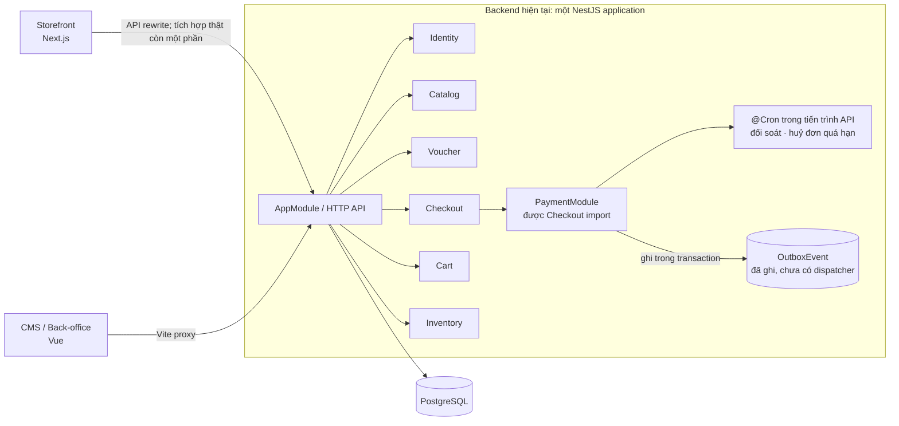
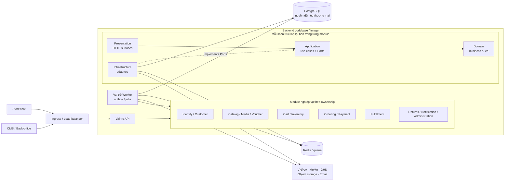

# Nghiên cứu 01: Kiến trúc ecommerce và vai trò Software Architect

**Trạng thái:** Nháp (tài liệu tham khảo).

Ngày: 2026-11-28  
Phạm vi: dự án Fashion Store trong backend `be-demo`; chỉ kết luận từ tài liệu business/architecture/ADR, source hiện có và chuẩn chính thức.

## 1. Tóm tắt

- **Mục tiêu được tài liệu gọi là modular monolith**, nhưng hiện trạng chính xác hơn là một NestJS monolith đã chia module, với mức độ bảo vệ ranh giới chưa đồng đều. Không nên nói dự án “chưa phải monolith”, cũng không nên nói mọi module đã đạt cấu trúc mục tiêu. [Nguồn: [Tổng quan kiến trúc](../../../architecture/01-overview.md), [AppModule](../../../../src/app.module.ts), [Quy tắc kiến trúc module](../../../../.claude/rules/module-architecture.md)]
- Kiến trúc đích theo ADR 0015 có **4 trách nhiệm logic**: Presentation, Application, Domain và Infrastructure. Đây không phải bốn dịch vụ triển khai độc lập; `Port` là hợp đồng, không phải tầng thứ năm. Hiện chưa có module nào được đánh dấu migrate theo quy tắc mới; Category có cấu trúc hexagonal riêng từ trước. [Nguồn: [ADR 0015](../../../adr/0015-one-layered-architecture-for-every-module.md), [Trạng thái migration](../../../../.claude/rules/module-architecture.md)]
- Target triển khai production là một codebase/image NestJS chạy API và Worker; hiện source/runtime đã xác minh được API nhưng chưa có Worker entrypoint. [Nguồn: [Tổng quan kiến trúc](../../../architecture/01-overview.md), [Docker Compose](../../../../docker-compose.yml), [AppModule](../../../../src/app.module.ts)]
- Vai trò Software Architect ở dự án này là vai trò dẫn dắt **các cấu trúc của hệ thống để đạt yêu cầu, ranh giới module, quyết định khó đảo ngược và bằng chứng nghiệm thu**. Đây là vai trò governance/thiết kế, không phải một actor nghiệp vụ như Guest, Customer, Staff hay Admin. [Nguồn: [Vai trò & phân quyền](../../../business/02-actors-permissions.md), [ISO/IEC/IEEE 42010](https://www.iso.org/standard/74393.html), [SEI Software Architecture](https://insights.sei.cmu.edu/blog/software-architecture-in-practice/)]

## 2. Kiến trúc cụ thể của ecommerce này

### 2.1 Bối cảnh nghiệp vụ và phong cách hệ thống

Dự án bán một nhóm hàng trong nước, chỉ dùng VND, có quy tắc size×màu, nhiều cấp danh mục và một kho ở MVP. Người mua đặt hàng qua Storefront; nhân viên và quản trị dùng Back-office. Backend được phép dùng VNPay, MoMo, COD, GHN và nhà cung cấp email. [Nguồn: [Tầm nhìn & phạm vi §1–6](../../../business/01-vision-scope.md), [Tổng quan kiến trúc §1–2](../../../architecture/01-overview.md)]

Tài liệu chọn **modular monolith** làm kiến trúc đích: một ứng dụng/deployable chứa nhiều module theo nghiệp vụ, có ownership và hợp đồng nội bộ rõ ràng. “Monolith” nói về ranh giới triển khai; “modular” nói về ranh giới bên trong. Vì vậy nó không đồng nghĩa với kiến trúc ba tầng, và cũng không phải tập hợp microservice chỉ vì có nhiều Nest module.

Hiện tại, backend đã là một NestJS application với `AppModule` làm composition root. `AppModule` nạp `identity`, `catalog`, `voucher`, `checkout`, `cart`, `inventory` cùng hạ tầng HTTP; `CheckoutModule` import `PaymentModule`. Nhưng một số service còn truy cập `PrismaService` trực tiếp, và quy tắc repo ghi nhận **chưa có module nào migrate** sang ADR 0015. Category có một cấu trúc hexagonal trước đó, nhưng không chứng minh các module khác đã theo ADR 0015. Kết luận: đây là monolith được module hóa một phần, đang tiến về modular monolith; chất lượng modularity cần được kiểm tra theo từng ranh giới. [Nguồn: [AppModule](../../../../src/app.module.ts), [CheckoutModule](../../../../src/modules/checkout/checkout.module.ts), [Quy tắc kiến trúc module](../../../../.claude/rules/module-architecture.md), [ADR 0015](../../../adr/0015-one-layered-architecture-for-every-module.md)]

Quy mô MVP 500–5.000 đơn/ngày là giả định trong tài liệu, không phải bằng chứng tải đã đo. Không nên dùng con số này một mình để biện minh cho microservices hoặc cho một thiết kế scale cụ thể. [Nguồn: [NFR](../../../architecture/10-nfr.md)]

#### Modular monolith gồm những gì?

- **Một đơn vị ứng dụng chính**: codebase và cách triển khai được quản lý chung; một ứng dụng có thể chạy ở nhiều replica.
- **Module theo năng lực nghiệp vụ**: ví dụ Catalog, Cart, Inventory, Ordering và Payment; mỗi module sở hữu dữ liệu/quy tắc thuộc mình.
- **Hợp đồng nội bộ có kiểm soát**: module khác gọi API/service public hoặc giao tiếp bất đồng bộ qua event; không tùy tiện xuyên vào database/model riêng.
- **Các adapter/hạ tầng**: PostgreSQL/Prisma, Redis, object storage, cổng thanh toán, vận chuyển và email nằm ở nơi phù hợp, không làm mờ quy tắc nghiệp vụ.
- **Kiểm chứng ranh giới**: dependency direction, quyền sở hữu dữ liệu và transaction được thể hiện trong code, lint/test và tài liệu.

Một monolith chỉ được chia thư mục chưa tự động thành modular monolith tốt. Ngược lại, một monolith không cần đủ mọi module mục tiêu mới được xem là đã có cấu trúc module; điều quan trọng là ranh giới hiện có có thật, được giữ, và được diễn giải đúng với mức triển khai hiện tại.

### 2.2 Cách đếm “số tầng” — 4 tầng logic

ADR 0015 quy định một kiến trúc Hexagonal cho mọi module (`domain/`, `application/` gọi Port, adapter ở `infrastructure/`, bề mặt HTTP ở `admin/` và `storefront/`). ADR không đếm số tầng và không dùng tên “Presentation”; bảng dưới là **cách đọc của tài liệu này**, gom các thư mục đó thành 4 trách nhiệm logic để dễ trao đổi:

| Tầng logic     | Trách nhiệm trong dự án                                                  | Sở tại chính            |
| -------------- | ------------------------------------------------------------------------ | ----------------------- |
| Presentation   | Controller/DTO/mapper của giao tiếp HTTP cho `admin/` và `storefront/`   | `admin/`, `storefront/` |
| Application    | Điều phối use case, service application và Port hợp đồng                 | `application/`          |
| Domain         | Quy tắc/kiểu dữ liệu nghiệp vụ thuần công nghệ                           | `domain/`               |
| Infrastructure | Adapter Prisma, storage, mail, payment/shipping và hạ tầng kỹ thuật khác | `infrastructure/`       |

`Port` không phải tầng thứ năm: nó là hợp đồng trong application (hoặc shared infrastructure port), còn adapter Prisma/outbound nằm ở Infrastructure. Nest composition root `*.module.ts` cũng không tạo tầng mới; nó lắp bề mặt, use case, Port và adapter lại. [Nguồn: [ADR 0015](../../../adr/0015-one-layered-architecture-for-every-module.md), [Module & ranh giới §4](../../../architecture/02-modules.md)]

Luồng điển hình được tài liệu quy định là `Controller → Application → Port`; Infrastructure Adapter triển khai Port và Prisma chỉ nằm ở adapter. Luồng HTTP hai kênh đều đi qua cùng backend, nhưng `admin/` và `storefront/` giữ riêng phần bề mặt. [Nguồn: [ADR 0015](../../../adr/0015-one-layered-architecture-for-every-module.md)]

### 2.3 Ranh giới module: ownership thay vì phân tầng kỹ thuật

Kiến trúc mục tiêu liệt kê **13 module nghiệp vụ**: `identity`, `customer`, `catalog`, `voucher`, `media`, `cart`, `inventory`, `ordering`, `payment`, `fulfillment`, `returns-refunds`, `notification` và `administration`. Ngoài ra còn hạ tầng dùng chung `config`, `common`, `http`, `security`, `infrastructure` và outbox. Đây là danh sách mục tiêu, không phải danh sách đã chạy. [Nguồn: [Module & ranh giới §1](../../../architecture/02-modules.md)]

Chỉ module sở hữu mới được ghi bảng; module khác dùng service public đã export hoặc domain event qua outbox. Một use case ghi nhiều module phải chạy trong một transaction do module điều phối mở. Dependency ngược được tránh: module dưới không import module trên. [Nguồn: [Module & ranh giới §2–3](../../../architecture/02-modules.md), [Data consistency](../../../architecture/04-data-consistency.md)]

Hiện trạng source không khớp hoàn toàn với inventory trong `02-modules.md`: composition root thực tế đăng ký `identity`, `catalog`, `voucher`, `checkout`, `cart` và `inventory`; `CheckoutModule` lắp thêm `PaymentModule`. `customer`, `media`, `ordering`, `fulfillment`, `returns-refunds`, `notification` và `administration` chưa phải các module độc lập đã được xác minh trong `AppModule`. `pricing` là feature trong `catalog`, còn `checkout` đang hiện diện trong source dù tên này không phải module trong danh sách mục tiêu. Do đó cần phân biệt tên/ranh giới đang có với tên/ranh giới mục tiêu, rồi đồng bộ inventory trong một công việc tài liệu riêng. [Nguồn: [AppModule](../../../../src/app.module.ts), [CheckoutModule](../../../../src/modules/checkout/checkout.module.ts), `PaymentModule` (`src/modules/payment/payment.module.ts`, hiện có trên nhánh của PR #129), [Module & ranh giới §1, §4](../../../architecture/02-modules.md)]

### 2.4 Số service triển khai và deployed topology

Ba cách đếm khác nhau, không trộn nhau:

1. **Đơn vị ứng dụng backend:** một NestJS application/codebase, không phải một database gộp vào cùng deployable.
2. **Runtime roles theo target:** cùng image chạy hai vai trò tiến trình: `api` và `worker` (outbox/BullMQ/job định kỳ). Có thể scale/restart riêng nhưng vẫn cùng một codebase và không tự biến thành hai microservice.
3. **Phụ thuộc và ứng dụng khách:** Storefront và Back-office là hai frontend kênh; production còn Load balancer/CDN/WAF, PostgreSQL, Redis, object storage, VNPay, MoMo, GHN và email provider.

[Nguồn: [Tổng quan kiến trúc §3–4](../../../architecture/01-overview.md), [Triển khai §1 và §4](../../../architecture/09-deployment.md)]

PostgreSQL là nguồn sự thật thương mại; Redis không thay thế database, chỉ là cache/rate limit/queue. Side effect như email, vận đơn và thông báo đi qua outbox, worker xử lý at-least-once và idempotent. [Nguồn: [Nguyên tắc kiến trúc](../../../architecture/01-overview.md), [ADR 0003](../../../adr/0003-inventory-reservations-and-transactional-outbox.md), [ADR 0007](../../../adr/0007-outbox-done-means-downstream-ack.md)]

Compose local khai báo `api`, `postgres`, `redis` và `mailpit`; source hiện tại không cho thấy Worker entrypoint. Vì vậy sơ đồ API + Worker là kiến trúc mục tiêu, không phải hiện trạng đã triển khai.

Tuy vậy, một phần việc nền **đã chạy, nhưng chạy trong tiến trình API**: `AppModule` nạp `ScheduleModule`, và `PaymentService` có hai `@Cron` — đối soát thanh toán đang chờ (mỗi 5 phút) và huỷ đơn quá hạn giữ hàng (mỗi phút). `PaymentService` cũng đã **ghi** `OutboxEvent` trong transaction, nhưng source chưa có dispatcher nào **đọc** và gửi các event đó. Hệ quả: scale API ra nhiều replica sẽ chạy trùng các cron này, và event outbox tích lại mà chưa có side effect tương ứng. [Nguồn: [AppModule](../../../../src/app.module.ts), `PaymentService` (`src/modules/payment/payment.service.ts`, hiện có trên nhánh của PR #129), [Prisma schema `OutboxEvent`](../../../../prisma/schema/schema.prisma), [Async events & jobs](../../../architecture/07-async-events-jobs.md)] [Nguồn: [docker-compose.yml](../../../../docker-compose.yml), [Tài liệu deployment §2](../../../architecture/09-deployment.md), [AppModule](../../../../src/app.module.ts)]

### 2.5 Hai sơ đồ: hiện trạng và kiến trúc mục tiêu

#### Hiện trạng đã xác minh

Đây là góc nhìn ở cấp ứng dụng và runtime local, không khẳng định mọi luồng Storefront đã tích hợp API thật:

CMS proxy tới backend; Storefront có API rewrite nhưng tài liệu tích hợp cho biết Catalog mới đọc API thật, các flow khác còn dùng MSW. Local Compose có Redis và Mailpit nhưng đây không phải bằng chứng rằng mọi dependency đã được tích hợp vào runtime. Worker không xuất hiện trong source/runtime đã kiểm tra; cron của Payment chạy ngay trong API và bảng outbox (nằm trong PostgreSQL) mới chỉ được ghi. [Nguồn: [CMS Vite config](https://github.com/LuongCongThanh/fashion-store-cms/blob/dev/vite.config.ts), [Storefront API integration](https://github.com/LuongCongThanh/fe-ecommerce-nike-style/blob/dev/docs/architecture/api-integration.md), [AppModule](../../../../src/app.module.ts), [docker-compose.yml](../../../../docker-compose.yml)]

#### Kiến trúc mục tiêu

Sơ đồ sau là mục tiêu theo tài liệu, không phải cam kết rằng mọi module, port, adapter hoặc worker đã được code. Một module mục tiêu có bốn trách nhiệm logic; các adapter cụ thể có thể khác theo nghiệp vụ:

Trong sơ đồ, các nhóm module là cách gom để dễ đọc, không phải module Nest mới hay định nghĩa ranh giới chính thức. API/Worker là hai vai trò runtime của cùng codebase theo thiết kế; module độc lập triển khai riêng chỉ nên xuất hiện nếu có lý do và quyết định kiến trúc mới. [Nguồn: [Tổng quan kiến trúc §3–4](../../../architecture/01-overview.md), [ADR 0015](../../../adr/0015-one-layered-architecture-for-every-module.md), [Module & ranh giới](../../../architecture/02-modules.md)]

### 2.6 Đánh giá kiến trúc: có cần vẽ lại không?

**Không cần vẽ lại toàn bộ kiến trúc từ đầu.** Tài liệu đã có sơ đồ target hệ thống và sơ đồ phụ thuộc module. Việc còn thiếu là giữ riêng hai câu trả lời: “đang chạy/đã code gì?” và “muốn hệ thống thành gì?”. Hai Mermaid view ở trên làm rõ khoảng cách đó; sơ đồ target hiện có không nên được gọi là bản as-built.

**Điểm tốt**

- Business docs có phạm vi ecommerce cụ thể và các quy tắc nhạy cảm như trạng thái đơn, tồn kho, thanh toán và tích hợp vận chuyển.
- Hệ thống đã có một ứng dụng backend làm điểm tích hợp; không cần trả giá vận hành microservices trước khi có bằng chứng nhu cầu.
- ADR, ownership module, outbox, idempotency và transaction boundaries đã được suy nghĩ ở cấp thiết kế.
- Có một ví dụ code (`category`) cho thấy nhóm đã từng áp dụng cấu trúc domain/application/adapter; có thể dùng để rút kinh nghiệm thay vì thiết kế lại trên giấy.

**Đánh giá tổng thể**: hướng kiến trúc hợp lý cho ecommerce hiện tại và có ý thức về nghiệp vụ/rủi ro; mức độ hoàn thiện khi đối chiếu code chưa đồng đều, còn khoảng cách rõ giữa target và as-built. Chưa có bằng chứng đủ để chấm hiệu năng, khả năng chịu tải hay mức production-readiness—cần test/metrics/deployment evidence.

**Khoảng cách/rủi ro cần quản lý**

- Năm service còn gọi `PrismaService` trực tiếp: `cart.service.ts`, `inventory.service.ts`, `payment.service.ts`, `identity/access.service.ts` và `identity/internal-account.service.ts`. Vì vậy ranh giới module chưa được bảo vệ đồng đều như ADR 0015.
- Cron đối soát/huỷ đơn chạy trong tiến trình API và outbox chưa có dispatcher (xem §2.4); đây là rủi ro khi chạy nhiều replica và khi cần side effect thật như email.
- Tài liệu `02-modules.md` ghi hiện source chỉ có identity/catalog/voucher, trong khi `AppModule` đã có checkout/cart/inventory và Checkout import PaymentModule. Inventory cần được cập nhật riêng, nếu không người đọc sẽ nhầm target, source và migration status.
- API + Worker là target; worker chưa có entrypoint được xác minh. Tích hợp Storefront cũng chưa hoàn toàn là API thật.
- “4 tầng” là kiến trúc logic trong module, không phải số tier deployment, số ứng dụng, hay chức danh Architect.

**Đề xuất của Architect**: giữ kiến trúc modular monolith làm hướng đi; không tạo thêm tầng/phân cấp chỉ để sơ đồ trông đầy đủ, không migrate mọi module trong một lần, và chưa tách microservices. Chọn một vertical slice có business value, đo được rủi ro/chất lượng, đặt một module boundary rõ ràng, rồi kiểm tra bằng test và import rules. Cập nhật inventory chính thức thành việc riêng sau khi đối chiếu code và trạng thái migration.

## 3. Software Architect là gì

Theo ISO/IEC/IEEE 42010, kiến trúc hệ thống là nền tảng của các khái niệm và thuộc tính thiết kế do môi trường kiến trúc đã định; tài liệu kiến trúc phải mô tả các quan điểm/concern của stakeholder. Bài viết chính thức của SEI mô tả kiến trúc phần mềm là tập cấu trúc cần để suy luận hệ thống, bao gồm các phần tử phần mềm, quan hệ và thuộc tính có thể nhìn thấy. [Nguồn: [ISO/IEC/IEEE 42010](https://www.iso.org/standard/74393.html), [Software Architecture in Practice, SEI](https://insights.sei.cmu.edu/blog/software-architecture-in-practice/)]

Trong bối cảnh dự án này, **Software Architect không phải vai trò đặt hàng hay vai trò sản phẩm trong hệ thống**. Repo chỉ khai báo Guest, Customer, Staff và Admin; “Architect” là vai trò thúc đẩy quyết định kỹ thuật và governance. Vai trò đó có hai trọng tâm cụ thể:

1. giữ đồng bộ với business rule và state machine của đơn hàng;
2. bảo vệ ranh giới module, ownership dữ liệu, nhất quán transaction, tích hợp outbox, idempotency và khả năng triển khai.

[Nguồn: [Vai trò & phân quyền](../../../business/02-actors-permissions.md), [Quy tắc nghiệp vụ](../../../business/04-business-rules.md), [Nguyên tắc kiến trúc](../../../architecture/01-overview.md)]

### 3.1 Software Architect, Solution Architect và Enterprise Architect

Đây là các **phạm vi trách nhiệm**, không phải tầng kỹ thuật và cũng không nhất thiết là một thang cấp bậc:

| Phạm vi                          | Câu hỏi chính                                                                                | Ví dụ áp dụng vào Fashion Store                                                                 |
| -------------------------------- | -------------------------------------------------------------------------------------------- | ----------------------------------------------------------------------------------------------- |
| Software / Application Architect | Một ứng dụng được cấu trúc thế nào để đáp ứng nghiệp vụ, chất lượng và khả năng thay đổi?    | Module ownership, tầng trong module, API, dữ liệu, transaction, testability và vận hành backend |
| Solution Architect               | Nhiều ứng dụng/tích hợp/hạ tầng phối hợp thế nào để giải quyết một nhu cầu kinh doanh?       | Storefront + CMS + Backend + payment/shipping + cách version API contract                       |
| Enterprise Architect             | Năng lực, danh mục hệ thống, tiêu chuẩn và đầu tư công nghệ của toàn tổ chức liên hệ ra sao? | Thường vượt phạm vi một cửa hàng/dự án đơn lẻ                                                   |

Một người có thể đảm nhận nhiều phạm vi, nhất là trong nhóm nhỏ. Với nền tảng senior frontend của bạn, bước chuyển thực tế là mở rộng từ thiết kế frontend sang **Software/Application Architecture** trước; các vấn đề liên hệ nhiều repository sẽ giúp bạn thực hành một phần trách nhiệm Solution Architecture. Không cần “lên tầng Architect” bằng cách vẽ thêm tầng trong ứng dụng.

## 4. Software Architect nên thực thi dự án thế nào

### 4.1 Quy trình bắt buộc

1. **Xác nhận nguồn authority:** business docs ưu tiên hơn architecture/ADR/convention; Google/Github hoặc nguồn thứ ba không thay tài liệu dự án. Với quyết định khó đảo ngược, ghi ADR trước hoặc cùng lúc khi thay đổi. [Nguồn: [Thứ tự đọc tài liệu](../../../README.md), [Quy trình thực thi](../../../agents/execution-workflow.md)]
2. **Đặt acceptance criteria theo user story/BR trước:** phân ranh giới module, trạng thái đơn, tồn kho, thanh toán và dữ liệu cá nhân phải có bằng chứng test.
3. **Chốt kiến trúc hiện tại vs mục tiêu:** không tạo module/tầng placeholder; chỉ tạo khi có implementation thực tế. Nên công nhận source hiện có trong `AppModule`, không biến toàn bộ danh sách mục tiêu thành backlog đã chạy.
4. **Thực thi theo vertical slice nhỏ:** một slice hoàn chỉnh từ HTTP controller/DTO → use case/service → Port/adapter → Prisma/schema/test; không đồng thời viết toàn bộ module mục tiêu.
5. **Dừng gate kỹ thuật và go-live:** chạy test PostgreSQL/Redis thật, test thanh toán/đối soát/idempotency/concurrency, replay worker/outbox, migration rollback/rolling migration và smoke/staging trước production. [Nguồn: [Triển khai §5–8](../../../architecture/09-deployment.md)]

### 4.2 Thứ tự triển khai phù hợp dự án

Repo đã có thứ tự migrate kiến trúc riêng: chuẩn hoá tài liệu kiến trúc → nền móng dùng chung → luật lint → migrate từng module theo dependency → hoàn tất migration. Mục tiêu này phải đặt trước các task tính năng chạm module nếu ranh giới đang thay đổi. [Nguồn: [Danh sách plan](../../../plan/README.md), [ADR 0015](../../../adr/0015-one-layered-architecture-for-every-module.md)]

Cho sản phẩm ecommerce end-to-end, thứ tự kỹ thuật nên dùng các slice đã track trong plan: identity/RBAC và catalog, cart, inventory, quote/COD, thanh toán online/đối soát, fulfillment GHN, state machine đơn, notification và returns/refunds. Không tự dịch `todo` thành code đang hoạt động; trạng thái hoàn tất được đối chiếu bằng PR/migration/test thực tế. [Nguồn: [Plan tổng thể](../../../plan/README.md), [Spec MVP](../../../plan/tasks/todo/25-mvp-commerce-end-to-end/spec.md)]

### 4.3 Định nghĩa “hoàn tất”

Một thay đổi kiến trúc được coi là hoàn tất khi:

- business acceptance criteria và state transitions được thỏa;
- dependency direction, module ownership và transaction boundary không bị vi phạm;
- lint/type/test/migration/OpenAPI phù hợp được chạy thật;
- trạng thái tài liệu và implement không trái nhau;
- những rủi ro chưa xác minh được ghi rõ thay vì biến thành giả định thành kiến.

[Nguồn: [Quy trình thực thi §2–5](../../../agents/execution-workflow.md), [ADR 0015](../../../adr/0015-one-layered-architecture-for-every-module.md), [Triển khai §7](../../../architecture/09-deployment.md)]

### 4.4 Những việc nên làm tiếp theo trên Fashion Store

1. **Đối chiếu business với source** cho một flow cụ thể, chẳng hạn checkout: ai khởi tạo, state nào hợp lệ, dữ liệu nào là nguồn sự thật, điều gì xảy ra khi payment callback gửi lặp hoặc tồn kho thay đổi đồng thời.
2. **Chốt sơ đồ as-built và target riêng**. Báo cáo này đã thêm hai góc nhìn đó; chúng không thay thế source-of-truth kiến trúc trong `docs/architecture/`.
3. **Chọn một vertical slice nhỏ có tiêu chí rõ**. Ví dụ: checkout giữ tồn kho đúng khi hai request mua biến thể cuối cùng cùng lúc. Viết acceptance criteria, trace qua module sở hữu dữ liệu, transaction và API; sau đó test concurrency/idempotency.
4. **Tạo hoặc cập nhật ADR chỉ khi quyết định khó đảo ngược, bất ngờ với người đọc sau này và có trade-off thật**. Một thay đổi folder nhỏ không tự động cần ADR.
5. **Đo rồi mới tối ưu**: kiểm tra latency, lỗi, saturation, logs/metrics, backup/restore và vận hành trước khi đề xuất cache, worker, thêm tầng hoặc tách service.
6. **Đồng bộ tài liệu as-built** như một đầu việc riêng với người duy trì backend. Không sửa tài liệu kiến trúc chính chỉ từ sơ đồ mục tiêu hoặc một lần đọc code.

Đây là cách làm Architect: làm rõ vấn đề, mô hình hóa rủi ro, đưa ra lựa chọn có lý do, rồi kiểm chứng bằng code/test/vận hành—không phải chỉ sản xuất sơ đồ.

## 5. Lộ trình 6 tháng cho Senior Frontend hướng tới Software/Application Architect

Bạn đã có nền tảng quan trọng: tư duy trải nghiệm người dùng, cấu trúc frontend, API integration, hiệu năng phía client và kinh nghiệm làm việc với team. Khoảng cần chủ động mở rộng là **business/data modeling, database & transaction, backend reliability/security, vận hành production và đánh đổi kiến trúc xuyên hệ thống**. Mốc sáu tháng là khung luyện tập, không bảo đảm đạt chức danh; năng lực cần được chứng minh qua quyết định và kết quả.

| Tháng                                   | Học và luyện trên Fashion Store                                                                                                                                                                       | Bằng chứng đầu ra                                                                                                  |
| --------------------------------------- | ----------------------------------------------------------------------------------------------------------------------------------------------------------------------------------------------------- | ------------------------------------------------------------------------------------------------------------------ |
| 1 — Hiểu domain và hệ thống             | Đọc business rules; vẽ luồng catalog → cart → checkout → payment → fulfillment; xác định actors, trạng thái, invariants, ranh giới giữa Storefront/CMS/Backend. Đánh dấu phần target-only.            | Context/current-state diagram, glossary thuật ngữ nghiệp vụ đã thống nhất, danh sách rủi ro/giả định cần xác minh. |
| 2 — Bổ sung backend/data                | Đọc Nest modules/DI, HTTP/OpenAPI, PostgreSQL schema, SQL, Prisma, auth, migrations và test integration. Theo dõi một request từ controller đến database và ngược lại.                                | Một vertical slice nhỏ hoàn chỉnh cùng API contract, migration nếu cần và integration test.                        |
| 3 — Module boundaries và consistency    | Học ownership, port/adapter, dependency direction, transaction isolation/locking, concurrency, idempotency. Dùng bài toán tồn kho/checkout để kiểm tra các trường hợp race.                           | Đề xuất một module boundary; ADR nếu có trade-off đáng ghi lại; test chứng minh invariant khi chạy cạnh tranh.     |
| 4 — Reliability, security, operations   | Học failure modes của payment/shipping, timeout/retry, outbox, duplicate delivery, observability, secrets/PII, health checks và khôi phục dữ liệu. Phân biệt worker trong target với runtime hiện có. | Threat/risk review cho một flow, dashboard/log evidence hoặc test retry/idempotency, hướng dẫn vận hành ngắn.      |
| 5 — Quality attributes và system design | Chuyển yêu cầu mơ hồ thành quality-attribute scenarios có điều kiện và cách đo; đo bottleneck trước tối ưu; đánh giá API compatibility giữa ba repo và rollout an toàn.                               | Bằng chứng đo được (benchmark hoặc test), trade-off note và đề xuất ưu tiên theo impact/risk/cost.                 |
| 6 — Dẫn dắt quyết định kiến trúc        | Trình bày một thay đổi từ nhu cầu kinh doanh đến options, trade-offs, sơ đồ, ADR, triển khai và kiểm chứng; xin review từ backend/operations/product.                                                 | Case study ngắn có before/after, quyết định bị loại và lý do, kết quả test/đo, phần còn rủi ro.                    |

Với hơn 10 giờ mỗi tuần, một nhịp thực tế là: khoảng 4–5 giờ làm vertical slice cùng team, 2–3 giờ đọc/đối chiếu code và vận hành, 2 giờ kiểm thử/đo, 1–2 giờ viết ADR/sơ đồ và xin review. Ưu tiên học để giải quyết câu hỏi thật trong project; không cần học hết mọi framework hay vẽ lại toàn hệ thống trước khi làm một thay đổi nhỏ.

**Dấu hiệu tiến bộ** không phải số lượng sơ đồ/khóa học. Bạn có thể giải thích được: yêu cầu nào tạo ra quyết định; những phương án nào đã cân nhắc; rủi ro nào được chấp nhận; module/dữ liệu nào chịu trách nhiệm; và bằng chứng nào cho thấy quyết định hoạt động.

Tài liệu tham khảo để học từ nguồn sở hữu:

- [NestJS modules](https://docs.nestjs.com/modules) — module, dependency injection và composition.
- [PostgreSQL transaction isolation](https://www.postgresql.org/docs/current/transaction-iso.html) — hiện tượng đồng thời và mức cô lập.
- [C4 model](https://c4model.com/) — các góc nhìn sơ đồ ở cấp context/container/component.
- [ISO/IEC/IEEE 42010](https://www.iso.org/standard/74393.html) — architecture description và stakeholder concerns.
- [SEI: Software Architecture in Practice](https://insights.sei.cmu.edu/blog/software-architecture-in-practice/) — cấu trúc và thuộc tính kiến trúc.

## 6. Điểm chưa xác minh / rủi ro

- Vai trò “Software Architect” không có định nghĩa chính thức trong repo; mục 3 ở trên là kết luận theo tiêu chuẩn kiến trúc chung và nội dung execution policy của dự án, không phải actor business của hệ thống.
- Quy mô 500–5.000 đơn/ngày và KPI MVP có mục “[Giả định · kiểm chứng]”; chưa dùng bằng chứng tài liệu hoặc test tải để khẳng định capacity thực.
- Cron của Payment đang chạy trong tiến trình API, chưa có cơ chế chống chạy trùng khi nhiều replica; `OutboxEvent` đã được ghi nhưng chưa có dispatcher, nên chưa thể coi outbox là đã hoạt động đầu-cuối.
- Worker, một số module mục tiêu, MinIO local và một số tích hợp bên ngoài chưa đồng nhất hoàn toàn với source/deployment hiện tại; tài liệu cần được đối chiếu trước khi đặt kế hoạch scale hoặc go-live.
- Sandbox VNPay/MoMo/GHN và dữ liệu merchant credentials chưa xác nhận UAT; gate thanh toán thật chưa thể coi là đạt chỉ từ spec.

[Nguồn: [Tầm nhìn & phạm vi §6–7](../../../business/01-vision-scope.md), [Tổng quan kiến trúc](../../../architecture/01-overview.md), [Triển khai §7](../../../architecture/09-deployment.md), [Plan tổng thể](../../../plan/README.md)]

## 7. Nguồn đã khảo sát

### Nguồn chính của dự án

- [Tầm nhìn và phạm vi](../../../business/01-vision-scope.md)
- [Vai trò và phân quyền](../../../business/02-actors-permissions.md)
- [Quy tắc nghiệp vụ](../../../business/04-business-rules.md)
- [Chỉ mục tài liệu](../../../README.md)
- [Tổng quan kiến trúc](../../../architecture/01-overview.md)
- [Module và ranh giới](../../../architecture/02-modules.md)
- [Nhất quán dữ liệu](../../../architecture/04-data-consistency.md)
- [Triển khai](../../../architecture/09-deployment.md)
- [ADR 0015 — một kiến trúc nhiều tầng cho mọi module](../../../adr/0015-one-layered-architecture-for-every-module.md)
- [ADR 0003 — giữ hàng và transactional outbox](../../../adr/0003-inventory-reservations-and-transactional-outbox.md)
- [ADR 0007 — outbox chỉ xong khi downstream xác nhận](../../../adr/0007-outbox-done-means-downstream-ack.md)
- [Execution workflow](../../../agents/execution-workflow.md)
- [Plan và danh sách nhiệm vụ](../../../plan/README.md)
- [Composition root `AppModule`](../../../../src/app.module.ts)
- [CheckoutModule](../../../../src/modules/checkout/checkout.module.ts) và `PaymentModule` (`src/modules/payment/payment.module.ts`, hiện có trên nhánh của PR #129)
- [Quy tắc migration module](../../../../.claude/rules/module-architecture.md)
- [Runtime HTTP `main.ts`](../../../../src/main.ts)
- [Docker Compose local](../../../../docker-compose.yml)
- [CMS Vite config](https://github.com/LuongCongThanh/fashion-store-cms/blob/dev/vite.config.ts)
- [Storefront API integration](https://github.com/LuongCongThanh/fe-ecommerce-nike-style/blob/dev/docs/architecture/api-integration.md)

### Chuẩn chính thức

- [NestJS modules](https://docs.nestjs.com/modules)
- [PostgreSQL transaction isolation](https://www.postgresql.org/docs/current/transaction-iso.html)
- [C4 model](https://c4model.com/)
- [ISO/IEC/IEEE 42010:2022 — Architecture description](https://www.iso.org/standard/74393.html)
- [SEI — Software Architecture in Practice](https://insights.sei.cmu.edu/blog/software-architecture-in-practice/)
